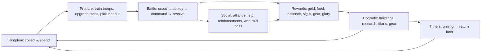
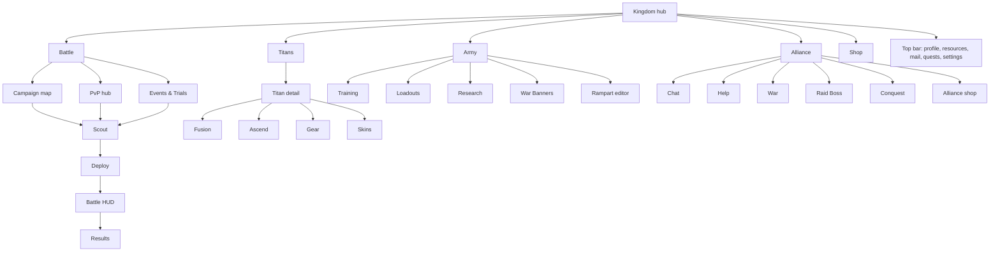
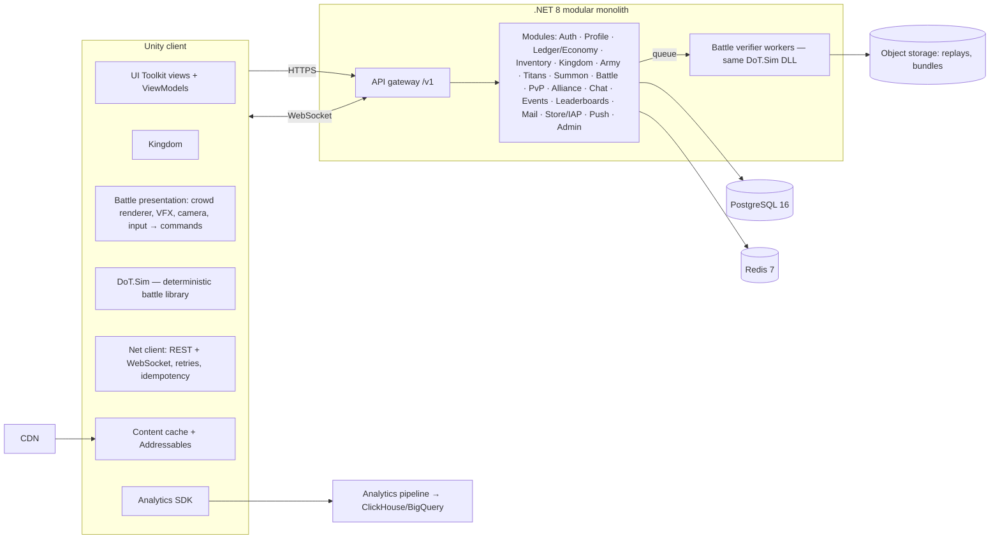

# DAWN OF TITANS — MASTER PROMPT
### A complete Game Design + Technical Design + Production specification for building a mythic real-time strategy game with colossal Titans, armies and kingdoms

`Version 1.0 · Document type: Master Prompt (GDD + TDD + Production Plan) · Language: English`

> **How to use this document.** Paste the whole document into an AI coding/design agent, or hand it to a development team, as the single source of truth. Section 0 tells the AI how to behave. Sections 1–28 define the game. Section 29 starts the work and contains follow-up prompts for each milestone. If your AI has a small context window, send Sections 0, 1, 3 and 29 first, then only the sections the current milestone needs (the map is in Section 23).

---

## TABLE OF CONTENTS

0. Directive to the AI
1. Product Vision
2. World, Lore & Narrative
3. Core Loops
4. Battle System (the heart of the game)
5. Titans (collection & progression)
6. Army & Troops
7. Kingdom (base building)
8. Economy
9. Progression, Pacing & First-Time User Experience
10. PvE: Campaign & Solo Modes
11. PvP
12. Alliances & Social
13. Live Ops & Events
14. Monetization & Ethics
15. UI / UX
16. Art Direction
17. Audio & Haptics
18. Technical Architecture
19. Data Model & Schemas
20. Balance Tables & Formulas
21. AI Systems
22. Content Plan
23. Roadmap & Milestones
24. Engineering Standards & Repository Layout
25. QA & Acceptance Criteria
26. Analytics & KPIs
27. Risks & Mitigations
28. Glossary
29. Kickoff Instructions & Follow-up Prompts

---

## 0. DIRECTIVE TO THE AI

### 0.1 Role
You are the founding team of a game studio in one agent: Creative Director, Lead Game Designer, Systems & Economy Designer, Technical Director, Gameplay Engineer, Backend Engineer, Technical Artist, UX Designer, QA Lead and Producer. You have shipped large-scale real-time strategy (formations, flanking, morale), mobile midcore strategy (kingdom building, alliances, live ops) and collection RPGs (hero collection, fusion, star ascension, gear sets).

### 0.2 Mission
Design and build **DAWN OF TITANS** (working title). It is a free-to-play online real-time strategy game for iOS and Android (primary, landscape) and PC (secondary). The player builds a mythic kingdom, raises an army and collects colossal Titans drawn from world mythologies. They command those Titans in short (2–3 minute), physics-rich battles against AI and other players, alone or with an alliance.

The design is inspired by NaturalMotion's *Dawn of Titans* (2016). This document is an original specification. Every name, character, artwork, UI, sound and line of code you produce must be original. Do not copy assets, text, logos or trade dress from any existing product. Mythological figures such as Zeus, Thor and Osiris come from public-domain mythology and may be reinterpreted with original designs. Before any public release, replace the working title with an original, trademark-cleared name.

### 0.3 Source of truth and precedence
1. This document is the single source of truth.
2. **Ambiguity:** pick the option that best serves the Design Pillars (1.3), write it down under "ASSUMPTIONS" and keep going. Never stall waiting for an answer.
3. **Disagreement:** if a rule here looks unfun, infeasible or contradictory, do not change it silently. Write a **Design Change Proposal (DCP)** in this form: *Problem → Evidence → Proposal → Impact (systems, content, economy, schedule) → Recommendation*. Keep following the original rule until the DCP is approved. If the rule blocks the build, apply the smallest change that unblocks it and flag it clearly.
4. **Numbers:** every number in this document is an *initial tuning target*. Numbers live in data/config files. Gameplay code never hard-codes them.
5. **Conflicts between sections** are resolved in this order: Pillars (1.3) > Battle (4) > Technical Architecture (18) > Economy (8) > everything else.

### 0.4 Operating rules
- **Data-driven everything.** Units, titans, abilities, spells, buildings, research, missions, loot tables, events, prices and UI strings are content data (JSON validated by JSON Schema). They can be changed without code changes.
- **Deterministic battle core.** Battle logic is deterministic and engine-independent (4.14, 18.3). The same simulation library runs on the client and on the server.
- **Server authority.** The server owns economy, inventory, progression, rewards and PvP results. The client only predicts and displays them.
- **Always playable.** Build vertically. Every milestone ends with a build that can be played.
- **Simplicity.** Choose simple, robust solutions. Start with a modular monolith, not microservices. Avoid exotic dependencies.
- **Production quality.** Deliver complete files. No "..." elisions, no pseudo-code in deliverables, no TODOs unless they are listed under "Known gaps".
- **Every system ships with** a config schema, sample content, unit tests, debug/cheat commands and analytics events.
- **Performance and readability on a mid-range phone** are features, not polish.
- **Day-one requirements:** accessibility, localization and age-appropriate content (PEGI 12 / ESRB T: fantasy violence, no blood, no gore, no dismemberment).

### 0.5 Output protocol (every response)
1. **Goal** — what this response delivers, in one paragraph.
2. **Assumptions & Questions** — numbered. Questions never block progress.
3. **Design / Architecture notes** — with Mermaid or ASCII diagrams where they help.
4. **File tree** of added and changed files.
5. **Code & data** — complete files, one fenced block each, with the file path as the first-line comment.
6. **Tests** — unit and integration tests, and how to run them.
7. **How to run / verify** — exact commands and the expected result.
8. **Known gaps & Next step** — what comes next according to the Roadmap (23).

If a response would exceed your output limit, split it into numbered parts. End each part with `CONTINUE: Part N+1 will contain …`, then continue in the next message.

### 0.6 Default technology profile (change only through a DCP or an explicit user instruction)
| Layer | Default | Acceptable alternatives |
|---|---|---|
| Client engine | Unity 6 LTS, URP, C# | Godot 4.x (C#); Unreal Engine 5 (C++) for a high-end PC edition |
| Battle simulation | Pure C# library (.NET Standard 2.1), fixed-point math, zero engine dependencies | — (this rule is mandatory) |
| Crowd rendering | GPU instancing with Vertex Animation Textures (BatchRendererGroup / RenderMeshInstanced) | Unity Entities Graphics |
| UI | Unity UI Toolkit (runtime) with MVVM bindings | uGUI |
| Backend | ASP.NET Core (.NET 8) modular monolith, PostgreSQL 16, Redis 7, WebSockets | Nakama; Node.js/TypeScript (the battle verifier stays .NET) |
| Infrastructure | Docker Compose (dev), Kubernetes (production), CDN for content bundles | Managed PaaS |
| Content pipeline | Spreadsheets/JSON → JSON Schema validation in CI → versioned content bundles | — |
| Analytics | First-party event pipeline (batched HTTP → ClickHouse or BigQuery) | GameAnalytics |
| Crash / performance | Sentry or Backtrace, plus an in-game performance HUD | Firebase Crashlytics |

If the user names a different engine or stack, map every engine-specific instruction to its equivalent and keep every engine-agnostic rule.

---

## 1. PRODUCT VISION

### 1.1 Elevator pitch
*"Command gods of legend the size of towers, and the armies that march at their feet."*

DAWN OF TITANS is a mythic strategy game. You grow a kingdom, collect Titans from Greek, Norse, Egyptian, Chinese and Celtic myth, and lead them with squads of soldiers in short, explosive real-time battles. Draw a path and your cavalry sweeps around the enemy flank. Tap a Titan and it wades into the enemy line, scattering soldiers like leaves. Time your strike in a Titan-versus-Titan **Clash** and the ground shakes.

### 1.2 Player fantasy
- "I am a **Titanlord**, a ruler who binds living colossi."
- "My decisions win battles: composition, counters, paths, timing. Not just my power number."
- "My kingdom grows visibly, from a burned fort into a mythic capital."
- "My alliance and I wage wars and topple world-boss behemoths together."

### 1.3 Design pillars (priority order)
1. **Colossal Scale.** Titans must feel ten times larger than humans: ground shake, slow heavy turns, footprints, soldiers flung through the air, and a camera that respects their size. Every titan action is an event.
2. **Command, not micromanagement.** Few units (1 Titan + up to 6 squads + up to 3 spells), big decisions, one-finger commands. Any battle can be won with 15 inputs or fewer. Mastery comes from timing and counters, not from actions per minute.
3. **Short, decisive battles.** 2–3 minutes. Clear win conditions, a state you can read at a glance, and a satisfying climax: a Titan Clash or a titan's fall.
4. **Build, Collect, Master.** Kingdom growth, titan collection (fusion, ascension, gear) and army research form a deep, fair long-term meta.
5. **Stronger Together.** Alliances provide help, reinforcements, wars, conquest and cooperative boss raids. Social play is the backbone of retention.

### 1.4 Anti-goals
- **No pay-to-win walls.** Free players can obtain every titan and item in reasonable time. Spending accelerates progress; it never exclusively unlocks power.
- **No blood or gore.** Soldiers are knocked down, flung and fade away.
- **No battle longer than 3:30.** No core action deeper than 3 taps from the Kingdom view.
- **No idle auto-battler core.** Manual command must be meaningfully better than auto-battle (target: a manual player beats the auto-battler with the same army ≥ 75% of the time).

### 1.5 Audience and market
- **Players:** midcore strategy players aged 18–45, mobile-first, who like mythology, Total War, Clash of Clans, Rise of Kingdoms and Summoners War.
- **Rating target:** PEGI 12 / ESRB T / Apple 12+.
- **Business model:** free-to-play with in-app purchases (Section 14).
- **Platforms:** iOS 15+, Android 9+ (ARM64; Vulkan or GLES 3.2), Windows 10+ (Steam), with cross-progression.
- **Orientation:** landscape only.
- **Connectivity:** online required. An offline practice battle mode is planned for [POST].

### 1.6 Session design
| Session type | Length | Typical content |
|---|---|---|
| Check-in | 1–3 min | Collect resources, queue upgrades and training, tap alliance Help, claim rewards |
| Standard | 8–15 min | 2–4 battles (campaign or PvP), titan upgrades, daily quests |
| Deep | 20–45 min | Events, Alliance War attacks, Raid Boss, Conquest, defense layout editing, collection management |

Targets: 4–6 sessions/day for engaged players; 12–18 min/day in week 1, 30–60 min/day for veterans.

### 1.7 Reference games (for feel only, never for copying)
| Reference | What to learn from it |
|---|---|
| Dawn of Titans (2016) | Overall concept, path-drawing controls, titan scale, short battles |
| Total War series | Formations, flanking, charges, morale and routing |
| Clash of Clans | Kingdom building, builder queue, raids, shields, replays |
| Rise of Kingdoms | Alliances, territory conquest, events cadence |
| Summoners War / RAID | Hero collection, fusion, star ascension, gear sets |
| Shadow of the Colossus / Attack on Titan | Sense of scale and weight |

### 1.8 Scope tiers and feature tags
| Tier | Milestone | Content |
|---|---|---|
| A — Prototype | [M0] | Battle sandbox: one map, 4 troop types, 2 titans, full controls, AI, deterministic simulation |
| B — Vertical Slice | [M1] | One campaign region, core kingdom, 5 titans, 6 troop types, summoning, fusion, FTUE |
| C — Alpha / Beta | [ALPHA] [BETA] | All launch systems in rough form, then polished; PvP, alliances, events |
| D — Launch | [LAUNCH] | Everything tagged [LAUNCH] or earlier |
| E — Post-launch | [POST] | Expansions, new modes, new lineages |

Features in this document carry these tags where it matters. An untagged feature is [LAUNCH].

---

## 2. WORLD, LORE & NARRATIVE

### 2.1 Premise
Ages ago the gods of many pantheons walked the world in titanic bodies of stone, bronze and storm. Their wars ended in the **Sundering**. The sky cracked, and the mythic realms (Olympus, Asgard, the Duat, the Jade Heaven and the Otherworld of the Tuatha) collapsed into one shattered land: **the Confluence**. The Titans fell into a long sleep. Their hearts, crystallized into **Titanhearts**, sank deep into the earth.

Now the Titanhearts are waking. **Morvane, the Hollow King**, was once a Titanlord. He tore the heart out of his own Titan and fused it with his body. He harvests Titanhearts to raise **Hollowed Titans**, corrupted and obedient husks, and his legions burn the free kingdoms.

You are the last heir of the House of Highvale (the player names their house). On the night your father's fortress falls, you perform the ancient **Binding** and a Titan answers. Rebuild your kingdom, rally an army, bind the Titans of every myth and break the Hollow Crown.

### 2.2 Tone and writing rules
- Epic, heroic, sunlit-but-dangerous mythic fantasy with moments of warmth and dry humor. Grand scale, human stakes.
- Dialogue bubbles: at most 2 lines / 120 characters (English) each. Always skippable and fully localizable (no text baked into images).
- Mission briefings: at most 3 sentences. Tooltips: at most 2 sentences.
- Treat every pantheon respectfully: heroic, never mocking.
- Avoid deities of living major religions (e.g., Hindu, Shinto, Abrahamic) unless they have been culturally reviewed.

### 2.3 Lineages (Titan factions)
| Lineage | Myth source | Visual motifs | Battle identity | Kingdom cosmetic theme |
|---|---|---|---|---|
| **Olympians** | Greek | marble, bronze, laurel, lightning, meanders | discipline, phalanx support, storm magic | white stone, terracotta roofs, colonnades |
| **Aesir** | Norse | runes, iron, fur, frost, ravens | raw melee power, berserk, frost | timber longhalls, carved prows, snow |
| **Duat** | Egyptian | gold, lapis, sandstone, scarabs, sun disks | attrition, curses, revival of the fallen | sandstone, obelisks, palms, canals |
| **Jade Heaven** | Chinese | jade, red lacquer, clouds, flame, cloud-scrolls | agility, fire, illusion clones, mobility | tiered pagodas, moon gates, gardens |
| **Tuatha** | Celtic | living wood, moss, standing stones, spirals, mist | nature, fear, sustain, terrain control | standing stones, round towers, green hills |
| **Hollow** *(enemy only)* | original | obsidian, bone-white cracks, violet-black ichor | corruption, decay, swarming husks | ruined, ashen, crystal growths |

### 2.4 Key characters
| Character | Role | Personality / function |
|---|---|---|
| **The Titanlord** (player) | Protagonist | Customizable name, house sigil and banner colors. Never voiced. Addressed as "my liege". |
| **Seren Valecourt** | Royal Aetherist and advisor | Calm, witty, scholarly. Teaches kingdom building, summoning and titans. |
| **Marshal Brann Kettleby** | Commander of the army | Gruff, loyal veteran. Teaches troops, counters and battle tactics. |
| **Ilsa Wren** | Scout and cartographer | Energetic, curious. Narrates the campaign map and enemy intel. |
| **Morvane, the Hollow King** | Main antagonist | Tragic and eloquent. Believes the Titans must be enslaved to prevent another Sundering. |
| **The Pale Heralds** (6) | Morvane's generals | One per region, each commanding a Hollowed Titan boss. |

### 2.5 Campaign story (6 Acts) — Acts 1–4 [LAUNCH], Acts 5–6 [POST]
| Act | Region / biome | Story beat | Boss | Mechanic introduced |
|---|---|---|---|---|
| 1 | **Highvale** — green valleys, farmland | Reclaim your home; your first Binding | Herald Vask and *the Bronze Hollow* (a corrupted Talos) | Basic commands, counters, Titan Clash |
| 2 | **Mistmoor** — marsh, coast, forests | Ally with the druids of the Tuatha | Herald Corrin and *the Drowned Colossus* | Terrain (forests, fords), weather (rain, fog) |
| 3 | **Sunreach** — desert, river cities | Free the priest-cities of the Duat; restore Osiris' heart | Herald Nephet and *Ammit the Devourer* | Sieges: walls, gates, towers |
| 4 | **Jade Peaks** — mountains, terraces | Pass the trials of the Stone Monkey | Herald Sho and *the Thousand-Armed Jade Colossus* | Elevation, bridges, ambushes |
| 5 | **Rimeheim** — tundra, frozen lakes | Wake the Aesir; stop the corruption of Ymir | Herald Skaldr and *Ymir Unbound* | Blizzard, ice that cracks under titans |
| 6 | **The Hollow Crown** — volcanic badlands | Storm Morvane's citadel | Morvane and *the Unmade* (Mythic, three phases) | Multi-phase boss using every mechanic |

- Each Act has 12 missions, 1 boss mission and 2–4 optional side missions.
- Each Act has an intro and an outro told in 3–6 illustrated story panels (voice optional).
- After Act 6: Heroic difficulty for all Acts, plus the endless **Titan Spire** tower mode [POST].

### 2.6 Narrative delivery
- Comic-style story panels with 2.5D parallax before and after each Act; short barks during battle; mission briefings.
- Every titan has a lore card (150–250 words), unlocked when it is bound. The **Lore Codex** collects them and grants rewards for completed sets.
- No mandatory cutscene is longer than 30 seconds. Every cutscene can be skipped after its first viewing, and the prologue can be skipped too.
- All story text sits in localization tables keyed by ID (e.g., `story.act1.intro.panel3`).

---

## 3. CORE LOOPS

### 3.1 Loop overview


### 3.2 Moment-to-moment loop (battle, 2–3 min)
Scout the enemy → choose counters → deploy → issue 8–15 commands (paths, targets, formations, abilities, spells) → react to the enemy titan and counters → win the Titan Clash → finish the battle → get rewards and a replay.

### 3.3 Session loop (3–15 min)
Collect production → queue builder upgrades and troop training → fight 1–4 battles → level or fuse titans and equip gear → send and receive alliance help → claim quests → leave with timers running. Push notifications bring the player back when timers finish (opt-in only).

### 3.4 Daily loop
5 daily quests plus a daily chest; the rotating Daily Trial; PvP raids; Raid Boss attempts (on event days); alliance help and troop donations; daily login reward; the daily free Bronze summon.

### 3.5 Weekly loop
| Day (server time, UTC) | Main activity |
|---|---|
| Mon–Wed | **Titan Trials** (solo scoring event) |
| Thu (prep) → Fri–Sat (battle) | **Alliance War** |
| Sun–Mon | **Raid Boss** (alliance co-op) |
| Every day | Daily Trials, PvP, campaign |
| Weekly | Weekly quest chest; alliance Season Points tally |

### 3.6 Season loop (4 weeks = 1 Season)
- PvP league season with soft reset.
- **Warpath** (battle pass) with 50 tiers.
- Alliance Season leaderboard.
- One **Conquest** event (7 days) per season.
- One featured titan banner per week; new titans and skins appear on a 2-season cadence.

### 3.7 Long-term loop (months)
Keep level 1 → 25; complete the 6 Acts; collect all 5 lineages (Lineage Resonance, 5.10); ascend favorite titans to 6★; build complete gear sets; climb PvP leagues; raise alliance prestige.

---

## 4. BATTLE SYSTEM

> This is the most important section. If time is short, cut anything else first.

### 4.1 Battle types
| Type | Used in | Win condition (summary) | Default timer |
|---|---|---|---|
| **Field Battle** | Campaign, PvP Raid, Alliance War, Conquest garrisons | Destroy or rout the enemy army and titan | 3:00 |
| **Siege** | Campaign Act 3+, Assault event | Breach the defenses and destroy the Keep | 3:30 |
| **Defense** | Campaign, events | Survive waves until the timer ends; protect the objective | 2:30–3:30 |
| **Boss Battle** | Act bosses, Raid Boss | Deal damage / defeat a giant boss (Raid Boss: deal maximum damage) | 2:00 (Raid Boss) / 3:30 |
| **Titan Hunt** | Daily Trials, Titan Trials | Defeat the enemy titan(s); escorts optional | 2:00 |

Every battle is described by a `BattleSetup` data object (map, sides, armies, modifiers, rules, seed). See 19.6.

### 4.2 Units of measure and scale
- 1 world unit = 1 meter. Simulation time step = 1/30 s ("tick").
- Human soldier: 1.8 m tall, collision radius 0.4 m.
- Horse and rider: 2.6 m tall, collision radius 0.9 m.
- Ballista engine: 3 × 2 m, collision radius 1.5 m, crew of 3.

| Titan size class | Height | Collision capsule radius | Foot radius | Step length | Typical move speed |
|---|---|---|---|---|---|
| Medium | 14 m | 3.0 m | 2.5 m | 7 m | 6.0–7.0 m/s |
| Large | 18 m | 4.0 m | 3.2 m | 8.5 m | 5.0–6.0 m/s |
| Colossal | 22 m | 5.0 m | 4.0 m | 10 m | 4.0–5.0 m/s |

Titans move faster than infantry (≈ 3–4 m/s) because of their stride, but they turn slowly (45–70°/s versus 360°/s for infantry). This creates the core tactical tension: titans arrive fast but cannot pivot to face flanking squads.

### 4.3 The battlefield

**Dimensions.**
- Field Battle: playable area **240 m (X) × 160 m (Z)**, plus a 40 m scenery skirt that cannot be entered.
- Attacker deployment zone: Z ∈ [8, 40], X ∈ [12, 228]. Defender deployment zone: Z ∈ [120, 152].
- Siege: playable area **260 m × 220 m**. The fortress occupies Z ∈ [140, 215].
- The battle sim uses a **2 m navigation grid** (120 × 80 cells for Field Battles). Each cell stores: walkable flags per movement class (Infantry, Cavalry, Siege, Titan), height, terrain tags and a cover value.
- Height map resolution: 1 m. Maximum elevation difference on a field map: 12 m.

**Terrain features.**
| Feature | Effect on troops | Effect on titans |
|---|---|---|
| Road | +15% move speed | none |
| Hill (≥ 2 m above target) | Ranged: +15% range, ×1.10 damage. Melee attacking uphill: ×0.90 damage | none |
| Forest | Ranged units inside: accuracy −30%. Units inside are hidden from enemies more than 25 m away. Cavalry: −40% speed, no charge bonus | Titans walk through; trees break (cosmetic) |
| Ford / shallow water | −50% speed, formation bonuses disabled, cannot charge | −20% speed |
| Deep water | Impassable | −40% speed (wading), Medium titans cannot enter |
| Ruins / rocks (cover) | Ranged damage taken −25% | Blocks nothing; rubble flies (cosmetic) |
| Mud / deep snow | −20% speed, cavalry cannot charge | −10% speed |
| Cliff | Impassable | Titans step over ledges ≤ 4 m high; higher cliffs are impassable |
| Wooden bridge | Choke point (width 6–10 m) | Colossal titans collapse it; troops on it take 50% max HP and drop into the water |
| Thin ice (Act 5) | Normal | Cracks after a titan stands on it for 3 s: the titan sinks waist-deep for 4 s (rooted, −30% armor) |
| Hollow Blight | 6 damage/s, morale regen disabled | 30 damage/s |

**Weather and time of day (map modifiers).**
| Modifier | Effect |
|---|---|
| Clear | none |
| Rain | Ranged range −20%; burning duration −50%; mud on dirt roads |
| Fog | Vision limited to 35 m (enemy units outside vision are hidden, except titans, which are always visible as silhouettes) |
| Sandstorm | Ranged accuracy −25%; periodic 5 s gusts that push projectiles |
| Blizzard | Move speed −15%; water tiles become thin ice |
| Night | Vision 45 m; torches and spells light areas; ambush bonus +25% damage for units starting hidden |

**Map authoring.** Maps are built in the engine editor and exported to an engine-free `BattleMapData` file containing: height samples, navigation grid, terrain tag layers, deployment zones, objectives, fortification slots, static obstacles and visual-only prop references. The simulation never reads engine scene objects.

### 4.4 Camera
- Perspective camera, pitch 52°, vertical FOV 38°, default distance 95 m, zoom range 45–150 m (pinch or mouse wheel). The pitch eases from 58° to 45° as the camera zooms in, for a more cinematic close view.
- Pan: one-finger drag on empty ground, with inertia (damping 0.92 per frame at 60 fps). The camera is clamped to the playable area plus 15 m.
- Double-tap a squad card or the titan portrait to center the camera on that unit. **Follow Titan** toggle (camera follows your titan smoothly; any manual pan cancels it).
- **Camera shake** from titan footsteps within 60 m: amplitude 0.04–0.25 m depending on size class and distance, 80 ms decay. Stomps and titan falls use 2–4× amplitude. A "Reduce camera shake" accessibility setting scales all shake by 0–100%.
- **Epic Moments** (cinematic micro-cuts): Titan Clash start, titan defeated, wall or gate breached. Each lasts 1.2–1.8 s. At most 1 every 20 s. Never during path drawing or ability targeting. Can be disabled in Settings.
  - In PvE, Epic Moments may slow simulation time to 0.35× and the battle timer pauses while they play.
  - In PvP and any server-verified competitive mode, simulation time never slows. Epic Moments are camera cuts only, and render-side "hit-stop" (80–120 ms freeze of visuals, the sim continues) is the only time effect allowed.

### 4.5 Controls

**Touch (primary).**
| Gesture | Context | Result |
|---|---|---|
| Tap own squad, titan, or its HUD card | any | Select it (single selection) |
| Tap **All Squads** banner button | any | Select all squads (they move as one formation group) |
| Tap enemy unit | own unit selected | **Attack** that target (pathfind, engage) |
| Tap ground | own unit selected | **Move** to that point (pathfinding chooses the route) |
| Drag starting on own unit (or from its card onto the field) | any | **Draw a path**. Release on ground: move along the path. Release on an enemy: follow the path, then attack |
| Double-tap ground or enemy | own unit selected | **Charge / Run**: +40% speed for up to 4 s, cavalry charge bonus; 12 s cooldown |
| Long-press own unit (300 ms) | any | **Command radial**: Formation, Stance, Halt, Retreat, Auto (AI control) |
| Two-finger tap | any | Deselect, or cancel the path being drawn |
| Pinch / one-finger drag on empty ground | any | Zoom / pan |
| Tap a titan ability button | titan alive | Show targeting reticle; drag to aim; release to cast; tap the button again to cancel. Untargeted abilities cast immediately |
| Double-tap a titan ability button | titan alive | **Quick cast** on the best automatic target |
| Drag a spell card onto the field | enough Valor | Area preview follows the finger; release to cast; drag back onto the card to cancel |

**Path drawing rules.**
- The finger position is sampled every 0.5 m of movement. The path is smoothed (two Chaikin iterations) and simplified (Ramer–Douglas–Peucker, ε = 0.75 m). At most 24 waypoints and 400 m total length.
- Every segment is projected onto the walkable grid for the unit's movement class. Blocked segments are shown in red during drawing and automatically re-routed around the obstacle by the pathfinder on release.
- The preview line uses the team color with direction chevrons and **ETA ticks every 5 s of travel time**, so players can time flanks.
- Drawing from the end of an existing path extends it (command queueing). On PC, hold Shift to queue.

**PC (mouse and keyboard).**
| Input | Action |
|---|---|
| LMB click / LMB drag box | Select / box-select squads |
| RMB click ground / enemy | Move / attack |
| RMB drag | Draw path |
| Double RMB | Charge / run |
| 1–6, `` ` `` (backtick), T | Select squad 1–6, all squads, titan |
| Q, E | Titan abilities 1 and 2 |
| Z, X, C (V when unlocked) | Spells 1–3 (4) |
| F / G | Cycle formation / cycle stance |
| H / R | Halt / Retreat |
| Space / Tab | Pause / toggle 2× speed (PvE only) |
| WASD, screen edges, wheel | Pan, pan, zoom |

All keys can be remapped. Gamepad support is [POST].

**From input to simulation.** The client turns every input into a deterministic `BattleCommand` stamped with the simulation tick at which it takes effect (see 4.14 and 19.6). UI-only actions (camera, selection) never create commands.

### 4.6 Battle flow and phases
1. **Selection.** Mission (PvE) or opponent (PvP) chosen.
2. **Scout screen** (pre-battle).
   - Shows the map, weather, modifiers, enemy titan (with level, stars and abilities), enemy squads (type, tier, size) and possible rewards.
   - PvP: enemy spells are hidden unless the player's Watchtower is level 8 or higher.
   - **Marshal's Advice:** up to 3 suggestions generated from the counter matrix (for example: "Their cavalry is strong: bring Spearmen").
   - The player picks a **Loadout** preset (1 titan + up to 6 squads + up to 3 spells) and can edit it. Entering a battle costs nothing; troops are lost only when they die.
3. **Deployment.**
   - 30 s in PvP. Unlimited in PvE (the battle timer starts on "Fight!").
   - Drag squad cards into the deployment zone. Set facing with the rotation handle or a two-finger twist. Set formation and stance. Optionally pre-draw an initial path; it is executed when the battle starts.
   - **Auto-Deploy:** places units from a template (ranged behind melee, cavalry on the flanks, titan in the center, siege engines at the rear).
   - The enemy deployment is visible during this phase.
4. **Battle.**
   - "3-2-1 Fight" countdown (1.5 s), then the timer runs (3:00 by default).
   - An **alliance Reinforcement squad** (12.6) can be deployed from the deployment zone during the first 60 s.
   - PvE only: 1× / 2× speed and pause.
   - **Surrender** at any time: counts as a defeat, and surviving troops return home.
5. **Resolution.**
   - Result screen: stars, rewards, casualties (killed and wounded), titan XP, MVP unit, damage breakdown per unit, a "Replay" button, "Share" (to alliance chat) and "Retry" (PvE).

### 4.7 Squads and formations

**Squad model.**
- A squad is a group of N identical soldiers of one troop type and tier.
- The squad holds the order, formation, stance, facing and morale. Each soldier is simulated individually (position, velocity, facing, HP, state, attack timer).
- An invisible **leader point** follows the path. Formation slots are computed relative to the leader point and the squad facing. Each soldier steers toward its slot.
- When soldiers die, the formation is compacted and rear-rank soldiers fill the front slots.
- After melee ends, soldiers return to formation within about 2 s.

**Base spacing:** infantry 1.4 m, cavalry 2.6 m, siege engines 4.0 m.

| Formation | Allowed for | Shape (width : depth) | Effects |
|---|---|---|---|
| **Line** (default) | all | 4 : 1 (ranged 5 : 1) | Maximum frontage and volley width |
| **Column** | all | 1 : 4 | +10% move speed (+25% on roads); +25% flank damage taken |
| **Wedge** | cavalry, Swordsmen, Militia | triangle | +20% charge damage; −10% armor |
| **Square / Shield Wall** | Spearmen, Swordsmen | 1 : 1 | No flank or rear bonus against it; +30% resistance to charge knockdown; −40% speed; Swordsmen also take −20% ranged damage |
| **Loose** | all | spacing × 2 | −50% damage from area attacks (titan sweeps, Grenadiers, spells); −15% melee damage dealt; enemy ranged accuracy against it −20% |

Formation changes take 1.5 s, during which the squad deals −30% damage.

**Stances.**
| Stance | Behavior |
|---|---|
| **Aggressive** (default for melee) | Auto-engages enemies within 25 m and pursues them up to a 40 m leash from its last ordered position |
| **Hold** | Stays in place. Engages enemies that enter weapon range. Melee soldiers move at most 6 m from their slots |
| **Skirmish** (default for ranged and light cavalry) | Keeps distance. If enemy melee comes within 12 m, retreats 15 m away from it, then resumes firing (automatic kiting) |

**Orders.** Move, Attack (target), Path (waypoints, optionally ending in an attack), Charge, Halt, Retreat (move to own deployment zone at +30% speed and never stop to fight), Auto (squad uses the AI controller from Section 21).

### 4.8 Morale
Morale makes flanking and titans matter emotionally, not just numerically. Each squad has morale from 0 to 100 and starts at 100.

| Event | Morale change |
|---|---|
| Each 1% of starting soldiers lost | −1.2 |
| Charged in the flank or rear | −15 (once per charge) |
| Hit by a titan stomp, sweep or thrown soldier | −10 (at most once per 3 s) |
| A friendly squad routs within 20 m | −10 |
| Enemy titan defeated | +25 for all squads |
| Own titan defeated | −20 for all squads |
| Not in melee for 3 s | +4 per second |
| Inside a War Priest aura | +3 per second |
| Rally Banner spell | +40 instantly |

| State | Morale | Effect |
|---|---|---|
| Steady | 50–100 | none |
| Shaken | 25–49 | −10% attack |
| Wavering | 1–24 | −25% attack, −10% move speed |
| **Routing** | 0 | Ignores orders and flees toward its own deployment edge. Regenerates +6 morale/s while fleeing and rallies automatically at 30. A routing squad that reaches the map edge leaves the battle; its soldiers count as survivors, not casualties |

Titans have no morale. Units tagged `Fearless` (Hollow husks, some bosses) ignore morale. Morale can be disabled per mode in config (for example, Raid Boss).

### 4.9 Troop roster (combat view)
Full meta (training, research, tiers) is in Section 6. Values below are **Tier 1, per soldier**.

| # | Troop | Class / tags | Squad size | HP | Armor | ATK | Attack interval (s) | Range (m) | Speed (m/s) | Role |
|---|---|---|---|---|---|---|---|---|---|---|
| 1 | **Militia** | LightInf · Melee | 24 | 120 | 5% | 14 | 1.2 | 1.5 | 3.8 | Cheap swarm, quick replacement |
| 2 | **Swordsmen** | HeavyInf · Melee · Shielded | 20 | 200 | 25% | 18 | 1.4 | 1.5 | 3.2 | Line holder, beats archers and pikes |
| 3 | **Spearmen** | Pike · Melee | 24 | 170 | 15% | 16 | 1.3 | 2.5 | 3.2 | Anti-cavalry wall |
| 4 | **Archers** | Ranged · Light | 20 | 90 | 0% | 12 | 1.6 | 38 (min 5) | 3.6 | Volley fire over friendly lines |
| 5 | **Outriders** (light cavalry) | Cavalry · Light | 12 | 260 | 10% | 22 | 1.5 | 1.8 | 9.0 | Flanker, hunts ranged and siege |
| 6 | **Knights** (heavy cavalry) | Cavalry · Heavy | 10 | 420 | 35% | 30 | 1.6 | 1.8 | 7.0 | Shock charge, trample |
| 7 | **Grenadiers** | Ranged · AoE | 12 | 100 | 5% | 40 (splash 3 m) | 3.5 | 22 | 3.2 | Breaks dense formations and walls |
| 8 | **Ballista Crew** | Siege | 3 engines × 3 crew | 600 per engine | 20% | 150 (piercing; was 180, tuned by harness, `docs/M0_Notes.md` 6a) | 4.5 | 42 (min 8; was 55, tuned by harness) | 1.6 | Titan slayer, structure breaker |
| 9 | **Chainbreakers** | Specialist · LightInf | 12 | 150 | 15% | 10 | 1.4 | 1.5 (chains 18) | 3.4 | Binds and staggers titans |
| 10 | **War Priests** | Support | 8 | 110 | 5% | — | — | aura 8 | 3.2 | Healing, morale, armor aura |

**Special rules per troop.**
- **Militia — Strength in Numbers:** +10% ATK while its squad has more living soldiers than the enemy squad it is fighting.
- **Swordsmen — Shield Block:** −40% damage from ranged attacks coming from the front arc (±60°). Can use Shield Wall (Square).
- **Spearmen — Brace:** while stationary, in Hold stance or in Square, charging enemies take ×2.0 damage on contact and their charge knockdown is negated. A titan charge deals −50% damage to braced Spearmen.
- **Archers — Volley:** indirect fire, so they can shoot over friendly units. Hit chance (4.12.4): 75% at ≤ 15 m, falling linearly to 40% at maximum range; 95% against titans. *Fire Arrows* research adds a 3 s burn (5 damage/s).
- **Outriders — Charge:** when moving faster than 6 m/s at contact, the first hit deals ×2.5 damage and knocks down infantry for 1 s (not braced or Square troops). Skirmish stance by default.
- **Knights — Lance Charge and Trample:** charge first hit ×3.0. Passing through Light infantry deals 30 damage per soldier and knocks it down.
- **Grenadiers — Firebomb:** 3 m splash (50% damage at the edge). Leaves a fire patch for 4 s (radius 2.5 m, 8 damage/s to every unit inside, friendly units take 50%). ×2.0 damage against structures.
- **Ballista Crew — Bolt:** pierces up to 3 soldiers in a line. Must be stationary for 2 s before firing (setup; was 1 s, tuned by harness). A hit on a titan applies *Pinned*: −10% move speed for 3 s, stacking up to 3 times. Crew can be killed separately; an engine with no crew stops firing.
- **Chainbreakers — Chain Harpoons:** while within 18 m of an enemy titan and with at least 3 soldiers alive, the squad throws one chain every 2.5 s. Each chain gives the titan −8% move speed and −5% attack speed for 10 s. At **5 chains** the titan is **Bound**: rooted and staggered for 2.5 s, then all chains break and the titan is immune to chains for 12 s. A titan Stomp removes all chains.
- **War Priests — Sanctuary aura (8 m):** allied troops heal 1.5% of max HP per second (titans are not healed), burns are cleansed, morale +3/s, armor +10%. Priests never attack and automatically keep 8 m away from enemies.

### 4.10 Counter matrix (damage multipliers)
Rows are attackers, columns are defender classes. Troop to defender class mapping: Militia and Chainbreakers = Light, Swordsmen = Heavy, Spearmen = Pike, Archers and Grenadiers = Ranged, Outriders and Knights = Cavalry, Ballista = Siege, War Priests = Support.

| Attacker ↓ / Defender → | Light | Heavy | Pike | Ranged | Cavalry | Siege | Support | Titan | Structure |
|---|---|---|---|---|---|---|---|---|---|
| Militia | 1.0 | 0.8 | 1.1 | 1.3 | 0.7 | 1.5 | 1.3 | 0.6 | 0.8 |
| Swordsmen | 1.2 | 1.0 | 1.3 | 1.3 | 0.8 | 1.5 | 1.3 | 0.7 | 1.0 |
| Spearmen | 1.0 | 0.8 | 1.0 | 1.1 | **2.0** | 1.2 | 1.1 | 1.0 | 0.7 |
| Archers | **1.4** | 0.6 | **1.4** | 1.0 | 0.8 | 1.0 | 1.4 | 0.5 | 0.3 |
| Grenadiers | **1.5** | 1.2 | **1.5** | 1.0 | 0.9 | 1.0 | 1.5 | 0.6 | **2.0** |
| Outriders | 1.2 | 0.8 | 0.5 | **1.75** | 1.0 | **1.75** | **1.75** | 0.5 | 0.5 |
| Knights | **1.5** | 1.2 | 0.6 | **1.75** | 1.2 | **1.75** | **1.75** | 0.6 | 0.6 |
| Ballista | 0.6 | 0.6 | 0.6 | 0.6 | 1.0 | 1.0 | 0.6 | **2.0** (was 2.5; tuned by harness) | **3.0** |
| Chainbreakers | 0.8 | 0.6 | 0.8 | 0.8 | 0.6 | 1.0 | 0.8 | **2.0** | 0.5 |
| Titan (any) | 1.0 | 1.0 | 1.0 | 1.0 | 1.0 | 1.2 | 1.0 | 1.0 | **2.0** |
| Archer Tower | 1.4 | 0.6 | 1.4 | 1.0 | 0.8 | 1.0 | 1.4 | 0.5 | — |
| Ballista Tower | 0.6 | 0.6 | 0.6 | 0.6 | 1.0 | 1.0 | 0.6 | 2.5 | — |

**The counter web players should learn:**
- Spearmen beat Cavalry. Cavalry beats Ranged, Siege and Support. Ranged beats Light infantry and Pikes.
- Swordsmen (shields) beat Archers and Pikes. Grenadiers beat dense infantry and walls.
- Ballista and Chainbreakers beat Titans. Titans beat dense troops, unless the troops use Loose formation.

### 4.11 Titans in battle

**4.11.1 Stat block.** MaxHP, ATK, Armor, AttackInterval, SweepRadius, SweepArc, Poise, MoveSpeed, TurnRate, CritChance, CritDamage, RageRegen, AbilityPower, SizeClass. All of these can be modified by level, stars, gear, research and buffs (Section 5).

**4.11.2 Class templates** (level 1, 1★, before per-titan variation of ±10%).
| Class | HP | ATK | Armor | Interval (s) | Basic attack | Poise | Move (m/s) | Turn (°/s) | Crit chance / damage | Size |
|---|---|---|---|---|---|---|---|---|---|---|
| **Juggernaut** (tank, control) | 16,000 | 140 | 40% | 2.4 | Sweep 7 m / 150° | 300 | 4.5 | 45 | 5% / 150% | Colossal |
| **Ravager** (melee damage) | 12,000 | 220 | 25% | 1.8 | Sweep 6 m / 120° | 200 | 5.5 | 60 | 10% / 175% | Large |
| **Warden** (army support) | 13,500 | 150 | 35% | 2.2 | Sweep 6.5 m / 140° | 250 | 5.0 | 55 | 5% / 150% | Large |
| **Mystic** (ranged caster) | 9,500 | 200 | 15% | 2.6 | Bolt, 30 m range, 5 m splash | 150 | 5.0 | 60 | 8% / 160% | Medium or Large |
| **Hunter** (ranged, anti-titan) | 10,000 | 190 | 20% | 1.6 | Shot, 45 m range, single target, ×1.2 vs titans (was ×2.0; lowered by the titan round robin, `docs/M0_Notes.md` 5a) | 170 | 6.5 | 70 | 12% / 180% | Medium |

Every Warden also has a built-in **Command Aura**: allied troops within 20 m get +8% ATK and +8% armor (scaled by the titan's ability level).

**4.11.3 Basic attacks.**
- **Melee titans** chain a 3-hit combo: *Sweep → Backhand sweep → Overhead smash*. The combo resets after 3 s without attacking. Sweeps hit every enemy soldier inside the radius and arc for 100% ATK. The smash hits a 4 m circle in front for 150% ATK and knocks targets down.
- **Against another titan**, every basic attack is single-target at 100% ATK (no area).
- **Ranged titans** fire a projectile or beam: Mystics deal splash damage, Hunters deal single-target damage that pierces up to 2 soldiers.

**4.11.4 Built-in titan actions** (all titans, automatic, data-driven so they can be tuned per titan).
| Action | Trigger | Effect | Cooldown |
|---|---|---|---|
| **Stomp** | ≥ 10 enemy soldiers within 7 m, or ≥ 3 chains attached | 8 m radius, 60% ATK, knockdown 1.2 s, removes all chains | 10 s |
| **Grab & Throw** (melee titans) | A cavalry soldier, Knight or Ballista engine within 6 m | Grabs it and throws it at the densest enemy squad within 35 m: 80% ATK in a 4 m splash. The thrown unit dies | 15 s |
| **Titan Charge** | Player double-taps a target more than 25 m away | +35% speed for up to 5 s; troops in its path take 40% ATK and are knocked back. If it reaches an enemy titan, the Clash starts with +1 timing score for the charger in the first Exchange | 20 s |
| **Footstep crush** | Every step | Soldiers under the foot (foot radius) take 15% ATK and are knocked down | per step |

**4.11.5 Movement and collision.**
- Titans path on the Titan movement layer (cell clearance = capsule radius).
- Troops never block titans. A titan pushes soldiers out of its capsule with a small knockback. Titans collide with each other, with structures and with cliffs.
- Melee soldiers can only hit a titan when within (titan capsule radius + 1.5 m): they attack the legs. Ranged attacks can hit the whole body.

**4.11.6 Automatic target selection** (when the titan has no player order). Re-evaluated every 0.5 s with 20% hysteresis to avoid flip-flopping.
| Candidate | Score |
|---|---|
| Enemy titan already engaged with it, within 15 m | 100 |
| Enemy squad attacking it | 60 + (squad DPS on the titan ÷ 10) |
| Densest enemy cluster within 20 m | 2 × soldiers within 6 m of the cluster center |
| Structure (Siege mode) | 30 + 20 if it is the Gate |
| Nearest enemy | 10 |

**4.11.7 Deterministic knockback model.**
- A knockback hit gives the soldier an impulse. Default values: sweep 9 m/s horizontal + 4 m/s vertical; smash 3 + 10; stomp 7 + 6 (radial).
- Knockback multipliers by mass: infantry ×1.0, horses ×0.4, Knights ×0.3. Siege engines are only moved by a smash, which topples them (disabled for 4 s).
- The soldier becomes **Airborne**: a ballistic point under gravity 9.81 m/s², with no control. On landing it is **Knocked Down** for 1.2 s, then stands up and rejoins its formation.
- Airborne for more than 0.8 s: landing damage = 10% of max HP. Landing within 1 m of other soldiers knocks them down too (no damage).
- **Visuals only:** the renderer may spawn a physics ragdoll that follows the sim trajectory (budget 24 at a time; the rest use baked tumble animations). Fallen soldiers stay for 15 s, then sink into the ground over 2 s (cap 150). No blood, ever.

**4.11.8 Poise, Stagger and Rage.**
- Every hit deals poise damage = damage × poise factor. Poise factors: troops 0.02, Ballista 0.15, titans 0.10, spells as defined per spell. A chain counts as 30 poise.
- When accumulated poise damage reaches the titan's Poise, the titan is **Staggered** for 2.5 s: it cannot act and takes +25% damage. Then poise resets. Poise regenerates 10% per second after 2 s without being hit.
- **Rage** (0–100) powers titan abilities. It starts each battle at 30. Gains: +3/s passively; +1 per enemy soldier killed (max +10/s from kills); +5 for every 5% of max HP lost.

**4.11.9 Titan Clash (signature mechanic).**
A cinematic duel when two titans meet, decided by timing and stats.
1. **Trigger.** Two enemy titans are within (radius A + radius B + 3 m), at least one targets the other, neither is Staggered or Bound, and this pair's 15 s clash cooldown is ready.
2. **Lock-in (0.6 s).** Both titans turn to face each other and grapple.
3. **Up to 3 Exchanges, 1.6 s each.** Wind-up 1.0 s while a timing ring closes on a marker, then a Strike of 0.6 s.
4. **Player input.** Tap the large **CLASH** button when the ring meets the marker. Perfect = within ±90 ms, Good = within ±220 ms, anything else (or no tap) = Miss. A latency calibration setting shifts the window by −100 to +100 ms.
5. **Scoring.** Perfect 3, Good 2, Miss 1. AI-controlled titans roll a result from their difficulty profile:

| AI profile | Perfect | Good | Miss |
|---|---|---|---|
| Recruit | 5% | 35% | 60% |
| Veteran (also used for PvP defenders and Auto-Clash) | 15% | 50% | 35% |
| Warlord | 30% | 50% | 20% |
| Nightmare | 45% | 45% | 10% |

6. **Exchange result.** The higher score wins the Exchange. A tie is broken by Clash Power = ATK × (1 + Poise ÷ 1,000).
   - Winner deals 200% ATK (250% on a Perfect) and poise damage equal to 35% of the loser's max Poise.
   - Loser deals 50% ATK.
   - If both Miss: both deal 75% ATK, both are pushed back 4 m and the Clash ends.
7. **End.** After 3 Exchanges, or as soon as a titan's poise breaks. A titan whose poise breaks is **Staggered for 3 s and takes +50% damage from everything** (the "execution window"; the UI flashes **STAGGERED!** so players can unload Ballistas and spells).
8. **Side effects.** Each Exchange releases a shockwave that knocks back all soldiers within 10 m (both sides, 5% max HP damage). Clashing titans cannot use abilities, but either side may cast spells into the Clash.
9. **Accessibility.** The *Auto-Clash* setting resolves the player's Exchanges with the Veteran profile. Boss titans may use special ring patterns (double rings, fake-outs, speed changes).

**4.11.10 Titan defeat.**
- At 0 HP the titan falls in the direction of the last hit.
- The **fall line** (a capsule as long as the titan's height and 5 m wide) deals 400 + 20% of max HP to every soldier inside it, from both sides, and knocks them down.
- The body becomes a static obstacle for 20 s, then crumbles into rubble that acts as a *Ruins / cover* zone for the rest of the battle.
- A defeated titan cannot return during the battle unless an ability explicitly says so.

### 4.12 Abilities, spells and combat math

**4.12.1 Ability framework** (titan abilities, spells, tower attacks and boss moves all use it). An ability definition is composed of:
- **Targeting:** Self, Point, Direction (line or cone), Unit, Auto (best target).
- **Delivery:** Instant, Projectile, Beam, Channel, Zone (over time), Summon, Leap, Dash.
- **Effects** (a list, applied in order): Damage, Heal, Knockback, Stun, Slow, Root, Fear (morale damage), Stat modifier (buff/debuff), Shield, Summon units, Terrain change (wall, chasm, ice), Cleanse, Rage change.
- **Scaling:** coefficient × ATK or × AbilityPower; flat values per level.
- **Cost and timing:** Rage (titans) or Valor (spells), cooldown, cast time, interruptible flag.
- **Presentation hooks:** animation, VFX, SFX, camera shake, Epic Moment flag.
- **AI hints:** how the AI scores targets for this ability (for example: "maximize soldiers hit", "enemy titan below 30% HP").

Each titan has **2 active abilities + 1 passive**, plus an **Awakened passive** unlocked at 6★. Ability levels 1–10 add +8% effect per level, with extra breakpoints at levels 5 and 10 (for example, +1 projectile or +2 m radius).

**4.12.2 Valor and spells.** Spells are the commander's tools. They cost **Valor**, a battle resource: start 3, +1 every 6 s, maximum 10, plus +2 when an enemy titan is Staggered by a Clash. Each spell also has its own cooldown. Three spell slots (a fourth at Temple level 12). Spells are unlocked and upgraded at the Temple of Aether (7.3) with levels 1–10 (+8% effect per level).

| Spell | Valor | Cooldown | Area | Effect |
|---|---|---|---|---|
| **Meteor Strike** | 6 | 30 s | 6 m radius, 0.8 s delay | 350 damage to troops, 1,200 to titans, ×1.5 to structures; knockback |
| **Hail of Arrows** | 4 | 25 s | 8 m radius, 6 s | 30 damage every 0.5 s to troops inside |
| **Healing Spring** | 4 | 25 s | 10 m radius, 6 s | Troops heal 5% max HP/s; titans 1.5%/s |
| **War Drums** | 3 | 20 s | 15 m radius, 8 s | Troops +25% move and attack speed; titans +10% |
| **Glacial Prison** | 5 | 30 s | 6 m radius | Troops frozen 3 s (+20% damage taken); titans slowed 50% for 4 s and take 40 poise damage |
| **Thunder Lance** | 5 | 30 s | single unit | Titan: 1,500 damage + 80 poise damage. Squad: lightning chains through 8 soldiers for 120 each |
| **Aegis Dome** | 4 | 25 s | 8 m radius, 8 s | Troops inside take −60% ranged damage |
| **Rally Banner** | 3 | 30 s | 12 m radius | +40 morale, cleanses fear and slows, +15% ATK for 6 s |
| **Earthsplitter** | 7 | 45 s | line 30 × 4 m | 200 damage + knockdown; leaves a chasm for 10 s (impassable to troops, −50% titan speed) |
| **Smoke Veil** | 3 | 20 s | 12 m radius, 8 s | Blocks line of sight in both directions; ranged accuracy inside −50% |
| **Quicksand** | 5 | 30 s | 8 m radius, 6 s | Troops −60% speed; titans inside at cast are rooted 2 s |
| **Titan's Wrath** | 8 | once per battle | own titan, 10 s | +40% ATK, +50% Poise, +30 Rage |

**4.12.3 Damage formula** (all values fixed-point in the simulation).
```
damage = ATK × (1 + Σ attack% modifiers)
             × CounterMultiplier(attackerType, defenderClass)
             × PositionMultiplier × ChargeMultiplier × CritMultiplier
             × Variance
             × (1 − EffectiveArmor)
             × DamageTaken modifiers (Staggered, Frozen, Loose formation vs area attack, Shield Block, Aegis …)

EffectiveArmor   = clamp(Armor × (1 − ArmorPenetration) + Σ armor buffs − Σ armor debuffs, 0, 0.75)
PositionMultiplier (melee vs troops in formation only):
                   front 1.00 · flank (side 90° arcs) 1.25 · rear (rear 90° arc) 1.50
                   × 1.10 for ranged attackers ≥ 2 m higher · × 0.90 for melee attacking uphill
ChargeMultiplier = 2.5 (Outriders) / 3.0 (Knights) on the first contact hit of a valid charge, else 1.0
CritMultiplier   = CritDamage on a crit roll (troops: 5% chance, ×1.5), else 1.0
Variance         = uniform(0.95, 1.05) from the battle's seeded RNG
Minimum damage per hit = 1
```

**4.12.4 Ranged hit resolution** (deterministic and cheap).
- The hit or miss of a projectile is decided **when it is fired**, using the seeded RNG:
  `hitChance = baseAccuracy(distance) × formationModifier × terrainModifier × weatherModifier × spellModifier`, clamped to [0.05, 0.98].
- On a hit, a living soldier of the target squad is chosen (weighted toward the front ranks for direct fire and evenly for volleys). Damage is applied when the projectile arrives. Flight time = distance ÷ projectile speed (arrows 30 m/s, bolts 45 m/s, bombs 18 m/s on an arc). If the chosen soldier is already dead on arrival, re-pick within the squad; if the squad is gone, the projectile lands harmlessly.
- On a miss, the projectile lands at a seeded random point near the target (visual only).

### 4.13 Fortifications (Siege maps and PvP Ramparts)
| Structure | HP | Armor | Size | Attack / effect | Notes |
|---|---|---|---|---|---|
| **Wall segment** | 4,000 | 50% | 8 × 2 m, 6 m high | — | Blocks troops. Warded spikes stop titans from stepping over, so titans must smash a segment (about 9 hits for a level-1 Ravager) |
| **Gate** | 8,000 | 50% | 10 m wide | — | Opens only for defender sorties. Attackers must destroy it |
| **Archer Tower** | 3,000 | 30% | 5 × 5 m | 3 arrows every 1.6 s, 18 ATK each, range 40 m | Uses the Archer counter row |
| **Ballista Tower** | 3,500 | 30% | 5 × 5 m | 220 ATK every 4.5 s, range 55 m, ×2.5 vs titans | Prioritizes titans |
| **Fire Cauldron** (above a gate) | 1,500 | 30% | — | When ≥ 8 enemy soldiers are within 6 m of the gate: 8 m cone of burning oil, 150 damage + burn 10/s for 4 s | Reloads in 20 s |
| **Spike Pit** (hidden trap) | — | — | 4 × 4 m | Triggers when ≥ 6 enemy soldiers stand on it: 150 damage, −50% speed for 4 s | Single use; revealed by Watch Posts |
| **Titan Snare** (hidden trap) | — | — | 6 × 6 m | Enemy titan steps on it: rooted 3 s + 60 poise damage | Single use |
| **Watch Post** | 1,200 | 20% | 3 × 3 m | Reveals hidden units and traps within 30 m; towers within 15 m get +10% range | — |
| **Keep** (Siege objective) | 20,000 | 40% | 20 × 20 m | Fires 2 bolts per 3 s (range 45 m) | Destroying it gives ★3 in a Siege |

**PvP Rampart.** In a PvP raid, the defender's half of the field contains a **Rampart** built in the Rampart Editor (7.6): wall segments, towers, traps and the starting positions, formations and stances of the defense army and titan. The number of structure slots grows with Keep level (2 slots at Keep 4, up to 12 at Keep 25; full table in 20.6).

### 4.14 Win conditions, stars and aftermath

**Stars are independent objectives.** You win with at least 1★. The battle ends immediately at 3★, when the attacker has no units left, or when the timer runs out.

| Battle type | ★ | ★★ | ★★★ |
|---|---|---|---|
| Field Battle | Destroy ≥ 50% of the enemy army's starting Power | Defeat the enemy titan | Destroy 100% of enemy forces (routed units that leave the map count as destroyed) |
| Siege | Breach: destroy the Gate or any 2 wall segments | Defeat the enemy titan | Destroy the Keep |
| Defense | Objective survives until the timer ends | Objective HP ≥ 50% | Objective HP ≥ 90% |
| Titan Hunt | Defeat the target titan | …within 90 s | …with your titan above 50% HP |
| Boss Battle / Raid Boss | Defined per boss; Raid Boss stars are damage thresholds | | |

**Battle Score** (for events and leaderboards) = 1,000 × stars + 10 × destruction% + 5 × remaining seconds + 5 × surviving own Power%.

**Casualties and aftermath.**
- **Attacker troops:** the army inventory counts soldiers per troop type and tier. A squad takes N soldiers from the inventory when it is deployed; survivors return. Of the soldiers killed, 30% (up to 45% with research) become **Wounded** and go to the Infirmary if it has capacity. The rest are lost.
- **Defender troops in PvP:** the defense army is *virtual*. It is built from the defender's unlocked troop types and tiers and never loses inventory. Defending must never punish players who are offline.
- **Titans:** a titan defeated in an attack enters **Recovery** for 20 minutes (Titan Sanctum level reduces this to 5 minutes; it can be skipped with a Recovery Draught or gems). Recovering titans cannot attack but still defend. Alliance War, Raid Boss and event battles never cause Recovery. Recovery time is a config value and may be set to 0 if testing shows it frustrates players.
- **Titan XP:** every titan that fights gains XP (more for victories and stars).

### 4.15 Unit behavior and movement (low level)
High-level commander AI is in Section 21.

**Soldier state machine.** Idle → MovingToSlot → Engaging → Attacking (melee) or Aiming → Firing → Reloading (ranged) → Airborne → KnockedDown → Dying → Dead.

**Squad state machine.** Idle, Moving, Charging, EngagedMelee, Firing, Reforming, Retreating, Routing.

**Pathfinding.**
- The leader point uses A* on the 2 m grid with per-movement-class costs (road 0.85, forest 1.6 for cavalry, ford 2.0, and so on), followed by line-of-sight string pulling.
- Many units heading to one target share a lazily computed **flow field**, cached per target cell and recomputed at most every 0.5 s.
- Titans path on their own clearance layer.

**Steering (per soldier).** Seek the formation slot + separation (radius 0.8 m) + static obstacle avoidance + lightweight reciprocal avoidance in crowds. Acceleration 6 m/s². Turn rates: infantry 360°/s, cavalry 180°/s. Neighbor queries use a uniform spatial hash with 4 m buckets, rebuilt every tick.

**Melee engagement.**
- When two enemy squads come within 3 m, they lock into melee.
- At 5 Hz each soldier is greedily paired with the nearest free enemy; at most 3 attackers per defending soldier. Unpaired soldiers move toward the nearest enemy.
- Soldiers in melee have their own attack timers. A small seeded random offset (0–0.3 s) desynchronizes swings so fights look organic.

**Automatic squad target selection** (Aggressive stance, Auto mode, AI). Re-evaluated every 1 s.
```
score = 100 × CounterMultiplier(self, target)
      − 1.0 × distance(m)
      + 15 if the target is attacking a friendly unit
      + 30 if self is cavalry and the target is Ranged, Siege or Support
      − 80 if self is cavalry and the target is braced Spearmen
      + 40 if self is anti-titan (Ballista, Chainbreakers) and the target is a titan
```

**Ranged behavior.** Fire at the target squad's centroid. Line of sight uses the grid (forests and Smoke Veil block it). Skirmish stance kites automatically (4.7).

**Cavalry behavior.** Path to the target, accelerate to charge speed within 20 m, resolve the charge on contact, fight for 2 s, then (in Skirmish stance or Auto) disengage 20 m and charge again (**cycle charging**).

### 4.16 Simulation and determinism (mandatory)
- **Fixed tick:** 30 Hz. The simulation never reads frame time.
- **Fixed-point math:** a 64-bit Q32.32 type (`Fix64`) for all positions, velocities, stats and timers. Deterministic square root; sine, cosine and atan2 from lookup tables. **No floating point inside the simulation.**
- **Seeded RNG:** xoshiro128** seeded from `BattleSetup.seed`, with separate streams per subsystem (combat, AI, spawn). A separate visual-only stream used by the renderer can never affect the simulation.
- **Ordered iteration:** entities live in arrays ordered by stable ID. No hash-map iteration in logic, no system clock, no threads inside a tick (unless partitioned and merged deterministically).
- **Commands:** `BattleCommand {tick, side, unitId, type, params}`, applied at the start of the given tick. Input delay is 0 ticks for single-player and async PvP, and 3 ticks (~100 ms) for real-time lockstep PvP [POST].
- **State hash:** every 30 ticks, compute a 64-bit hash (xxHash64) of the full sim state. Hashes are stored in the replay and used for desync detection and server verification.
- **Replay** = header (format version, content hash, seed, `BattleSetup`) + command list + periodic hashes. Target size under 30 KB for a 3-minute battle.
- **Server verification:**
  - PvP raids, Alliance War, Conquest and any battle that feeds a leaderboard are re-simulated headlessly by the server with the same simulation DLL. The server compares the result and the final hash. On mismatch it rejects the claim, flags the account and keeps its own result.
  - Campaign battles: always verify battles that grant premium-grade rewards. Otherwise verify a 10% sample plus anomaly heuristics (impossible damage, impossible speed, impossible timing).
  - Headless speed target: ≥ 200× real time per core (a 3-minute battle verifies in under 1 s).
- **Content pinning:** every battle records its content version hash. The server keeps the last N content versions loaded so it can verify battles fought just before an update.
- **Rendering is decoupled:** the renderer interpolates between the last two sim states and runs at 30 or 60 fps. Animation is driven by sim events (AttackStarted, HitLanded, Airborne, Died, AbilityCast…) read from an event queue.
- **Automated test:** 1,000 seeded battles are simulated on x86-64 and ARM64. Every state hash must match bit-for-bit. This test runs in CI on every commit that touches the simulation.

### 4.17 Performance budget (battle)
| Item | Budget |
|---|---|
| Soldiers (both sides) | up to 420 |
| Titans | 2 (up to 4 in special modes) |
| Structures / projectiles / fallen bodies | 30 / 300 / 150 |
| Sim CPU per tick, mid tier (e.g., Snapdragon 778G, Apple A13) | ≤ 4 ms average, ≤ 8 ms worst |
| Sim CPU per tick, low tier (e.g., Snapdragon 665, Helio G85) | ≤ 7 ms average |
| Draw calls | ≤ 150 (instanced) |
| Visible triangles (mid tier) | ≤ 600k |
| Soldier LODs | LOD0 1,200 tris (≤ 25 m) · LOD1 500 (≤ 60 m) · LOD2 150 |
| Titan | LOD0 40k tris on mobile; two 2048² textures (albedo; packed normal + ORM) |
| Crowd animation | Vertex Animation Textures, about 20 clips per troop type, 30 fps |
| Frame rate | High tier 60 fps · Mid tier 60 fps with dynamic resolution 0.75–1.0 · Low tier 30 fps locked |
| Thermal | 30 min sustained without falling below target on a mid-tier phone |
| Memory (battle) | ≤ 900 MB high tier · ≤ 650 MB on 3 GB devices |
| Load time | Tap "Fight" → deployment screen in ≤ 6 s on mid tier |

### 4.18 Game feel ("juice") requirements
- Render-side hit-stop of 100 ms on heavy titan hits, smashes and Clash Strikes.
- Camera shake profiles per event (4.4). Dust rings on footsteps; debris on wall hits; trees bending away from titans.
- Soldiers flung with spin, flailing animation and shouts. No gore.
- Titans show weight: anticipation before attacks, follow-through after them, slow committed turns, IK foot placement on slopes. Footprint decals (cap 40).
- Clash: screen-space shockwave distortion (mobile-friendly), rising drums, ring UI pulse, slow camera push-in.
- Telegraphs: ground decals for enemy titan abilities and spells (enemy = red/orange, own = team color) shown at least 0.6 s before impact.
- Floating damage numbers: on for titans and bosses, off for troops by default (setting).
- Event toasts for big moments: "Your Knights routed their Archers!", "Titan STAGGERED!".
- The ability button glows when castable; the titan roars once when Rage is full.
- Haptics (17.4).

### 4.19 Auto-battle, speed and sweeping
- **Auto** can be toggled per squad or for the whole army. It hands control to the AI controller at Veteran level (21.3).
- Auto is allowed in PvE after a mission has been cleared once, and in PvP raids (manual play is stronger by design, see 1.4).
- **2× speed** and pause: PvE only.
- **Sweep:** a mission cleared with 3★ can be resolved instantly with a War Scroll and its Food march cost. Rewards are rolled from the mission's loot table. No troops are lost.

### 4.20 Balance guardrails (time-to-kill targets at equal Power)
| Matchup | Target |
|---|---|
| Titan vs one dense troop squad of the same tier | Squad wiped in 5–10 s (10–20 s in Loose formation) |
| Mixed army of 6 squads vs a lone titan of equal Power | Titan dies in 35–60 s with ≥ 1 anti-titan squad; 60–90 s without |
| Titan vs titan of equal Power, no support | 25–40 s; the Clash decides 30–40% of the outcome |
| Squad vs its hard counter (×1.75–2.0) of the same tier | The countering squad wins with ≥ 50% survivors |
| Average PvE battle length at equal Power | 90–150 s |
| Army with 20% less Power but correct counters vs army with no counters | ~50% win rate |

**Balance harness.** For every balance change, run 10,000 automated AI-vs-AI battles with varied compositions and output win-rate and pick-rate matrices. Flag any troop type with pick rate above 35% or a win-rate deviation above 8 points at equal Power.

---

## 5. TITANS (collection and progression)

### 5.1 Titan identity
Each titan = **Lineage** (5) × **Class** (Juggernaut, Ravager, Warden, Mystic, Hunter) × **Rarity** × **Size class** + 2 active abilities + 1 passive + 1 Command Aura (troop bonus) + 1 Awakened passive (6★) + lore + skins.

### 5.2 Rarity
| Rarity | Color | Starting stars | Rarity stat multiplier | Duplicate converts to |
|---|---|---|---|---|
| Common | gray | 1★ | 1.00 | 10 shards |
| Rare | blue | 2★ | 1.10 | 15 shards |
| Epic | purple | 3★ | 1.20 | 25 shards |
| Legendary | gold | 4★ | 1.35 | 40 shards |
| Mythic | crimson | 5★ | 1.50 | 60 shards |

Duplicates are converted to shards automatically, so the roster never fills with copies.

### 5.3 Levels and stars
- **Level cap** = 10 + 10 × stars (1★ → 20, 2★ → 30 … 6★ → 70).
- **Stat formula** (HP, ATK, Poise; armor and speeds use class values plus flat bonuses):
  `Stat(L, S) = ClassBase × TitanVariance × RarityMult × (1 + 0.045 × (L − 1)) × StarMult(S)`
  with `StarMult` = 1★ 1.00 · 2★ 1.10 · 3★ 1.22 · 4★ 1.36 · 5★ 1.52 · 6★ 1.70, and `TitanVariance` = the titan's own ±10% per stat.
- **XP to the next level:** `XP(L) = round(120 × L^1.75)` (table in 20.3).
- **XP sources:** battles (every participating titan; campaign 50–400 XP per battle, ×1.5 on 3★), Titan Essence items (Small 500, Medium 2,500, Large 12,000, Grand 60,000 XP), Fusion.

### 5.4 Fusion (feeding)
- Select a target titan and up to 6 fodder titans. The fodder titans are consumed.
- XP gained per fodder = `300 × fodderLevel × RarityValue × LineageBonus`, with RarityValue Common 1 · Rare 3 · Epic 8 · Legendary 20 · Mythic 50, and LineageBonus = 1.5 when fodder and target share a lineage.
- Gold cost = `50 × targetLevel` per fodder.
- Locked or favorited titans can never be selected as fodder. Feeding a titan of Epic rarity or higher needs a confirmation dialog.
- Common titans drop often (Bronze summons, campaign) so that they serve as fodder.

### 5.5 Ascension (stars)
Requirements: the titan is at its level cap, plus the costs below. Ascension keeps the level, raises the level cap and StarMult, and raises the ability level cap.

| Ascension | Titan shards | Gold | Aether Cores | Ability level cap after |
|---|---|---|---|---|
| 1★ → 2★ | 10 | 20,000 | 5 | 4 |
| 2★ → 3★ | 20 | 80,000 | 15 | 5 |
| 3★ → 4★ | 40 | 300,000 | 40 | 7 |
| 4★ → 5★ | 80 | 1,200,000 | 100 | 9 |
| 5★ → 6★ | 150 | 4,000,000 | 250 | 10 + **Awakening** |

(A 1★ titan has ability level cap 3.) **Starlight Shards** are wildcard shards from events and shops; they can replace shards for Common to Legendary titans, never for Mythic titans.

### 5.6 Abilities and Awakening
- Ability levels 1–10: costs Ability Tomes (Lesser for levels 2–5, Greater for 6–10) plus Gold (20.3).
- At 6★ the titan **Awakens**: an Awakened passive, a cosmetic aura and an Awakened portrait frame.

### 5.7 Gear
**Slots and main stats.**
| Slot | Possible main stat |
|---|---|
| Weapon | ATK |
| Helm | HP% or Poise% |
| Armor | Armor (flat) or HP% |
| Relic | Ability Power%, Rage Regen% or Crit Chance |

- **Gear rarity:** Common, Rare, Epic, Legendary. Number of substats on drop: 0 / 1 / 2 / 3.
- **Enhancement:** +0 to +15 at the Forge with Ore + Gold. Enhancement always succeeds (no failure chance). At +3, +6, +9 and +12, a new substat is added (maximum 4); if 4 already exist, a random substat is improved.
- **Substat pool and roll ranges:**

| Substat | Roll range | Substat | Roll range |
|---|---|---|---|
| ATK% | 3–6% | Crit Damage | 4–8% |
| HP% | 3–6% | Move Speed% | 1–3% |
| Armor (flat) | 1–3% | Rage Regen% | 3–6% |
| Poise% | 3–6% | Ability Power% | 3–6% |
| Crit Chance | 2–4% | Troop Aura% (Warden only) | 1–2% |
| Damage vs Titans% | 3–6% | Damage vs Troops% | 3–6% |

- **Sets:**

| Set | 2-piece bonus | 4-piece bonus |
|---|---|---|
| **Stormcaller** | +10% Ability Power | Abilities cost −15% Rage |
| **Bulwark** | +15% Poise | Immune to Bound; chains have −50% effect |
| **Warlord** | Troops within 20 m +6% ATK | Troops within 20 m +10% ATK and armor, +2 morale/s |
| **Bloodfury** | +10% ATK | Heals 6% of damage dealt |
| **Swiftstride** | +8% move speed | +25% turn rate; Titan Charge cooldown −40% |
| **Colossus** | +12% HP | Fall-line damage ×2 when defeated; +20% Clash Power |
| **Hunter's Mark** | +10% damage vs titans | The first hit on a new titan target marks it: +15% damage taken from all sources for 6 s |
| **Earthshaker** | +15% Stomp damage | Stomp cooldown −40%, radius +2 m |

- **Sources:** campaign drops (each region favors 2 sets), Forge crafting (choose slot and set; rarity is weighted by Forge level), events, Alliance Shop.
- **Management:** salvage gear into Ore; reroll one substat with Runes ("Reforge"); lock items; save gear presets per titan; inventory 300 slots (expandable).

### 5.8 Summoning (Summoning Altar)
| Summon | Cost | Common | Rare | Epic | Legendary | Mythic |
|---|---|---|---|---|---|---|
| **Bronze** | 1 Bronze Sigil (earned in play), 1 free per day | 70% | 27% | 3% | — | — |
| **Silver** | 1 Silver Sigil (quests, events) | 20% | 60% | 18.5% | 1.5% | — |
| **Aether** | 1 Aether Sigil or 300 gems; ×10 for 2,700 gems | — | 72% | 25% | 2.5% | 0.5% |
| **Lineage** | 1 Lineage Sigil | Aether rates, limited to one chosen lineage | | | | |
| **Featured Banner** | Aether Sigil or gems | Aether rates. 50% of Legendary results are the featured titan. If you lose the 50/50, your next Legendary is guaranteed to be the featured titan | | | | |

**Pity rules (Aether, Lineage and Featured).**
- Every 10th summon guarantees Epic or better.
- Legendary soft pity: from the 71st summon without a Legendary, the Legendary rate rises by +5 percentage points per summon. Hard pity at 90. A Mythic result also resets the Legendary counter. Expected result with pity: about 1 Legendary-or-better per 30 Aether summons.
- Mythic pity: guaranteed by summon 300 (a separate counter).
- Counters are tracked per summon type, carry over between banners of the same type and are always visible in the UI.

**Integrity.** The server performs all summon rolls with an auditable log. Disclosed odds must match the configured odds exactly; a CI test checks this. Unwanted shards can be exchanged for Starlight Shards at a 5:1 ratio.

### 5.9 Lineage Resonance and the Codex
- For each lineage, count your titans at 4★ or higher:
  - 2 titans → that lineage's titans get +2% HP.
  - 4 titans → +4% HP, +2% ATK.
  - 6 titans → +6% HP, +4% ATK, +2% armor.
- **Codex:** each titan bound for the first time grants a lore entry, +5 Kingdom Power and a small reward. Completing a lineage page grants a portrait frame and a Lineage Sigil.

### 5.10 Titan Power (display and matchmaking)
```
Squad Power = Σ over soldiers of sqrt(EHP × DPS)                where EHP = HP ÷ (1 − Armor)
Titan Power = sqrt(EHP × DPS × AoEFactor) × (1 + 0.03 × Σ ability levels)
              AoEFactor: melee titans 6 · Mystic 4 · Hunter 2
Army Power  = Titan Power + Σ Squad Power + spell levels × 40
```
Power is a guideline for matchmaking and UI. It is re-fit regularly against the balance harness (4.20).

### 5.11 Launch roster (25 titans)
Format: **Name** — Rarity · Class · Size. **A1 / A2** = active abilities (Rage cost), **P** = passive, **Cmd** = Command Aura, **Aw** = Awakened passive (6★).

**OLYMPIANS**
1. **Talos, the Bronze Sentinel** — Common · Juggernaut · Colossal. A1 *Molten Ichor* (40): 10 m cone, 120% ATK + burn. A2 *Bronze Bulwark* (40): −40% damage taken for 5 s. P: immune to Fear; +20% armor vs ranged. Cmd: Swordsmen +5% HP.
2. **Atlas, the World-Bearer** — Rare · Juggernaut · Colossal. A1 *Shoulder the Sky* (50): enemy troops within 15 m must target Atlas for 4 s; Atlas takes −30% damage meanwhile. A2 *Worldfall* (60): leap to a point, 10 m area, 180% ATK + knockdown. P: +25% Poise. Cmd: Spearmen +8% HP.
3. **Ares, the Bloodied Spear** — Epic · Ravager · Large. A1 *Spear Storm* (50): 5 thrusts along a 14 m line, 70% ATK each. A2 *War Frenzy* (40): +35% attack speed for 8 s; each kill adds 0.2 s. P: +2% ATK per 10% of the enemy army destroyed (max +20%). Cmd: Swordsmen +8% ATK.
4. **Artemis, the Moonlit Huntress** — Epic · Hunter · Medium. A1 *Silver Volley* (50): 3 arrows at a titan, 120% ATK each, applies Mark (+15% damage taken, 6 s). A2 *Moonstep* (40): dash 15 m; the next shot deals ×2 and 60 poise damage. P: +15% crit chance at Night, in Fog or in forests. Cmd: Archers +10% range.
5. **Zeus, the Storm Throne** — Legendary · Mystic · Large. A1 *Thunderbolt* (60): 35 m lightning line, 220% ATK, chains to 6 soldiers per squad hit. A2 *Aegis of Olympus* (50): allied troops within 18 m get a shield worth 15% of max HP for 6 s. P: critical hits call down a lightning strike (80% ATK, 4 m). Cmd: Spearmen and Archers +6% ATK. Aw: Thunderbolt leaves a storm field for 4 s.

**AESIR**
6. **Jötunn Raider** — Common · Ravager · Large. A1 *Ice Cleaver* (40): sweep for 160% ATK + 30% slow for 3 s. A2 *Glacial Roar* (40): enemy troops within 12 m lose 25 morale. P: immune to slows. Cmd: Militia +5% ATK.
7. **Freyja, Mother of Valkyries** — Rare · Warden · Large. A1 *Call of the Valkyries* (60): 6 spectral shield-maidens land at a point and fight for 12 s (Fearless). A2 *Gift of Fólkvangr* (60): revives 25% of a squad's fallen soldiers within 15 m. P: allied troops within 20 m get +15% morale regeneration. Cmd: Militia +10% HP.
8. **Ymir, the Primordial Frost** — Epic · Juggernaut · Colossal. A1 *Frozen Earth* (50): 12 m ring; troops frozen 2 s, titans slowed 40% for 3 s. A2 *Avalanche Slam* (60): 8 m smash, 220% ATK, leaves an ice field (−30% speed, 5 s). P: +30% HP, −10% move speed. Cmd: Swordsmen +6% armor.
9. **Thor, the Thunderer** — Legendary · Ravager · Large. A1 *Hammer Throw* (50): the hammer flies 30 m and returns, hitting everything on its path twice for 150% ATK. A2 *Thunderclap* (60): leap, 9 m area, 250% ATK, 1 s stun. P: every 3rd combo hit releases chain lightning to 4 soldiers. Cmd: Knights +8% ATK. Aw: Hammer Throw stuns titans for 1 s.
10. **Odin, the All-Father** — Mythic · Mystic · Large. A1 *Gungnir* (70): a spear that never misses: 400% ATK to a titan, −20% armor and revealed for 8 s. A2 *Huginn and Muninn* (50): ravens mark up to 3 enemy squads; they take +25% damage and are revealed for 10 s. P: +2 starting Valor; spells cost −1 Valor (minimum 2). Cmd: all troops +5% ATK. Aw: *Wild Hunt*, once per battle at 50% HP, summons 8 spectral wolves.

**DUAT**
11. **Sandstone Sentinel** — Common · Warden · Large. A1 *Sandwall* (50): raises a 16 m sand wall that blocks troops for 8 s. A2 *Sun's Blessing* (50): heals troops within 12 m by 20%. P: +15% armor on desert maps. Cmd: Archers +5% HP.
12. **Sobek, the Nile Tyrant** — Rare · Juggernaut · Colossal. A1 *Death Roll* (70): grabs an enemy titan or engine and rolls for 3 s, 300% ATK in total + stagger. A2 *River's Embrace* (40): heals 15% HP and +20% armor for 6 s (doubled near water). P: −30% damage from troop melee. Cmd: Spearmen +5% armor.
13. **Sekhmet, the Lioness of War** — Epic · Ravager · Large. A1 *Pounce* (50): leap 20 m, 200% ATK area, knockdown. A2 *Burning Breath* (50): 12 m cone, 140% ATK + burn. P: enemy troops within 8 m take 15 damage per second. Cmd: Outriders +8% ATK.
14. **Anubis, the Weigher of Hearts** — Epic · Hunter · Medium. A1 *Weigh the Heart* (60): 250% ATK to a titan, doubled if the target is below 30% HP. A2 *Jackal Pack* (50): 10 jackal spirits hunt enemy ranged units for 10 s. P: +1 extra Rage for each enemy soldier killed within 25 m. Cmd: Chainbreakers +10% chain rate.
15. **Osiris, Lord of the Afterlife** — Legendary · Warden · Large. A1 *Rise Again* (70): revives up to 30 fallen allied soldiers within 15 m at 50% HP. A2 *Field of Reeds* (50): 12 m zone for 8 s; allies heal 3%/s, enemies are slowed 25%. P: once per battle, on reaching 0 HP, he is untargetable for 3 s and rises with 30% HP. Cmd: War Priests heal +20%. Aw: *Rise Again* also restores Knights and Ballista engines.

**JADE HEAVEN**
16. **Terracotta Colossus** — Common · Juggernaut · Colossal. A1 *Clay Legion* (60): summons 12 Fearless terracotta soldiers for 15 s. A2 *Earthen Guard* (40): +40% armor for 5 s. P: immune to knockdown from troop charges. Cmd: Spearmen +5% HP.
17. **Nezha, the Lotus Prince** — Rare · Ravager · Medium. A1 *Wind-Fire Wheels* (40): dash 25 m, leaving a fire trail for 4 s. A2 *Universe Ring* (50): a ring bounces between 4 enemy squads, 120% ATK each with knockback. P: +20% move speed. Cmd: Outriders +8% speed.
18. **Erlang Shen, the Three-Eyed** — Epic · Hunter · Medium. A1 *Third Eye Beam* (60): 2 s channeled beam, 40 m, 100% ATK every 0.25 s. A2 *Celestial Hound* (50): his hound bites an enemy titan for 150% ATK and silences its abilities for 2 s. P: sees hidden units; unaffected by Smoke Veil. Cmd: Archers +8% accuracy.
19. **Gonggong, the Flood Serpent** — Epic · Mystic · Large. A1 *Deluge* (60): a 30 × 10 m wave pushes troops 10 m, deals 150% ATK and puts out fires. A2 *Pillar Breaker* (60): structures take ×3; a titan takes 250% ATK + 80 poise damage. P: +20% ATK in rain. Cmd: Swordsmen +6% HP.
20. **Sun Wukong, the Monkey King** — Legendary · Hunter · Medium. A1 *Ruyi Staff* (60): the staff extends along a 30 m line, 250% ATK + knockback. A2 *Hair Clones* (70): 3 clones with 30% of his stats fight for 8 s. P: immune to Bound; below 40% HP he automatically somersaults 25 m away from melee (20 s cooldown). Cmd: Militia +10% ATK. Aw: clones can also Clash.

**TUATHA**
21. **Wicker Giant** — Common · Warden · Large. A1 *Burning Effigy* (50): ignites for 6 s; enemies within 8 m take 25 damage per second, allies gain morale. A2 *Bramble Snare* (50): 10 m zone that roots troops for 2 s. P: regenerates 0.5% HP per second out of combat. Cmd: Militia +5% armor.
22. **Cú Chulainn, Hound of Ulster** — Rare · Ravager · Medium. A1 *Gáe Bulg* (50): spear throw at a titan, 220% ATK, and its healing is reduced 20% for 8 s. A2 *Ríastrad* (60): battle frenzy for 8 s: +40% ATK, +15% size, cannot be slowed. P: +10% ATK while fighting a titan. Cmd: Swordsmen +5% ATK.
23. **The Morrígan, Phantom Queen** — Epic · Mystic · Medium. A1 *Crow Storm* (50): 12 m zone for 5 s; enemy troops get −40% accuracy and lose 30 morale. A2 *Prophecy of Doom* (60): the enemy titan gets −20% armor for 8 s and its Clash timing windows shrink by 50%. P: +10 Rage whenever an enemy squad routs. Cmd: enemy squads within 20 m lose 1 morale per second.
24. **The Dagda, the Good God** — Legendary · Warden · Colossal. A1 *Club of Life and Death* (60): 9 m smash, 260% ATK to enemies; allied troops in the area heal 25%. A2 *Cauldron of Plenty* (60): places a cauldron for 10 s; allies within 12 m heal 4%/s and get +20% ATK. P: *Harp of Seasons*, every 20 s the aura changes season (Spring: heal; Summer: ATK; Autumn: armor; Winter: enemy slow) for troops within 25 m. Cmd: War Priests aura radius +15%; Spearmen +5% HP.
25. **Balor of the Evil Eye** — Mythic · Mystic · Colossal. A1 *Evil Eye* (80): opens the eye in a 3 s channel; 45 m cone, 500% ATK to titans and 300 damage every 0.5 s to troops. A2 *Fomorian Tide* (60): summons 2 Fomorian brutes (6 m mini-titans) for 15 s. P: Evil Eye charges 25% faster for each 25% HP lost. Cmd: enemy troops within 25 m −10% ATK. Aw: Evil Eye passes through terrain and structures.

**Distribution:** Common 5 · Rare 5 · Epic 8 · Legendary 5 · Mythic 2. Classes: Juggernaut 5 · Ravager 6 · Warden 5 · Mystic 5 · Hunter 4.
**[M1] slice roster:** Talos, Jötunn Raider, Atlas, Artemis, Thor.
**[POST] candidates:** Ra (Duat, Mythic), Pangu (Jade Heaven, Mythic), Kronos (Olympians, Mythic), Hel (Aesir), Lugh (Tuatha). New lineages to consider: Mesopotamian, Mesoamerican, Slavic, Polynesian (each with cultural review).

**Hollow boss titans (enemy only, not collectible at launch):** the Bronze Hollow, the Drowned Colossus, Ammit the Devourer, the Thousand-Armed Jade Colossus, Ymir Unbound, the Unmade. Each has 2–3 phases, unique Clash patterns and phase-change arena events.

### 5.12 Skins
Cosmetic only, never stats: alternative armor and materials, VFX recolors and an idle animation per skin. Sources: shop, Warpath, events, Codex rewards.

---

## 6. ARMY & TROOPS (meta)

### 6.1 Inventory model
- The army inventory stores **soldier counts per troop type and tier** (for example, `spearmen_t3: 212`).
- A squad is formed when it is deployed: it takes N soldiers of one type and tier. If fewer than N are available, the squad deploys under strength (minimum 50% of N).
- Survivors return to the inventory after the battle. Wounded soldiers go to the Infirmary (4.14).
- **Reserve capacity** (War Camps) limits how many soldiers you can hold in total, measured in capacity points per squad-equivalent.

### 6.2 Training
| Troop | Trained at (building level) | T1 cost per squad | T1 time per squad | Capacity per squad |
|---|---|---|---|---|
| Militia | Barracks 1 | 240 Food | 60 s | 10 |
| Spearmen | Barracks 2 | 360 Food + 30 Gold | 90 s | 12 |
| Swordsmen | Barracks 3 | 420 Food + 60 Gold | 120 s | 14 |
| Chainbreakers | Barracks 7 | 360 Food + 240 Gold | 200 s | 16 |
| Archers | Archery Range 1 | 300 Food + 60 Gold | 90 s | 12 |
| Grenadiers | Archery Range 5 | 300 Food + 260 Gold | 180 s | 16 |
| Outriders | Stables 1 | 420 Food + 140 Gold | 150 s | 18 |
| Knights | Stables 5 | 600 Food + 300 Gold | 240 s | 24 |
| Ballista Crew | Siege Workshop 1 | 500 Food + 500 Gold | 300 s | 30 |
| War Priests | Temple of Aether 3 | 300 Food + 300 Gold | 200 s | 14 |

- **Queue:** 5 squads per training building, +1 for every 5 building levels.
- **Training speed:** −2% training time per level of the training building.
- **Cancel:** refunds 80% of the cost.
- **Promote:** existing soldiers can be promoted to a newly unlocked tier at the training building for 80% of the cost difference and 50% of the time, so old troops are never wasted.

### 6.3 Troop tiers
| Tier | HP & ATK multiplier | Armor bonus | Cost multiplier | Time multiplier | Requirements |
|---|---|---|---|---|---|
| T1 | ×1.00 | +0% | ×1 | ×1.0 | — |
| T2 | ×1.35 | +2% | ×3 | ×1.5 | Keep 5, training building 5, research "Tier II: <family>" |
| T3 | ×1.80 | +4% | ×8 | ×2.2 | Keep 9, training building 10, research |
| T4 | ×2.40 | +6% | ×20 | ×3.2 | Keep 14, training building 15, research |
| T5 | ×3.20 | +8% | ×50 | ×4.5 | Keep 19, training building 20, research |

**Tier names** (visuals progress: cloth and leather → metal helmets → mail and colored tabards → plate and plumes → ornate lineage-style armor with glowing runes):
| Troop | T1 | T2 | T3 | T4 | T5 |
|---|---|---|---|---|---|
| Militia | Levy | Militia | Footmen | Vanguard | Titanborn Vanguard |
| Spearmen | Spear Levy | Hoplites | Phalangites | Royal Phalanx | Aegis Phalanx |
| Swordsmen | Shieldbearers | Swordsmen | Legionaries | Sentinels | Oathsworn |
| Archers | Bowmen | Archers | Longbowmen | Rangers | Starshot Rangers |
| Grenadiers | Firebrands | Grenadiers | Alchemists | Pyromancers | Sunfire Grenadiers |
| Outriders | Scouts | Outriders | Lancers | Windriders | Storm Riders |
| Knights | Mounted Men-at-Arms | Knights | Cataphracts | Paladins | Titan Knights |
| Ballista Crew | Scorpion | Ballista | Heavy Ballista | Siege Lance | Titanbane Ballista |
| Chainbreakers | Ropers | Chainbreakers | Harpooners | Colossus Binders | Godchainers |
| War Priests | Acolytes | War Priests | Hierophants | Oracles | Aether Saints |

All soldiers wear the player's banner colors and house sigil on tabards and shields.

### 6.4 Drill levels
Each troop type has Drill levels 1–10, researched in the War College: +3% HP and ATK per level (maximum +30%).

### 6.5 War Banners (troop artifacts)
Each troop type has one War Banner, levels 1–20, upgraded with Banner Silk + Gold. +1% HP and ATK per level, plus perks at levels 10 and 20:

| Troop | Level 10 perk | Level 20 perk |
|---|---|---|
| Militia | +2 soldiers per squad | Strength in Numbers +20% ATK |
| Spearmen | Brace stuns cavalry for 0.5 s | +15% damage vs titans |
| Swordsmen | Shield Block 50% | Shield Wall speed penalty −20% (instead of −40%) |
| Archers | Fire Arrows for free | Every 4th volley fires twice |
| Outriders | Charge knockdown 1.5 s | +15% move speed |
| Knights | Trample damage ×2 | Charge cooldown −30% |
| Grenadiers | Fire patch lasts 6 s | Splash radius +1 m |
| Ballista Crew | Bolts pierce 5 soldiers | Pinned stacks up to 5 |
| Chainbreakers | Bound at 4 chains | Each chain also gives −10% titan armor |
| War Priests | Aura heals titans 0.5% HP/s | Revives 1 fallen soldier every 5 s |

### 6.6 Army size, squad slots and recovery
- **War Camps:** 1 at Keep 1, 2 at Keep 6, 3 at Keep 12. Capacity per camp = `60 × 1.10^(L − 1)` points (level 25 ≈ 591).
- **Squad slots in battle:** 3 at start · 4 at Keep 3 · 5 with research Command I (Keep 6) · 6 with Command II (Keep 12) · +1 Reinforcement slot from the alliance (Alliance Hall level 3).
- **Infirmary:** capacity `40 × 1.12^(L − 1)` soldiers. Healing costs 50% of the training cost (Food only) and takes 25% of the training time. Wounded soldiers that do not fit in the Infirmary are lost.

### 6.7 War College research tree
Only one research runs at a time. Costs are Gold + Food; times use the building time formula (7.4) with the node's tier.

| Branch | Node (levels) | Effect | First available |
|---|---|---|---|
| **Military** | Tier II–V per family: Infantry (Militia, Spearmen, Swordsmen, Chainbreakers), Ranged (Archers, Grenadiers), Cavalry (Outriders, Knights), Siege, Support | Unlocks the tier for that family | Keep 5 / 9 / 14 / 19 |
| | Drill: <troop> (10) | +3% HP and ATK | Keep 4 |
| | Formations: Loose / Wedge / Square (1 each) | Unlocks the formation (Line and Column are available from the start) | Keep 3 / 4 / 5 |
| | Fire Arrows (1) | Archers' arrows burn | Keep 8 |
| **Command** | Command I / Command II (1 each) | +1 squad slot | Keep 6 / 12 |
| | Valor Mastery (5) | +4% Valor regeneration | Keep 7 |
| | Fourth Spell Slot (1) | Needs Temple level 12 | Keep 12 |
| | Reinforcement Mastery (5) | Reinforcement squads +4% HP and ATK | Keep 8 |
| **Economy** | Agronomy (10) / Mining (10) | +4% Food / Gold production | Keep 4 |
| | Masonry (10) | −3% construction time | Keep 5 |
| | Logistics (10) | +5% storage capacity | Keep 5 |
| | Training Drills (10) | −3% training time | Keep 6 |
| | Field Medicine (5) | +3 percentage points wounded ratio (30% → 45%) | Keep 7 |
| **Titancraft** | Titan Vigor (10) / Titan Might (10) | +2% titan HP / ATK | Keep 5 |
| | Aether Attunement (5) | +3% titan Rage regeneration | Keep 8 |
| | Bonding Rites (5) | −5% Fusion gold cost | Keep 5 |
| | Swift Recovery (5) | −6% titan Recovery time | Keep 6 |
| **Defense** | Tower Engineering (10) | +4% tower damage | Keep 4 |
| | Reinforced Walls (10) | +5% wall and gate HP | Keep 6 |
| | Trapcraft (3) | Unlocks Titan Snare; +1 trap slot per level | Keep 8 |
| | Defense Doctrine (10) | Defense army troops +3% HP | Keep 6 |

---

## 7. KINGDOM (base building)

### 7.0 Original-faithful kingdom (implemented; supersedes 7.1–7.5 where they differ)
Direction from the project owner: the kingdom, island, buildings and resources follow the original *Dawn of Titans*
(NaturalMotion, 2015) as closely as possible, always checked against the original. The reference with sources is
`docs/Original_Reference.md`; numbers taken from the original's wiki are marked `"src": "wiki"` in the data, our
estimates `"src": "est"`.
- **Map.** The city stands on a floating shard of the broken world, a 40 × 40 grid (2 m per tile in the prototype).
  **4 expansions** instead of 8 plots: the first is open, the others cost 33,000 / 307,000 / 1,431,000 Gold (wiki).
  Locked land is forest; free placement and moving of buildings on the grid.
- **Resources:** Gold, Food, Gems, **Portal Stones** (1 per 7 min, capacity 18–30 by Portal level; a raid costs 3, a capture 6).
  Mines and Farms keep their output up to their own capacity until it is collected with a tap.
- **Buildings (original names):** Castle (max 25, gates everything), Gold Mine, Farm, Gold Vault, Granary, Gold Reserve,
  Food Reserve, Barracks, Army Camp, Garrison, Armoury, Medical School, Alliance Camp, Arcane Tower, Spell Forge, Portal,
  Builder's Yard, Hall of Titans, Relic Temple, Eternal Shrine, Adventurers' Guild, plus four Emissary Councils under our own names
  (Sunreach, Rimeheim, Jade Peaks, Mistmoor) with the original's elements (fire, ice, earth, poison).
- **Builders:** 1 at the start; Builder's Yard hires the 2nd–5th for 1,500 / 4,000 / 9,000 / 20,000 Gems. One construction per builder.
  Missing Gold/Food can be bought with Gems; speed-ups cost Gems pro rata of the remaining time.
- **Castle requirements** repeat in a three-level cycle: Garrison + Army Camp → Armoury + Hall of Titans → Arcane Tower + Portal.
- **Lands:** gold and farm lands around the kingdom; raid (loot) or capture (permanent income, docks to the kingdom).
  Fill time 6 h (L1) → 15 h (L5) → 24 h (L9+); land limit 3–15 by Castle level, up to 30 with Gems; a titan on a land adds 1% per titan level.
  Captured lands are upgraded one level at a time for Gold by a builder, and keep producing meanwhile; a land goes no
  higher than the top of the level band the Castle opens on the world map; ruins are not upgraded (prices are ours).
- **Army (original rules; supersedes 6.x where they differ):** the human line trains Militia, Archers and Spearmen in the
  Barracks for Food, one unit (squad) at a time, queue 6 → 20 by Barracks level (wiki: Militia 135 Food at L1, 1 min; Spearmen
  145 Food, 5 min; Archers 200 Food). Trained units wait in the Army Camp (capacity 10 → 225; battle slots 3 → 14).
  The Armoury raises troop levels for Food (Militia 1→2: 3,500), capped by the Armoury level. **Casualties:** without a
  Medical School every squad that took damage is destroyed after the battle; with it a squad returns if it kept at least
  the threshold (85% at L1 → 75% at L11). **Emissary troops** (original rule): every troop trains in the Barracks, but a
  people's troop needs its council: Sunreach sends Grenadiers (War Priests from council L3), Rimeheim sends Pikemen
  (Chainbreakers from L3), Jade Peaks sends Goliaths (Ballista Crew from L3), Mistmoor sends Panthers (Castle 8, wiki).
  The council level caps its troops' level at 2 × level + 1 (ours); pikes slow, goliaths cleave and knock down, panthers
  poison (numbers ours).
- **Titans (original rules; supersedes 5.x where they differ):** rarity R1–R4 (stars) sets the max level 20/30/40/50;
  titans earn XP in battles and rest after battles once above level 10. The Relic Temple gives a free relic every day and
  has altars for 1,000 and 4,000 Gems (R4 only from altars); the daily relic is either a relic item or a titan. The Altar of
  Power sells a relic (R2–R5) for 1,000 Gems.
  Fusion unlocks at Castle 7, costs Food and moves sacrificed titans' strength into the chosen titan. Classes follow the original
  (Berserker, Champion, Guardian, Sorcerer, Ranger…); names and looks are ours.
- **Relic items (original 1.8 rules):** combat relics are worn by titans, economy relics sit on buildings. A titan starts with
  one relic slot; more open at titan levels 20, 30, 40, 50 and with ascension. Rarity R1–R5. A relic has one to three
  effects; locked ones open through repair (how many start open is ours: R1–R3 one, R4 two, R5 three). Combat relics wear
  out per battle (R1 20, R2 16, R3 12, R4 8 battles; XP relics 2; R5 6 is ours); a broken relic gives nothing until
  repaired, and a titan can't wear two relics of the same kind. Combat effects: titan damage, health, armor, crit chance,
  armor piercing, army damage and health, XP. Economy relics work for a time on a fitting building (24–96 h by rarity and
  a stopped clock while detached are ours): mine and farm production and storage, Barracks and council training,
  Spell Forge crafting, Armoury and Arcane Tower research, Hall of Titans rest. The catalogue (15 kinds), names and
  numbers are ours. From Castle 8 a relic is repaired for Food by sacrificing other relics: each sacrifice adds a chance
  from the original's rarity table (R1–R4 wiki, R5 ours); sacrifices are lost either way. A whole relic can be repaired
  for the improvement roll: a success may raise one effect a level (4 levels, +15% of the first each) or, with a
  sacrifice of at least the target's rarity, open the next locked effect (80% → 40% by rarity, ours). Won land battles
  drop one relic per star (rarity by land level, ours); the inventory holds 200. Bonuses reach the battle through
  `TitanSetup.hpPct/atkPct/armorPct/critPct/piercePct` (armor capped at 75%, piercing at 75%) and
  `SideSetup.troopHpPct/troopAtkPct`.
- **Spells (original rules; supersede the valor-only spells of 4.12 for land battles):** the original's spells are
  Fireball, Shield, Freeze, Terror, Lightning, Rage, Acid Cloud and Raise Dead (Raise Dead comes later). The Spell Forge
  crafts them into stock for Gold (queue 2 → 10 and capacity 10 → 65 by Forge level, Castle 5 → 21); each cast in battle
  uses one charge (`SideSetup.spellCharges`; the AI never casts an empty spell). A battle takes up to 3 kinds with their
  whole stock; casting still needs valor. The Arcane Tower researches spell levels (parallel research 1 → 6, level cap
  6 → 23 by tower level); each level adds 8% to the spell's effect (`SideSetup.spellLevels`) and 15% to its craft price.
  Terror lowers enemy morale (`Morale` effect).
- **Titans on lands:** a titan guarding a land adds 1% production per titan level (stars don't matter); one titan per land,
  and it can still fight.
- **Land battles** use the player's chosen titan, squads and spells; survivors per squad and spent charges come from the
  deterministic battle and feed the casualty rule and the spell stock, so a server can recompute both.
- **Seasons, alliances and alliance leagues (original rules; supersede 3.6, 11.4 and 12.12 until a server exists):** a
  season is one week (Monday 00:00 UTC). Victory points from almost every win count for the player and for the alliance
  and reset when the season ends. From about 1,000 VP (guides) the player joins an alliance. Alliances meet in leagues;
  every week the best go up and the worst go down, and every member is paid by the alliance's result: Gems, Portal
  Stones and a crystal of rarity 1–4 holding a relic or sometimes a titan (rarity grows with the league, R4 only at the
  top, a higher place gives a better titan chance; wiki Leagues, Announcements 1.8). Allies send troops to the Alliance
  Camp, and its level sets how many join a battle (wiki). Without a server the other 48 alliances and their members are
  AI: their weekly VP follow from the kingdom seed and each alliance's strength. Ours: 6 leagues of 8 (Bronze → Titan),
  2 up and 2 down, rewards −10% per place (at least 30%), titan chance 30% → 2%, the alliance pays only members who
  joined at least a day before the season ends (otherwise the personal league pays), strong alliances ask up to 8,000 VP,
  an own alliance costs 100 Gems (12.1) and gets an AI recruit every 6 h up to 24, leaving disbands it; reinforcements:
  1–10 squads by Alliance Camp level, a request every 20 minutes (12.6), one squad arrives per minute at the league's troop
  level (capped by the player's Armoury) and fights one land battle. Numbers live in `kingdom.json` → `alliances`.
- **Implementation:** deterministic engine-free C++ module `Source/DoTKingdom` (integer math, explicit time), content in
  `Content/Data/kingdom/*.json` (`buildings.json`, `army.json`, generated by `SimTools/kingdom_data.py`), tests in
  `SimTools/kingdom_tests.cpp`. The same code runs in Unreal, in the browser (WebAssembly) and on a future server.

### 7.1 Kingdom map and camera
- The kingdom is a river valley on a **56 × 56 tile grid (4 m per tile)**. A 24 × 24 area in the center is open at the start.
- **8 expansion plots** surround it. Each is unlocked with a Keep level and Gold by clearing ruins or overgrowth. Expansions add building space and decorative landmarks (waterfall, ancient titan bones, shrine).
- Camera: perspective at a fixed 45° pitch, pan and pinch zoom, no rotation. Tap a building to select it.
- **Edit mode** (button): drag buildings to new positions for free. Buildings cannot overlap and must be fully inside unlocked land. Roads, fences and props are generated automatically.
- Ambient life: villagers, carts, birds, smoke from chimneys, soldiers drilling outside training buildings, titans resting in the Sanctum (the player's current favorite titans are visible, at full scale, in the valley; this sells the fantasy).
- Visual day–night cycle following the device's local time (option); seasonal decorations during events.
- **Obstacles:** trees, rocks and ruins can be cleared for a little Gold and occasionally drop 1–5 gems. They regrow slowly on empty tiles.

### 7.2 Builders (Architects)
- 2 Architects for free. A 3rd costs 500 gems; a 4th costs 1,000 gems or comes with the Royal Charter subscription while it is active; a 5th is an achievement reward (Keep 15).
- Construction can be finished for free when 3 minutes or less remain.
- Alliance members can tap Help to reduce timers (12.4).

### 7.3 Buildings
| Building | Function | Unlock (Keep) | Count by Keep level | Max level | Footprint (tiles) |
|---|---|---|---|---|---|
| **Keep** | Heart of the kingdom; gates every other building level and feature; base storage | start | 1 | 25 | 6 × 6 |
| **Farm** | Produces Food | 1 | 2 → 3 (K3) → 4 (K5) → 5 (K8) → 6 (K11) → 7 (K15) → 8 (K19) | 25 | 3 × 3 |
| **Gold Mine** | Produces Gold | 1 | same as Farm | 25 | 3 × 3 |
| **Granary** | Stores Food; protects part of it from raids | 1 | 1 → 2 (K6) → 3 (K13) | 25 | 3 × 3 |
| **Treasury** | Stores Gold; protects part of it from raids | 1 | 1 → 2 (K6) → 3 (K13) | 25 | 3 × 3 |
| **Barracks** | Trains Militia, Spearmen, Swordsmen, Chainbreakers | 1 | 1 | 25 | 4 × 4 |
| **Archery Range** | Trains Archers, Grenadiers | 2 | 1 | 25 | 4 × 4 |
| **Stables** | Trains Outriders, Knights | 4 | 1 | 25 | 4 × 4 |
| **Siege Workshop** | Trains Ballista Crews | 8 | 1 | 25 | 4 × 4 |
| **War Camp** | Army reserve capacity | 1 | 1 → 2 (K6) → 3 (K12) | 25 | 5 × 5 |
| **Infirmary** | Heals wounded soldiers | 7 | 1 | 25 | 3 × 3 |
| **War College** | Research (6.7) | 4 | 1 | 25 | 4 × 4 |
| **Titan Sanctum** | Titan roster capacity, Recovery speed, Fusion and Ascension | 3 | 1 | 25 | 6 × 6 |
| **Summoning Altar** | Summoning; its level unlocks summon types (L1 Bronze, L2 Silver, L3 Aether, L5 Lineage) and extra free daily summons | 2 (FTUE) | 1 | 10 | 4 × 4 |
| **Forge** | Gear crafting, enhancement (max enhancement = Forge level, up to +15), salvage, reforge | 5 | 1 | 20 | 4 × 4 |
| **Temple of Aether** | Spell unlocks and levels; trains War Priests | 6 | 1 | 25 | 4 × 4 |
| **Watchtower** | Scouting depth; +1 Rampart slot at levels 5, 10, 15 and 20 | 4 | 1 | 20 | 2 × 2 |
| **Alliance Hall** | Alliance features, reinforcement capacity, Help count | 5 | 1 | 20 | 4 × 4 |
| **Market** | Resource exchange at a loss (1,000 Food → 400 Gold or the reverse), daily deals | 7 | 1 | 15 | 3 × 3 |
| **Defenses** (Walls, Gate, Archer Tower, Ballista Tower, Fire Cauldron, Spike Pit, Titan Snare, Watch Post) | Bought and upgraded in the Kingdom's Defense tab. They stand along the valley walls cosmetically; their battle placement is set in the Rampart Editor (7.6) | 4 | by Keep (20.6) | 20–25 | — |
| **Decorations** | Statues, gardens, banners, titan monuments. Cosmetic only | 1 | unlimited (space) | — | 1 × 1 to 4 × 4 |

**Level rule:** no building can be upgraded above the current Keep level (except the Altar, Forge, Watchtower, Alliance Hall and Market, which have their own caps and Keep requirements per level).

**Watchtower scouting depth:** L1 enemy army composition · L4 enemy Power breakdown · L8 enemy spells · L12 number of hidden traps · L16 trap positions are revealed at battle start.

**Titan Sanctum:** roster capacity `20 + 4 × (L − 1)` titans (level 25 = 116); Recovery time falls linearly from 20 min (L1) to 5 min (L25).

### 7.4 Costs, times, production and storage
```
UpgradeCost(L)  = B × g^(L − 2)      Gold, for upgrading level L−1 → L (L ≥ 2); military buildings also cost Food = 50% of the Gold cost
UpgradeTime(L)  = T0 × h^(L − 2)     seconds, capped at 7 days
Production(L)   = P0 × 1.28^(L − 1)  per hour (Farm P0 = 240 Food, Gold Mine P0 = 200 Gold)
Producer buffer = 8 hours of production; collected with one tap or with "Collect All"
Storage(L)      = 5,000 × 1.38^(L − 1) per Granary / Treasury
Keep storage    = 2,000 × 1.38^(L − 1) of each resource (always protected)
Raid protection = Granary / Treasury protect 20% (L1) rising linearly to 40% (L25) of their capacity
```

| Building | B (Gold) | g | T0 (s) | h |
|---|---|---|---|---|
| Keep | 1,000 | 1.55 | 60 | 1.45 |
| Farm, Gold Mine | 150 | 1.50 | 20 | 1.42 |
| Granary, Treasury | 200 | 1.50 | 30 | 1.42 |
| Barracks, Archery Range, Stables, Siege Workshop | 400 | 1.52 | 45 | 1.43 |
| War Camp | 300 | 1.52 | 40 | 1.43 |
| Infirmary, Market | 300 | 1.50 | 40 | 1.42 |
| War College, Titan Sanctum, Temple of Aether, Forge | 600 (Sanctum 800) | 1.53 | 60 | 1.44 |
| Watchtower, Alliance Hall | 500 | 1.52 | 45 | 1.43 |
| Archer Tower / Ballista Tower | 500 / 700 | 1.50 | 45 | 1.42 |
| Wall segment | 50 | 1.50 | instant | — |

Computed tables for key levels are in Section 20.4.

### 7.5 Keep level unlock schedule
| Keep | Unlocks |
|---|---|
| 1 | Farm ×2, Gold Mine ×2, Granary, Treasury, Barracks, War Camp, Militia, Act 1 |
| 2 | Archery Range (Archers), Spearmen, Summoning Altar |
| 3 | Titan Sanctum, Fusion, 4th squad slot, Farm and Gold Mine ×3, Loose formation, first expansion plot |
| 4 | Stables (Outriders), War College, Watchtower, **PvP Raids**, Rampart (2 slots), Defenses, Wedge formation |
| 5 | Forge (gear), **Alliances** (Alliance Hall), Tier II research, Square formation, Farm and Gold Mine ×4 |
| 6 | Temple of Aether (spells), 2nd War Camp, Granary and Treasury ×2, Command I |
| 7 | Infirmary, Market, Chainbreakers, Valor Mastery |
| 8 | Siege Workshop (Ballista), Act 3 sieges, alliance Reinforcements, Farm and Gold Mine ×5 |
| 9 | Tier III research |
| 10 | Alliance War eligibility, Conquest eligibility |
| 11 | Farm and Gold Mine ×6 |
| 12 | 3rd War Camp, Command II (6 squads), 4th spell slot |
| 13 | Granary and Treasury ×3 |
| 14 | Tier IV research |
| 15 | Farm and Gold Mine ×7, 5th Architect achievement |
| 16–18 | Advanced research nodes, extra Rampart slots, Heroic campaign difficulty |
| 19 | Tier V research, Farm and Gold Mine ×8 |
| 20–25 | Max building levels, Mythic-tier event content, prestige cosmetics (Keep skins) |

### 7.6 Rampart Editor (PvP defense)
- A tactical editor of the **defender half of a standard field map** (Z ∈ [80, 160]) on a 4 m grid. The player chooses one of 4 battlefield maps for their Rampart.
- Place wall segments, the Gate, towers, traps and Watch Posts up to the slot budget for your Keep level (20.6).
- Place the **Defense Loadout**: 1 titan + squads + spells (the defense AI casts them), each squad with starting position, formation and stance.
- **Validation:** a walkable route must exist from the attacker zone to every defender unit (walls cannot seal the field completely; a Gate counts as a route once destroyed). Traps cannot be placed within 8 m of the attacker deployment edge.
- **Test Defense:** simulates an AI attack (Veteran) against the layout and shows the replay.
- 3 saved layout presets. The Alliance War defense uses its own preset.

### 7.7 Kingdom Power
`Kingdom Power = Σ buildings (10 × L^1.5 each; Keep × 5) + Σ Power of the top 5 titans + research Power (25 per research level) + Codex bonus`. It is shown on the profile and used for matchmaking floors and alliance requirements.

---

## 8. ECONOMY

### 8.1 Currencies and items
| Item | Type | Main sources | Main sinks | Notes |
|---|---|---|---|---|
| **Gold** | soft | Gold Mines, battles, raids, quests, events | Buildings, research, Fusion, Ascension, gear, spells | Capped by storage |
| **Food** | soft | Farms, battles, raids, quests | Troop training and healing, research, march cost (Sweep, Conquest) | Capped by storage |
| **Gems** (Aether Gems) | premium | IAP, quests, achievements, events, Warpath, obstacles | Speed-ups, builders, summons, shields, refreshes, packs | Never capped |
| Titan Essence (S/M/L/Grand) | item | Campaign, Daily Trials, events | Titan XP | — |
| Sigils: Bronze / Silver / Aether / Lineage | item | Play, quests, events, Warpath, shop | Summons | — |
| Titan Shards / Starlight Shards | item | Duplicates, events, shops | Ascension | Starlight = wildcard (not Mythic) |
| Aether Cores | item | Trials, events, Raid Boss, Conquest | Ascension | — |
| Ability Tomes (Lesser / Greater) | item | Trials, events, Alliance Shop | Ability levels | — |
| Ore: Iron / Silversteel / Adamant / Aetherium | item | Campaign, salvage, Trials | Gear enhancement and crafting | Tiered by gear rarity |
| Runes | item | Events, Raid Boss | Gear reforge | — |
| Banner Silk | item | PvP chests, Alliance War, events | War Banners | — |
| Speed-ups (1 m, 5 m, 15 m, 1 h, 3 h, 8 h, 24 h) | item | Quests, events, alliance | Timers (general, construction, training, research) | — |
| Shields (8 h, 24 h, 3 days) | item | Events, shop | Raid protection | Cooldowns apply (8.4) |
| Recovery Draughts / War Scrolls | item | Quests, events | Skip titan Recovery / Sweep missions | — |
| **Glory** | rating | PvP | — (not spendable) | League position |
| **Honor** | alliance currency | Alliance activities, donations, wars | Alliance Shop | Personal balance |
| Conquest Marks / Event Tokens | event currency | Conquest / events | Event shops | Expire after the event shop closes (shown clearly) |
| Warpath XP, Lord XP | progress | Almost everything | — | — |

### 8.2 Economy principles
1. Every source has a sink. Model the economy before tuning: a spreadsheet plus a Python simulation of player cohorts (casual, engaged, spender) that projects balances and time-to-Keep-level.
2. Storage caps limit hoarding and give raids a purpose.
3. The server owns every transaction. An append-only **ledger** records each change (`player, currency, delta, reason, refId, idempotencyKey, timestamp`). Balances are derived from the ledger and cached.
4. Prices in gems follow formulas (8.5), so new content never needs hand-made price lists.
5. Watch these dashboards: currency balance percentiles per Keep band, sources vs sinks per day, inflation index (median Gold balance ÷ median next upgrade cost), gem balance growth for non-payers.

### 8.3 PvP raid loot
```
stealable_r   = max(0, stored_r − protected_r)     for r ∈ {Food, Gold}; uncollected producer buffers count at 50%
loot_r        = min(stealable_r × StealRate(stars) × LevelDiffFactor, LootCap(defenderKeep))
StealRate     = ★1 10% · ★2 15% · ★3 20%
LevelDiffFactor (attacker Keep − defender Keep): ≤ 0 → 1.0 · 1 → 0.9 · 2 → 0.7 · 3 → 0.5 · ≥ 4 → 0.25
LootCap(K)    = 2,000 × 1.37^(K − 1) per resource    (K5 ≈ 7k · K10 ≈ 34k · K15 ≈ 164k · K20 ≈ 792k · K25 ≈ 3.8M)
Defender loss = 70% of loot_r (the other 30% is generated as a war bounty, to soften losses)
```
- **War Chest:** the first 5 PvP victories each day add a bonus chest (Gold, Food, Banner Silk, Sigils).
- Revenge attacks use the same formula with a +10% bonus.

### 8.4 Shields and protection
- **Beginner protection:** until Keep 5 or 3 days after account creation, whichever comes first. Up to 3 attacks can be made without losing it.
- **After being raided:** ★1 → 4 h shield, ★2 → 8 h, ★3 → 12 h. At most 16 h of raid shields per rolling 24 h, so nobody is protected permanently.
- **Attacking while shielded** removes 3 h of shield per attack.
- **Purchasable shields:** 8 h (100 gems, 12 h cooldown), 24 h (250 gems, 3-day cooldown), 3 days (600 gems, 7-day cooldown).
- Defense is never punishing (4.14): the defense army is virtual, and the defender only risks unprotected resources.

### 8.5 Gem price formulas
```
SpeedUpGems(minutes)  = ceil(0.75 × minutes^0.80)        1 m → 1 · 1 h → 20 · 8 h → 105 · 24 h → 253 · 7 d → 1,197
ResourceGems(amount)  = ceil((amount ÷ 100)^0.695)       1k → 5 · 10k → 25 · 100k → 122 · 1M → 603 · 10M → 2,986
Training/healing skip = 0.8 × SpeedUpGems
Titan Recovery skip   = ceil(1.5 × remaining minutes)
"Buy missing resources" on any upgrade uses ResourceGems on the shortfall only.
```
Any action that costs more than 100 gems needs a confirmation step (accidental-spend protection).

### 8.6 Income targets (engaged free player, per day)
| Keep band | Gold/day | Food/day | Gems/day | Aether-rate summons/month (gems + sigils) |
|---|---|---|---|---|
| 1–4 | ≈ 40k | ≈ 50k | 50 (FTUE boosted) | 20 |
| 5–9 | ≈ 70k–300k | ≈ 90k–380k | 40 | 15 |
| 10–14 | ≈ 300k–1.2M | ≈ 380k–1.5M | 40 | 14 |
| 15–19 | ≈ 1.5M–5M | ≈ 1.9M–6M | 40 | 14 |
| 20–25 | ≈ 6M–20M | ≈ 7M–24M | 40 | 14 |

About 60% of soft-currency income comes from production and about 40% from battles, quests and events. Re-check these targets against the cohort simulation every content update.

### 8.7 Anti-exploit rules
- Every client request that changes state carries an **idempotency key**. Replays of the same key return the original result.
- The server validates every precondition (resources, levels, timers, inventory) inside one database transaction.
- Timers use server time only; the device clock is ignored.
- Rate limits per endpoint; anomaly detection on currency gain per hour.
- Rewards from battles are granted only from the server's verified result (4.16).

---

## 9. PROGRESSION, PACING & FIRST-TIME USER EXPERIENCE (FTUE)

### 9.1 Lord level (account level)
- Levels 1–60. `XP(L) = round(50 × L^2.2)`.
- Sources: completed upgrades (`XP = ceil(upgradeMinutes^0.6)`), battles (10–200), quests, achievements.
- Each level grants gems (20–50), Sigils and cosmetics. Lord level is used for matchmaking floors and some event brackets.

### 9.2 Pacing targets (engaged free player)
| Milestone | Target |
|---|---|
| FTUE complete (Keep 3, first summon, first Fusion) | 15 min |
| Keep 4 (PvP unlocked) | end of day 1 |
| Keep 5 (alliances) | day 2 |
| First Epic titan (day-3 quest: choose 1 of 3 Epics) | day 3 |
| Act 1 complete | day 3 |
| Keep 8 | day 7 |
| Act 2 complete | day 10 |
| Keep 10 (Alliance War) | day 14 |
| First Legendary (Beginner Banner: 50 summons at −20% gem price, guaranteed Legendary within 50) | day 30–45 for free players |
| Keep 12 / 15 / 18 / 20 | day 30 / 60 / 120 / 180 |
| Keep 25 | day 400+ |

### 9.3 Difficulty curve
- Recommended Power grows about +4.1% per campaign mission (from 4,000 at Act 1 mission 1 to about 108,000 at the Act 6 boss; table in 20.7). A boss mission is a +20% spike, followed by two easier missions.
- If the player's army is more than 20% below the recommended Power, the scout screen shows concrete upgrade tips ("Upgrade your Spearmen to Tier II") before the battle. It never blocks the player.
- After 2 consecutive defeats on the same mission, offer the **Marshal's Plan**: an auto-built counter loadout from the player's own army.

### 9.4 FTUE script (about 15 minutes)
| Time | Step | Teaches | Analytics event |
|---|---|---|---|
| 0:00 | **Prologue battle "The Fall of Highvale"** (night, burning castle). The player commands a borrowed **Zeus** (prologue only) and two squads against Hollow husks: tap to attack, draw a path, cast *Thunderbolt*. Morvane arrives with the Unmade; a scripted Clash (cannot be failed) ends with Zeus' heart shattered and the player escaping | Core controls, the fantasy, the villain | `ftue_step_01_prologue` |
| 1:30 | Story panels (3). You wake in the ruins with Seren. **The Binding:** a scripted summon of **Talos** | Summoning | `ftue_step_02_binding` |
| 2:30 | **Battle 1 "Ashes of the Gate":** 2 Militia squads + Talos vs husks | Selecting squads, tap to attack, auto Stomp | `ftue_step_03_battle1` |
| 3:30 | **Kingdom intro:** collect from a Farm, build a Gold Mine, upgrade the Keep to level 2 (finished free because under 3 minutes remain) | Collecting, building, the free-finish rule | `ftue_step_04_kingdom` |
| 5:00 | Build the Archery Range; the first Archer squad trains instantly | Training | `ftue_step_05_training` |
| 6:00 | **Battle 2 "The Hollow Scouts":** Archers on a hill (elevation bonus tip) behind Militia | Ranged units, hills, paths | `ftue_step_06_battle2` |
| 7:30 | **Summoning Altar:** guaranteed **Atlas** (Rare) | Rarity, the summon screen | `ftue_step_07_summon` |
| 8:30 | **Fusion:** feed 2 reward Common titans into Atlas | Titan levels, Fusion | `ftue_step_08_fusion` |
| 9:30 | **Battle 3 "Riders in the Mist":** enemy Outriders; train Spearmen before it; Brace in Hold stance | Counters, stances | `ftue_step_09_battle3` |
| 11:00 | Campaign map with Ilsa: stars and rewards | Map, stars | `ftue_step_10_map` |
| 12:00 | **Battle 4 "The Bronze Scout":** a weakened Hollow titan. First real Clash (2 attempts allowed), then the Stagger window with focused Archers | Clash, Stagger | `ftue_step_11_clash` |
| 14:00 | **Name your house:** name, sigil, banner colors. Welcome chest; daily quests unlock. Soft notification ask (explain the benefit first; the system prompt only appears after "Yes") | Investment, return triggers | `ftue_step_12_identity` |
| 15:00 | Start the Keep 3 upgrade; "Next goals" panel opens a guided chain of 60 main quests for days 1–7 | Goals | `ftue_complete` |

**FTUE rules.**
- After the prologue, an "I have played strategy games before" option skips the remaining tutorial steps and grants all their rewards.
- Checkpoints after every step: if the app closes, the player resumes at the last checkpoint.
- No gem-spending prompts during the FTUE. The first offer (Starter Pack) appears no earlier than day 2 or Keep 4.
- Every step logs start, completion and time spent, so funnel drop-offs can be found.

### 9.5 Returning and late players
- **Comeback bonus** after 7+ days away: resources, speed-ups, a Silver Sigil and a "What's new" summary.
- **Catch-up:** upgrades below 50% of the server's median Keep level get −20% time (configurable). Alliance mentoring is [POST].
- One global world. Conquest maps are instanced per event (12.7).

---

## 10. PvE: CAMPAIGN & SOLO MODES

### 10.1 Campaign map
- One illustrated 2.5D map per region. Mission nodes are connected by roads, and the fog of war lifts as the player advances.
- Region star chests at 12, 24 and 36 stars (regions have 13 missions × 3★ = 39 possible stars).
- Ilsa Wren comments on new nodes; enemy intel previews show the dominant enemy troop types.

### 10.2 Mission structure
`MissionDef` (19.6): id, act, index, type, map, weather, enemy army (titan, squads, AI profile, deployment), scripted triggers, star objectives, recommended Power, rewards (first clear, 3★ bonus, repeatable loot table), march cost (Food) and unlock requirements.

| Mission type | Description | Star rules |
|---|---|---|
| Field Battle | Standard army vs army | 4.14 |
| Siege | Attack a fortress | 4.14 |
| Defense | Hold a village, bridge or shrine against waves | 4.14 |
| Titan Hunt | Kill a titan with light escorts | 4.14 |
| Escort | Protect a caravan moving along a road | ★ arrives · ★★ caravan HP ≥ 50% · ★★★ ≥ 90% |
| Breakthrough | Get troops into the exit zone | ★ 30% of army Power · ★★ 50% · ★★★ 70% |
| Ambush | Enemies start hidden; scout and react | Field rules |
| Boss | Hollow titan boss with phases | Boss-specific |

**Pattern per region (12 missions + boss):** M1–M3 field battles introducing the region's new enemy; M4 a special type; M5–M7 field or siege; M8 Titan Hunt; M9–M11 mixed; M12 elite (Heroic-like); M13 boss. Plus 2–4 optional side missions with unique rewards (lore, decorations).

**Difficulties:** Normal; **Heroic** (unlocked when an Act is cleared: enemy Power ×1.6, new modifiers, rewards ×2, higher gear rarity); Nightmare [POST].

**Scripted triggers (data-driven).**
- *Conditions:* time elapsed, unit count, HP threshold, area entered, objective state, spell cast, titan defeated.
- *Actions:* spawn units, play a dialogue bark, change weather, apply a modifier, collapse a bridge, update an objective, camera hint.
- Example: *when enemy titan HP < 50% → spawn 2 Hollow Militia squads at the north edge + bark "herald_vask_rage_01".*

**Rewards.** First clear: 10–30 gems + Sigils. Region star chests. Repeatable loot: Gold, Food, Titan Essence, Ore, gear (each region favors 2 gear sets).

### 10.3 Daily Trials (rotating by weekday; Sunday all are open)
| Day | Trial | Battle type | Main reward |
|---|---|---|---|
| Monday | Gold Vault | Defense (protect treasure carts) | Gold |
| Tuesday | Essence Springs | Titan Hunt | Titan Essence |
| Wednesday | Forge Depths | Siege | Ore, gear |
| Thursday | Lineage Trial (lineage rotates weekly) | Field Battle | Lineage shards and Sigils |
| Friday | Banner Grounds | Field Battle | Banner Silk |
| Saturday | Hall of Tomes | Boss | Ability Tomes |

3 attempts per day per trial, 10 difficulty tiers. A tier cleared with 3★ can be swept.

### 10.4 Titan Trials (weekly solo event, Monday–Wednesday)
- Fixed-rule challenges, for example: "Aesir titans only, rain, the enemy fields Knights".
- Score = Battle Score (4.14). Leaderboards in brackets of 100 players within a Power band. Milestone rewards plus rank rewards.

### 10.5 Assault (monthly event, 5 days)
- A gauntlet of 10 fortified sieges. **Army persistence:** casualties carry over between stages, with no healing except through Boons.
- After each stage, choose 1 of 3 **Boons** (for example: +15% cavalry speed; revive 30% of losses; +1 Valor regeneration; Meteor Strike costs −2 Valor).
- 3 retry tokens per run. Rewards per stage; leaderboard by stages cleared, then score.

### 10.6 Practice Arena
A sandbox to test any composition you own against AI armies: no rewards, no losses. It also powers "Test Defense" (7.6).

### 10.7 Titan Spire [POST]
Endless tower of 100 floors with stacking modifiers. The top 10 floors reset weekly with leaderboards.

---

## 11. PvP

### 11.1 Modes
| Mode | Type | Status |
|---|---|---|
| **Raids** | Asynchronous: attack another player's AI-controlled Rampart and Defense Loadout | [LAUNCH] |
| **Revenge** | Raid a player who raided you in the last 24 h (+10% loot) | [LAUNCH] |
| **Friendly Duel** | Asynchronous vs a friend's or alliance member's defense; no losses, no rewards | [LAUNCH] |
| **Clash Arena** | Real-time 1v1, normalized stats, ranked | [POST] |

### 11.2 Raid flow
1. PvP Hub → **Find Opponent** shows 3 candidates: *Easy* (−10% Power), *Fair* (±5%), *Hard* (+15%), each with Power, Glory, Keep level and estimated loot. A free refresh every 15 minutes; otherwise a small Gold cost that scales with Keep level.
2. Picking a candidate opens the Scout screen (detail depends on Watchtower level, 7.3).
3. The battle is fought against the defender's Rampart and Defense Loadout, controlled by the defense AI (Veteran; the defender's titan uses the Veteran Clash profile).
4. Results are verified by the server (4.16). The defender receives a defense log entry with a replay and a **Revenge** button.

### 11.3 Matchmaking
- Search by Glory ±200, widening by 100 every 3 s up to ±800.
- Defender's defense Power within 0.7–1.4× of the attacker's attack Power. Keep difference ≤ 3.
- Exclude: players attacked by this attacker in the last 24 h, same alliance, shielded players, players active in the last 2 minutes, and players currently being attacked (a defense is locked for 4 minutes during an attack).
- **Fallback bots ("Ghost Lords"):** built from anonymized real defense snapshots of similar Power, or generated from templates. Flagged server-side. The first 5 PvP battles of a new player are against slightly easier bots.

### 11.4 Glory and leagues
- Hidden MMR (Glicko-2) plus visible **Glory**.
```
Attacker win:  +round(clamp(20 + 10 × (defMMR − attMMR) ÷ 400, 5, 40) × StarFactor)   StarFactor: ★1 0.6 · ★2 0.8 · ★3 1.0
Attacker loss: −round(clamp(15 − 10 × (defMMR − attMMR) ÷ 400, 5, 30))
Defender:      ±70% of the opposite change (defense losses are softened)
```
| League | Glory |
|---|---|
| Bronze I–III | 0–999 |
| Silver I–III | 1,000–1,999 |
| Gold I–III | 2,000–2,999 |
| Platinum I–III | 3,000–3,999 |
| Diamond I–III | 4,000–4,999 |
| Titan | 5,000+ |
| Legend | Top 200 worldwide |

- **Season** = 4 weeks. Rewards by peak league: gems, Sigils, Banner Silk, an exclusive banner frame. Soft reset: Glory above 2,000 becomes `2,000 + (Glory − 2,000) × 0.5`.
- Daily first-win bonus; win-streak loot +5% per consecutive win (maximum +25%).

### 11.5 Defense log and replays
- The last 30 defenses are kept; replays are retained for 14 days and can be shared to alliance chat.
- **Replay Viewer:** play, 0.5×/1×/2×/4×, timeline scrubbing (re-simulation from seed and commands; backward seeking uses state snapshots every 10 s), free camera, unit info on tap.

### 11.6 Fair-play rules
- No purchases during a battle.
- Only one attacker at a time per defender.
- Every reward comes from the server-verified result.
- Defense AI strength never depends on spending.

### 11.7 Clash Arena [POST] — design summary
- Real-time 1v1 with normalized stats (all titans level 50, 5★, normalized gear; troops Tier IV).
- Draft: each player bans 1 titan, then picks 1 titan + 6 squads + 3 spells from a shared pool.
- Lockstep deterministic netcode, 3-tick input delay, relay servers. On disconnect, the AI takes over for up to 30 s while the player reconnects.
- Separate ranked ladder, spectator mode, tournament support.

---

## 12. ALLIANCES & SOCIAL

> **Implemented now (7.0):** the original's weekly alliance leagues with AI alliances, joining from 1,000 VP, an own
> alliance and reinforcements through the Alliance Camp. Chat, roles, help, donations, tech, wars, raid bosses and
> conquest below need the backend and stay as designed.

### 12.1 Alliance basics
- **Create:** Keep 5 and 100 gems (free from Keep 8). Name, tag (3–4 characters), emblem (shape + icon + colors), description, language, type (Open / Request / Invite-only), requirements (minimum Kingdom Power and Keep level).
- **Size:** 30 members, +2 per Alliance Level, up to 50. Alliance Levels 1–10 come from Alliance XP earned by member activity.

### 12.2 Roles and permissions
| Permission | Leader | Co-Leader (≤ 3) | Officer (≤ 8) | Veteran | Member |
|---|---|---|---|---|---|
| Accept / invite | ✓ | ✓ | ✓ | — | — |
| Kick (lower roles only) | ✓ | ✓ | ✓ (Members only) | — | — |
| Promote / demote | ✓ | ✓ (up to Officer) | — | — | — |
| Start War / join Conquest | ✓ | ✓ | — | — | — |
| War targets, Conquest orders | ✓ | ✓ | ✓ | — | — |
| Edit profile, tech priority | ✓ | ✓ | — | — | — |

If the Leader is inactive for 14 days, leadership passes automatically to the most active Co-Leader.

### 12.3 Chat
- Alliance chat, global chat rooms per language, private messages between friends.
- Shared replays and battle reports, emoji and stickers, @mentions, an optional machine-translation button.
- Safety: report, mute, block; profanity filter per locale; rate limits; moderator tools. Chat follows regional age rules (for example, off by default for minors where required).

### 12.4 Help
- Members can request help on construction, research and healing timers.
- Each help reduces the remaining time by 1% of the total (minimum 60 s). Maximum helps per timer = 5 + ⌊Alliance Hall level ÷ 2⌋ (maximum 15).
- Each help given earns +10 Honor (daily cap: 50 helps).

### 12.5 Donations and Alliance Tech
- Members donate Gold or Food to Alliance Tech (daily cap) and earn Honor and Alliance XP.
- **Alliance Tech** examples: +production, +help count, +reinforcement tier, +5% raid loot protection, +3% troop HP in Alliance War, +Raid Boss damage, +member cap.

### 12.6 Reinforcements
- From Alliance Hall level 3, a member can donate one squad (taken from their own inventory) into your **Reinforcement slot**. Requests have a 20-minute cooldown.
- The reinforcement squad can be deployed during the first 60 s of any attack (except event modes) and also defends your Rampart. It is consumed after use.
- Donating earns Honor and Alliance XP.

### 12.7 Alliance modes are no-loss
Troops used in Alliance War, Raid Boss and Conquest battles are **not lost**, and titans do not enter Recovery. This removes any economic reason not to participate. The main economy sinks remain in campaign and PvP raids.

### 12.8 Alliance Shop (Honor)
Sigils, Ability Tomes, Starlight Shards (weekly limit), gear chests, Banner Silk, decorations.

### 12.9 Alliance War (weekly)
- **Eligibility:** at least 10 members at Keep 10+. Leaders choose the roster size (10 / 15 / 20 / 25 / 30) and opt in.
- **Matchmaking:** War Power (sum of the roster's defense Power) within ±10%, same roster size.
- **Prep day (Thursday, 24 h):** members set their **War Defense** (a separate Rampart preset). Leaders mark targets and notes on the War Map.
- **Battle days (Friday–Saturday, 48 h):** each member has 2 attacks. Each enemy base can give up to 3 stars; attacking a base again only adds stars beyond the best previous result on it.
- **Victory:** most total stars → tie-break by total destruction % → tie-break by average attack time.
- **Rewards:** War Chest per member based on stars contributed (at least 1 attack required), Honor, Alliance War League points (season divisions Bronze → Titan).

### 12.10 Raid Boss (weekly, Sunday–Monday, 48 h)
- The Leader picks a boss tier (1–10). The boss HP pool scales with tier and alliance size.
- Each member has 3 attempts per day (2 minutes each). Damage reduces the shared HP pool.
- Phases at 75% / 50% / 25% with mechanics: husk spawns, shield phases that need Chainbreakers, telegraphed area attacks, grabs.
- **Bosses:** *Thornhide Behemoth* (armored, nature), *the Drowned Colossus* (water, summons), *Ammit the Devourer* (grabs and swallows squads), *the Cinder Colossus* (burning ground).
- **Rewards:** personal damage milestones per attempt; an alliance-wide chest for all participants when the boss dies (by tier); top-damage leaderboard inside the alliance.

### 12.11 Conquest (once per Season, 7 days)
- 8 alliances of similar Season Power on an instanced **61-tile hex map** (radius 4). Each starts at a fortress on the map edge.
- **Tiles:** Plains (1 point/h), Fort (3 points/h; NPC garrison, then defended by assigned members' Conquest defenses), Shrine (alliance buff such as +5% ATK in Conquest), central **Titan Sanctum** (10 points/h and doubles the points of adjacent tiles).
- **March Tokens:** 1 per 2 h, maximum 6. Attack a tile adjacent to your territory: you fight one of the tile's garrison defenses (AI-controlled). Each star reduces the tile's Control by 10; at 0 the tile is captured. A captured tile cannot be attacked for 1 h (truce).
- **Ranking** by Conquest Points. Rewards: Conquest Marks (shop: skins, Starlight Shards, Aether Cores) and trophy banners on the alliance profile.

### 12.12 Alliance Season (4 weeks)
Season Points come from Alliance War results, Raid Boss kills (by tier), Conquest placement and members' event scores. Leaderboard by divisions; end-of-season rewards for all members.

### 12.13 Friends and profiles
- Friend list (50), friend codes, visit friends' kingdoms (view only), Friendly Duels.
- No direct gifting of currency or items between players (prevents real-money trading).
- Profile showcase: favorite titan in a 3D viewer, achievements, badges, house sigil, league history.

### 12.14 Moderation and safety
Reporting flows, automated text moderation, multilingual name filters, alliance name review, block lists, regional rules for minors, and GDPR/CCPA data requests (export and deletion) from Settings.

---

## 13. LIVE OPS & EVENTS

### 13.1 Event framework
Every event is content data (`EventDef`, 19.6) and needs no client update:
- **Schedule:** start and end (UTC), recurrence rule, preview period.
- **Eligibility:** minimum Keep level, platform, region, player segment.
- **Objectives:** action → points rules from a shared catalog (for example `win_battle` by stars, `train_troops` per capacity point, `upgrade_building` per minute of build time, `summon` per summon, `raid_boss_damage`, `pvp_win`).
- **Milestone rewards**, **leaderboard** (bracket size, Power band, reward table), **event shop** (currency, items, purchase limits).
- **Featured content:** banner titan, battle modifiers, special maps.
- **Presentation:** banner art, colors, localization keys, push notification templates.

**Rule:** no event lets players buy leaderboard rank directly with gems or money. Points come from play.

### 13.2 Event catalog
| Event | Cadence | Summary |
|---|---|---|
| Titan Trials | weekly | Solo rule-based challenges (10.4) |
| Alliance War | weekly | 12.9 |
| Raid Boss | weekly | 12.10 |
| Assault | monthly | Roguelite siege gauntlet (10.5) |
| Conquest | each Season | 12.11 |
| Kingdom Rush | each Season | Points for construction and research time |
| Training Grounds | each Season | Points for troops trained and Drill research |
| Summoning Festival | with each new titan | Featured banner + summon milestones (milestones also reachable with free Sigils) |
| Lineage Week | monthly | Lineage-themed Trials, Lineage Sigils, themed decorations |
| Holiday events | seasonal | Decorations, skins, light-hearted modifiers |
| Community Goal | occasional | A worldwide target ("Defeat 10 million Hollow husks"); everyone gets the reward if the world succeeds |
| Login events | 7-day and 28-day | 13.6 |

### 13.3 Season calendar (4 weeks)
| Week | Highlights |
|---|---|
| 1 | Season start, new Warpath, featured titan banner, Kingdom Rush |
| 2 | Assault, Summoning Festival |
| 3 | Lineage Week, **Conquest** (7 days) |
| 4 | Training Grounds, season finale (league and alliance season rewards) |
Weekly fixed rhythm on top of this: Titan Trials (Mon–Wed), Alliance War (Thu–Sat), Raid Boss (Sun–Mon).

### 13.4 Warpath (battle pass)
- One per Season (4 weeks), **50 tiers**, 1,000 Warpath XP per tier.
- **XP sources:** daily quests (100 each), weekly challenges (500 each), battles (10 each, capped at 300/day), events.
- **Free track:** 300 gems total, Sigils, Titan Essence, gear, Banner Silk.
- **Premium track ($9.99):** an exclusive titan skin at tier 1 and another at tier 50, 1,500 gems total, 10 Aether Sigils, Starlight Shards, decorations, +10% Warpath XP.
- **Premium+ ($19.99):** Premium + 10 tiers immediately + an exclusive frame.
- Tier skip: 150 gems. Past tier 50: a bonus chest every 2,000 XP.

### 13.5 Quests and achievements
- **Daily quests:** 5 per day, chosen from a pool by Lord level; 2 free rerolls per day; a daily chest for completing all 5.
- **Weekly quests:** 5 per week with a weekly chest.
- **Main quest line:** about 300 quests that guide progression (the first 60 cover days 1–7).
- **Achievements:** about 150, in bronze/silver/gold tiers, granting gems and titles.

### 13.6 Login calendars
- **7-day newcomer calendar:** day 3 = choose 1 of 3 Epic titans; day 7 = Freyja (Rare) + 5 Aether Sigils.
- **28-day monthly calendar:** missed days can be caught up with gems (maximum 3 per month).

### 13.7 Leaderboards
Global, regional, friends and alliance boards for Kingdom Power, Glory, Raid Boss damage, Titan Trials, Assault and Conquest. Only server-verified scores are listed.

### 13.8 Live ops tooling (admin console)
- Event scheduling with preview, content versioning and rollback.
- Segment targeting and A/B configuration.
- Mail with attachments to players or segments; compensation tool.
- Player lookup with full ledger audit; ban/mute tools with reasons.
- Feature flags and remote config with staged rollout.
- Economy and KPI dashboards.
- **Release flow:** server configs reload without downtime. New art arrives through CDN content bundles that the client downloads in the background; event art is delivered at least 48 h before the event starts.

---

## 14. MONETIZATION & ETHICS

### 14.1 Principles
- **Fair:** no power that only money can buy; everything can be earned in play.
- **Transparent:** odds, pity counters, real prices and contents are always visible.
- **Respectful:** no fake timers, no hidden auto-renewals, no confusing currency chains, no pressure pop-ups during battle or right after a defeat.
- **Safe:** optional spending limits, parental controls, regional compliance.

### 14.2 Gem packs
| Price (USD) | Gems | First-purchase bonus |
|---|---|---|
| $0.99 | 80 | ×2 |
| $4.99 | 500 | ×2 |
| $9.99 | 1,100 | ×2 |
| $19.99 | 2,400 | ×2 |
| $49.99 | 6,500 | ×2 |
| $99.99 | 14,000 | ×2 |
Local prices use the stores' price tiers.

### 14.3 Offers and subscriptions
- **Starter Pack ($4.99, once):** Freyja (Rare titan), 600 gems, 3 Aether Sigils, 24 h of speed-ups, 100k Gold and 100k Food. Appears from day 2 or Keep 4.
- **Milestone packs** at Keep 6, 10 and 15 (available 48 h, honest value labels calculated with the gem formulas in 8.5).
- **Builder's Pack:** 3rd Architect + resources.
- **Titan Packs:** shards of the featured titan.
- **Royal Charter ($9.99 / 30 days):** 4th Architect while active, 100 gems per day (claimed daily), +10% training and research speed, +1 free Bronze summon per day, auto-collect for producers, crown portrait frame. Clear renewal information and one-tap cancellation through the store.
- **Warpath Premium ($9.99) / Premium+ ($19.99)** per Season.
- **Cosmetics:** titan skins ($4.99–$14.99 or 600–1,800 gems), Keep skins (lineage architecture sets), banners, battle-start emotes.

### 14.4 Gacha ethics and compliance
- Odds for every summon type are listed per rarity and per titan; pity counters are visible; purchase history and total spent are visible in Settings.
- Optional monthly spending limit set by the player. Support for iOS and Android family controls.
- Age gate on first launch with regional minimum ages. Players under 13 (or the local age of digital consent) get a restricted mode with no purchases, no open chat and no targeted ads.
- **Belgium and the Netherlands:** no paid random summons. Offer direct shard purchases and non-random alternatives (server-side region flags).
- **China** (if ever released): published odds and pity, minors' playtime limits. **South Korea:** odds disclosure. **Japan:** no "complete gacha" mechanics.
- EU/UK consumer law and US FTC guidance: clear prices, no deceptive design. Apple and Google store policies, including loot box odds disclosure.

### 14.5 Ads
Optional rewarded videos only, opt-in, capped at 5 per day (double the daily chest, +1 Daily Trial attempt). Disabled for payers and in selected markets via config. Never interstitial ads.

### 14.6 Revenue benchmarks (validate in soft launch)
Payer conversion 3–5% by day 30 · ARPPU $25–40 per month · ARPDAU $0.15–0.30 · LTV target set after soft launch (initial benchmark ≥ $5 in tier-1 countries).

---

## 15. UI / UX

### 15.1 Principles
- Primary actions are reachable by thumbs in landscape (bottom corners). Core actions take 3 taps or fewer from the Kingdom.
- Consistent placement; every tap gives feedback within 100 ms.
- Readable on 5-inch phones: minimum text 12 pt equivalent; text contrast ≥ 4.5:1; icons always paired with labels in menus.
- Error-proof: confirmations for destructive actions and spends over 100 gems; undo where possible (for example, cancel training).

### 15.2 Navigation map


### 15.3 Screen inventory
| ID | Screen | Key elements |
|---|---|---|
| S01 | Splash / loading | Key art, tips, progress, content download size and Wi-Fi notice |
| S02 | Age gate, terms, privacy | Regional flow, consent toggles |
| S03 | Login / account link | Guest, Apple, Google, Steam, email; cross-progression |
| S04 | **Kingdom** (hub) | 15.5 |
| S05 | Building panel | Info, level, effects now/next, Upgrade, Speed up, actions (Train, Research…) |
| S06 | Training | Troop cards (tier, stats, counters), quantity, queue, promote |
| S07 | War College | Research tree with branches, current research, requirements |
| S08 | Titan roster | Grid with filters (lineage, class, rarity, stars) and sort; locked/favorite icons |
| S09 | Titan detail | 3D viewer (rotate, zoom, idle and attack preview), stats, abilities, gear, lore, skins |
| S10 | Fusion / Ascension | Fodder selector with XP preview; shard and cost display |
| S11 | Gear and Forge | Inventory, filters, enhance, salvage, reforge, craft, set preview |
| S12 | **Summoning Altar** | 15.6 |
| S13 | Loadouts | Presets: titan + squads + spells; Power and counter summary |
| S14 | Campaign map | Regions, mission nodes, stars, chests |
| S15 | Scout (pre-battle) | Enemy info, Marshal's Advice, loadout edit, rewards, Fight |
| S16 | Deployment | Zone overlay, draggable cards, formation/stance/facing controls, Auto-Deploy, timer |
| S17 | **Battle HUD** | 15.4 |
| S18 | Results | Stars, loot, casualties and wounded, titan XP, MVP, replay, share, retry |
| S19 | PvP hub | Glory, league, 3 opponents, refresh, revenge list, defense log |
| S20 | Replay viewer | Timeline, speeds, free camera |
| S21 | Rampart editor | Grid, structure palette, budget counters, defense loadout, validation, Test Defense |
| S22 | Alliance | Overview, members, chat, help, reinforcements, tech, shop, war map, Raid Boss, Conquest map |
| S23 | Events hub | Active and upcoming events, progress, leaderboards, event shop |
| S24 | Warpath | Tiers, tracks, claim all, purchase |
| S25 | Quests and achievements | Daily, weekly, main line, achievements |
| S26 | Shop | Featured, gems, packs, resources, cosmetics, Alliance and event shops |
| S27 | Mail / inbox | System mail, compensation, rewards (claim all) |
| S28 | Profile | Showcase titan, stats, badges, house identity |
| S29 | Leaderboards | Tabs per board, filters |
| S30 | Settings | Graphics, audio, controls (calibration, handedness), language, accessibility, notifications, account, support, privacy (data export and deletion), spending limit |

### 15.4 Battle HUD (landscape, inside safe areas)
| Zone | Contents |
|---|---|
| Top-left | Timer (mm:ss), the 3 star objectives with live progress, pause (PvE) |
| Top-center | Live Army Power bars: yours vs the enemy's |
| Top-right | 1×/2× (PvE), Auto toggle, sound, mini-map toggle (units as dots, titans as icons) |
| Bottom-left | "All Squads" banner + up to 6 squad cards + reinforcement card. Each card: type icon, tier pips, soldier count, HP bar, morale bar, current order icon. Tap = select, double-tap = focus camera, long-press = command radial |
| Bottom-center | Titan portrait (HP, Poise, Rage), ability buttons A1/A2 with Rage cost and cooldown rings. During a Clash, the large **CLASH** button (≥ 140 px) appears above them |
| Bottom-right | Valor meter (10 pips) + 3–4 spell cards with cost and cooldown; drag to cast |
| World space | Team-colored selection rings; squad banners above squads (icon + count, scaled with zoom, large hit areas); titan HP bar (shown when damaged); path previews with ETA ticks; telegraph decals; status icons (Routing, Staggered, Bound) |

- Minimum touch target 48 dp. Squads can be selected through their floating banners to avoid mis-taps in crowds.
- A left-handed option mirrors the bottom-left and bottom-right zones.

### 15.5 Kingdom HUD
- **Top-left:** avatar with Lord level, Kingdom Power.
- **Top-center:** Gold and Food with storage bars, Gems, each with a "+" shortcut.
- **Top-right:** mail, events, settings.
- **Left edge:** event banner carousel, main-quest tracker, Architect status (e.g., 2/2 busy, with timers).
- **Right edge:** alliance Help button (badge), chat.
- **Bottom bar:** **Battle** (large, primary), Titans, Army, Alliance, Shop.

### 15.6 Summoning experience
- Banner carousel; "Odds" button on every banner; pity counters always visible.
- Animation: a Titanheart rises from the Altar and cracks. Light color hints at the rarity (blue / purple / gold / crimson). Skippable after the first viewing.
- 10× summons reveal a grid, then play full-screen reveals for new Epic-or-better titans: name, lineage, class, roar, one lore line, and the "Shards +N" conversion shown for duplicates.

### 15.7 Badges and pop-ups
- A red badge means something can be claimed or acted on. Badges are never used for marketing.
- At most one pop-up at session start, chosen by priority: compensation > event start > offer. Offers never block the Battle button and never appear right after a defeat.

### 15.8 Accessibility
- Colorblind modes (protanopia, deuteranopia, tritanopia) plus shape coding: own squads use round banners, enemies use diamond banners.
- Text size 100/115/130%; UI scale; reduce motion and camera shake; no flashing faster than 3 Hz.
- Subtitles for voice lines and captions for key sounds ("Titan roars").
- Auto-Clash; Clash timing calibration; tap-or-hold input options; left-handed HUD.
- Full gamepad and screen-reader support for menus [POST].

### 15.9 Localization
- **Launch languages:** English (source), Russian, German, French, Spanish (Spain and Latin America), Portuguese (Brazil), Italian, Turkish, Polish, Japanese, Korean, Simplified Chinese, Traditional Chinese, Indonesian, Thai, Vietnamese. Arabic (RTL) [POST].
- ICU MessageFormat for plurals and gender; string IDs only; no string concatenation; +35% text expansion budget; Noto font families with dynamic CJK subsets; locale-aware numbers and dates; a pseudo-localization build for QA; cultural review of mythological content per region.

### 15.10 UI visual style
"Illuminated manuscript meets clean modern UI."
- Bronze-and-parchment frames are used sparingly (headers, rewards). Content panels are dark slate (opacity 0.85) for readability over 3D.
- **Palette:** accent gold `#E8B85C`; own team blue `#3A8DDE`; enemy red `#D9483B`; rarity colors Common `#9AA3AD`, Rare `#3D8BFF`, Epic `#A458F5`, Legendary `#F2B23A`, Mythic `#E03A5C`.
- **Typography:** an open-license display serif for titles (e.g., Cinzel, OFL) and a clean sans for UI text (e.g., Inter or Noto Sans).
- **Icons:** bold two-tone silhouettes. **Motion:** 150–250 ms ease-out transitions; buttons scale to 0.96 when pressed.

---

## 16. ART DIRECTION

### 16.1 Style statement
**"Mythic epic realism with stylized proportions."** Painterly, hand-crafted textures over physically based materials. A saturated but grounded palette. Readability beats detail: a player must understand a battle at 95 m camera distance on a 6-inch phone in sunlight.

### 16.2 Readability rules
1. **Team identity:** own units use the player's banner color (default blue) on tabards, shields, plumes and ground rings. Enemies use red-black. Hollow enemies use violet-black with bone-white cracks. Team color covers at least 25% of a soldier's visible surface.
2. **Troop silhouettes** must be distinguishable at LOD2 by shape alone: Spearmen = tall vertical spears; Swordsmen = large rectangular shields; Archers = bows held up and quivers; Grenadiers = glowing bombs and bandoliers; Outriders = light horses with pennants; Knights = barded horses with lances; Chainbreakers = coiled chains and hooks; War Priests = robes and staff-censers; Ballista = A-frame engines.
3. **Weapons and shields are 1.2× realistic size.**
4. **Titans** each have one unique silhouette feature that reads at any distance (Zeus' lightning halo, Thor's hammer, Osiris' crook and flail with green skin, Wukong's staff and cloud, Balor's single giant eyelid). Class language: Juggernauts are broad and heavy; Ravagers are lean with big weapons; Wardens have banners, auras and shields; Mystics float slightly and glow; Hunters are slender, with ranged weapons.
5. **VFX color language:** own spells use gold/white; enemy telegraphs use orange-red; Hollow effects use violet; healing uses green; frost uses cyan; lightning uses blue-white.

### 16.3 Scale language
- Human 1.8 m, titans 14–22 m. Every titan has readable surface detail at human scale (rivets, carvings, cracks) so it feels huge up close.
- Dust, debris and soldiers are sized consistently. Footprints remain on terrain (decals).
- The camera never frames a titan smaller than about 12% of screen height at the default zoom.
- In the kingdom, the player's favorite titans rest in the Sanctum at full scale, towering over buildings.

### 16.4 Environments (battle biomes)
| Biome | Region | Palette | Signature props |
|---|---|---|---|
| Green valleys | Highvale | spring greens, warm stone, blue sky | farms, stone bridges, windmills, ruined forts |
| Marsh and coast | Mistmoor | teal, moss, gray mist | standing stones, reed beds, shipwrecks, dolmens |
| Desert | Sunreach | ochre, gold, lapis accents | obelisks, colossal statues, canals, palms |
| Mountains | Jade Peaks | jade, red lacquer, white cloud | terraced fields, pagodas, rope bridges, waterfalls |
| Tundra | Rimeheim | white, ice blue, iron gray | runestones, longhalls, frozen lakes, giant bones |
| Volcanic | The Hollow Crown | black, ember orange, violet | obsidian spires, lava rivers, Hollow crystal growths |

Each biome needs 4 battle maps at launch (24 in total), with day and dusk lighting variants and weather support.

### 16.5 Kingdom art
- A diorama-like river valley seen at 45°: warm, alive and readable. Buildings change silhouette at levels 1, 5, 10, 15, 20 and 25.
- Lineage architecture skins (cosmetic) can be applied to the Keep and to sets of buildings.
- Ambient motion everywhere (see 7.1): smoke, waterwheels, banners, birds, villagers.

### 16.6 Characters
- **Soldiers:** a modular kit (body, head, helmet, torso, arms, weapon, shield, cape) per troop type and tier, combined with the player's colors and sigil through material parameters.
- **Titans:** hero assets. Hand-sculpted high-poly → baked to game resolution. Each has 2–4 material zones (skin/stone/metal/cloth/emissive), destructible armor pieces that crack at 50% and 25% HP (visual only), and emissive "Titanheart" glow that pulses with Rage.
- **Story characters:** illustrated portraits (3 expressions each) for dialogue; 3D models are not required at launch.

### 16.7 Animation
- **Soldiers:** about 20 baked clips per troop type in Vertex Animation Textures: idle ×2, walk, run, charge, attack ×3, block, hit, knockdown, get up, tumble (airborne), death ×3, cheer, rout. Root motion is driven by the simulation, not by clips.
- **Titans:** skeletal animation, 60–90 clips each: locomotion set with start/stop/turn-in-place, combo attacks, stomp, grab and throw, charge, abilities, hit reactions by direction, stagger, Clash grapple and strike pairs, death falls in 4 directions, victory and idle variants.
- **Procedural layers:** foot IK on slopes, look-at toward the current target, additive hit reactions, physics-driven secondary motion (capes, chains, hair).
- **Physical hit reactions** for soldiers come from the deterministic knockback in 4.11.7, rendered with cosmetic ragdolls within budget.

### 16.8 VFX catalog (minimum for launch)
Footstep dust ring; stomp shockwave; sweep trail; smash crater; thrown-soldier trail; Clash shockwave and spark burst; stagger stars/ring; titan fall dust cloud and debris; lightning (bolt, chain, storm field); fire (bomb, patch, cone, burning ground); frost (freeze shell, ice field); healing (spring, aura); shields (Aegis dome, Bulwark glow); meteor (trail, impact); chasm crack; smoke veil; quicksand; rally banner burst; summoning (Titanheart crack, rarity light pillars); arrows and bolts (instanced trails); level-up and reward sparkle.
**Budget:** at most 2,000 GPU particles on screen on mid-tier phones; soft particles only on high tier; every effect has a low-tier variant.

### 16.9 Lighting and post-processing
- One real-time directional light (sun or moon) with cascaded shadows (2 cascades on mobile, shadows only from titans, structures and large props; soldiers use blob shadows on low tier).
- Baked ambient and light probes for kingdom and maps. Sky gradient + clouds.
- Post: color grading LUT per biome and per weather, mobile-friendly bloom, light vignette. No screen-space reflections or heavy ambient occlusion on mobile.
- Quality tiers: Low / Medium / High / Ultra (PC), auto-detected by device benchmark on first launch and adjustable in Settings.

### 16.10 Technical art budgets
| Asset | Triangles (LOD0) | Textures | Notes |
|---|---|---|---|
| Soldier | 1,200 | 512² atlas per troop type | VAT animation, 3 LODs |
| Horse + rider | 2,200 | 1024² atlas | VAT animation, 3 LODs |
| Titan | 40k (mobile) / 120k (PC) | 2 × 2048² (4096² on PC) | Skeletal, 3 LODs |
| Building (kingdom) | 3k–12k | Shared trim sheets + 1024² unique | 2 LODs |
| Battle map | ≤ 400k visible | Terrain splat (4 layers) + 2048² unique | Static batching |
| UI | — | Atlases ≤ 2048² | 9-slice frames, SDF fonts |

**Download size:** initial install ≤ 200 MB (FTUE and Act 1 assets). Everything else streams as on-demand bundles (Addressables) with Wi-Fi recommendations for large downloads.

### 16.11 Art production pipeline
Concept (silhouette sheets → color keys → final callouts) → high-poly sculpt → game mesh → bake → materials → rig → animation → in-engine review at gameplay camera distance on a mid-tier phone → LODs → VFX and audio hooks → QA. Every titan has a one-page **Titan Sheet**: silhouette, scale chart next to a human, palette, materials, animation list, ability VFX descriptions, sound palette.

Placeholder art (simple capsules with team colors and floating labels) is acceptable in M0 and M1, as long as scale and readability rules are respected.

---

## 17. AUDIO & HAPTICS

### 17.1 Music
- Orchestra with choir and lineage-flavored instruments (Greek lyre, Norse hardanger fiddle and throat drums, Egyptian ney and sistrum, Chinese erhu and dizi, Celtic harp and uilleann pipes).
- **Adaptive battle music** with 4 layers mixed by battle intensity: *Prepare* (deployment), *Engage* (first contact), *Clash* (titan duel: drums and choir peak), *Resolution* (victory or defeat stinger, 6–10 s).
- Kingdom music: calm themes per lineage skin and time of day; short stingers for level-ups, summons and rewards.
- Music changes at bar boundaries; no hard cuts.

### 17.2 Sound effects (minimum list)
- **Titans:** footsteps by size class and ground type (with sub-bass), roars, attack whooshes, impacts on troops/titans/structures, Clash strikes, stagger, fall, ability sounds per titan.
- **Troops:** marching (layered by unit count), horses, battle cries per lineage-neutral human voices, weapon clashes, arrow volleys (whoosh + rain of impacts), bombs, ballista thunk, chain throws, priest chants, rout cries.
- **World:** wind, rain, fire, water, crumbling walls, collapsing bridges, cracking ice.
- **UI:** taps, confirmations, errors, rewards, summon build-up and reveals per rarity.
- Crowd sounds use a voice-limiting system: at most 48 simultaneous voices on mobile, with priority (titans and player actions first) and distance-based culling. Large crowds are represented by layered loops whose volume follows unit counts.

### 17.3 Voice
- Advisors (Seren, Brann, Ilsa) record short lines for tutorials, briefings and barks. Morvane and the Heralds have taunts.
- Titans: roars and a few effort sounds, with no spoken language (avoids localization cost and keeps them mythic).
- Launch voice language: English with subtitles in every language; additional voice languages [POST].

### 17.4 Haptics (iOS Core Haptics, Android VibrationEffect)
Light tick for selection and path drawing; medium pulse for titan footsteps within 30 m (rate-limited); heavy pulse for stomps, smashes and Clash strikes; a rising pattern for a successful summon of Epic rarity or better. A haptics on/off switch and an intensity slider are in Settings.

### 17.5 Mixing
Ducking: titan abilities and Clash duck troop sounds by −6 dB; voice ducks music by −8 dB. Loudness target −16 LUFS (mobile). Separate sliders: Master, Music, Effects, Voice, UI.

---

## 18. TECHNICAL ARCHITECTURE

### 18.1 System overview


### 18.2 Client architecture
**Assemblies.**
| Assembly | Responsibility | May reference |
|---|---|---|
| `DoT.Sim` | Deterministic battle simulation (pure C#) | `DoT.Content` only |
| `DoT.Content` | Content definitions, loaders, validation (shared with the server) | — |
| `DoT.Client.Core` | Bootstrap, dependency injection (VContainer or a small service locator), state store, server time | Content |
| `DoT.Client.Net` | API client, WebSocket, retry/backoff, idempotency keys | Core |
| `DoT.Client.Battle` | Sim runner, snapshot interpolation, crowd renderer, VFX/SFX dispatch, camera, input → `BattleCommand` | Sim, Core |
| `DoT.Client.Kingdom` | Grid, buildings, edit mode, ambient life | Core |
| `DoT.Client.UI` | UI Toolkit documents, styles, ViewModels | Core |
| `DoT.Client.Audio` / `.Analytics` / `.Debug` | Audio system, telemetry, cheat console and performance HUD | Core |

**Scene flow.** Boot (services, authentication, content check) → Kingdom scene ↔ Battle scene (loaded additively; on low-tier devices the Kingdom is unloaded during battle to save memory).

**State management.**
- The client keeps a read model of `PlayerState` built from a server snapshot plus `StateDelta` patches.
- Every mutation is a client **intent** sent to the server; the response returns the authoritative delta.
- Optimistic UI only for safe actions (for example, collecting resources), with rollback if the server rejects.
- Server time offset is synchronized at login and every 5 minutes; every timer is displayed from server time.

**Poor or no network.** A request queue with exponential backoff and idempotency keys. After 10 s offline, show a reconnect banner. Single-player and async battles continue locally and submit their results when the connection returns (accepted within 10 minutes of the battle's expiry).

**Battle presentation bridge.**
- `SimRunner` runs fixed 1/30 s steps with an accumulator; `SnapshotBuffer` keeps the previous and current states.
- The presentation reads sim arrays (positions, facing, animation state) and writes them into GPU instance buffers every frame, interpolated.
- The sim's event queue drives animations, VFX, SFX, haptics and camera effects.
- Camera, selection and UI live only in presentation code and never touch the simulation.

**Crowd rendering.** One material per troop type × tier × team (team color through material parameters), animated with Vertex Animation Textures. Per-instance data: position, rotation, clip, clip time offset, tint, LOD. Uploaded once per frame with `GraphicsBuffer`. CPU frustum culling (GPU compute culling on high tier), distance-based LOD.

**Asset management.** Addressables groups: core, FTUE, kingdom, per-biome maps, per-titan, per-troop, UI, audio banks. Assets for a battle are preloaded from its `BattleSetup` and released after it.

**Device tiering.** A short benchmark on first launch (CPU, GPU, RAM) selects the quality preset (16.9); players can change it.

### 18.3 Battle simulation library (`DoT.Sim`)
**Fixed system order per tick.**
1. Apply commands for this tick
2. AI decisions (squad and titan AI, staggered across ticks)
3. Path requests and flow fields
4. Steering and movement
5. Collisions and deterministic knockback
6. Targeting and melee engagement
7. Attack timers and abilities
8. Projectiles
9. Damage resolution and status effects
10. Morale
11. Deaths and cleanup
12. Objectives and win check
13. Event emission
14. State hash (every 30 ticks)

**Public API.**
```csharp
public sealed class BattleSimulation
{
    public static BattleSimulation Create(BattleSetup setup, SimContent content);
    public void Step(ReadOnlySpan<BattleCommand> commandsForThisTick);
    public SimSnapshotView Snapshot { get; }            // zero-allocation read-only views
    public int DrainEvents(Span<SimEvent> buffer);      // returns the number written
    public BattleStatus Status { get; }                 // Running / Finished
    public BattleResult GetResult();
    public ulong ComputeHash();
    public int CurrentTick { get; }
}
```

**Rules.**
- Data-oriented storage (struct arrays by component). No allocations inside `Step` (pools only), no LINQ, no exceptions for control flow, no static mutable state.
- `Fix64` (Q32.32) for all math; `FixVec2` for positions on the XZ plane, with terrain height sampled from the map; sine/cosine lookup table with 4,096 entries; integer Newton square root; deterministic `atan2`.
- `SimContent` is built from content definitions at battle start and is immutable during the battle.

**Tests.** Golden replays (recorded battles with expected hashes); cross-platform determinism on x86-64 and ARM64; invariant tests (HP never negative, no overflow, units never leave map bounds, every battle ends by the time limit); benchmarks with BenchmarkDotNet (target ≥ 6,000 ticks per second with 420 soldiers on one desktop core, which equals ≥ 200× real time).

### 18.4 Backend
**Style.** ASP.NET Core (.NET 8) modular monolith. Each module owns its PostgreSQL schema and exposes internal interfaces, so it can be split out later. HTTPS + JSON for version 1 (MessagePack optional later), versioned routes `/v1/...`.

**Authentication.** JWT access tokens (15 min) + refresh tokens (30 days). Platform sign-in: Sign in with Apple, Google, Steam session tickets, email magic link; guest accounts bound to the device, linkable later. Cross-progression via account linking.

**Real time.** A WebSocket gateway for chat, alliance events and live notifications ("You are being attacked", "Help received").

**Endpoint examples.**
| Area | Endpoints |
|---|---|
| Auth | `POST /v1/auth/guest`, `POST /v1/auth/link`, `POST /v1/auth/refresh` |
| State | `GET /v1/player/state`, `GET /v1/time` |
| Kingdom | `POST /v1/kingdom/build`, `/upgrade`, `/speedup`, `/collect`, `/move`, `/expand` |
| Army | `POST /v1/army/train`, `/cancel`, `/promote`, `/heal`, `/research` |
| Titans | `POST /v1/titans/fuse`, `/ascend`, `/ability/upgrade`, `/gear/equip`, `/gear/enhance`, `/gear/reforge` |
| Summon | `POST /v1/summon` (type, count) → results + pity counters |
| Battle | `POST /v1/battle/start` → `battleId`, seed, `BattleSetup`; `POST /v1/battle/finish` → commands, claimed result, final hash |
| PvP | `GET /v1/pvp/opponents`, `POST /v1/pvp/refresh`, `POST /v1/pvp/revenge`, `GET /v1/pvp/defenselog` |
| Alliance | create, join, leave, roles, help, donate, reinforce, war, raidboss, conquest endpoints |
| Live | `GET /v1/events`, `POST /v1/events/{id}/claim`, `GET /v1/leaderboards/{id}`, `GET /v1/mail`, `POST /v1/mail/claim` |
| Store | `POST /v1/store/purchase` (receipt validation), `GET /v1/store/catalog` |

**Battle protocol.**
1. `start`: the server creates a `BattleSession` (id, seed, full setup snapshot including both armies, content hash, expiry 15 min) and marks the attacker's troops as *in battle*.
2. `finish`: the client sends its command log, claimed result and final hash. The server queues verification (usually done in under 1 s). Rewards are granted only after verification; meanwhile the client shows "Confirming results…".
3. If the client never finishes before expiry, the battle counts as a defeat with 0 stars and the troops return home (lenient by design).

**Data storage.**
- PostgreSQL: accounts, devices, players, ledger (append-only), inventories, buildings, a generic `timers` table (type, refId, endsAt), titans, gear, troops, research, alliances and members, events progress, battles (metadata), purchases, audit logs. Chat history is recent in Redis and archived in partitioned PostgreSQL tables.
- Redis: sessions, caches, leaderboards (sorted sets), rate limits, matchmaking pools, chat pub/sub, push notification schedule (sorted set by time).
- Object storage (S3-compatible): replays (14-day TTL) and content bundles, served through the CDN.

**Timers** are resolved lazily (`endsAt ≤ now` means complete) whenever state is read; a background scheduler only sends push notifications.

**Scaling and reliability.** Stateless API pods behind a load balancer; PostgreSQL primary + 2 read replicas; Redis cluster; verifier workers autoscaled by queue depth. Targets: 99.9% monthly availability for core APIs; p95 latency < 150 ms for state mutations; graceful degradation (a chat outage never blocks battles); backward-compatible migrations (expand → migrate → contract); announced maintenance windows with in-game banners.

**Security.** TLS 1.2+; JWT keys rotated; rate limits per IP and account; strict input validation; server-side receipt validation (App Store Server API, Google Play Developer API, Steam) with refund notifications handled by policy; IL2CPP with code stripping; root/jailbreak detection only as a risk signal; cheat detection via the battle verifier, economy anomaly alerts and server-only time.

**Privacy.** GDPR/CCPA data export and deletion endpoints; consent management for analytics and ads; data minimization; pseudonymous IDs in analytics.

### 18.5 Content pipeline
1. **Sources:** spreadsheets for balance tables; JSON files in the repository for complex definitions (abilities, missions, AI profiles, map metadata).
2. **Exporter** (a .NET CLI tool) converts spreadsheets to canonical JSON.
3. **Validation in CI:** JSON Schema; cross-references (every ID exists, no cycles); loot and odds tables sum to 100%; disclosed odds equal configured odds; numeric ranges.
4. **Versioning:** content version = SHA-256 of the canonical JSON. The client downloads content bundles from the CDN through a manifest with delta updates.
5. **Server:** keeps several content versions loaded, hot-reloads non-breaking changes, and verifies each battle with the exact content version it recorded.
6. **Localization:** string tables sync with a translation management system; missing strings fall back to English; a pseudo-localization build exists for QA.

### 18.6 Telemetry
Batched, gzip-compressed event uploads with an offline queue (up to 5 MB). Common fields: `event_id`, client and server timestamps, pseudonymous `player_id`, `session_id`, platform, app version, content version, country, device tier. Economy events are emitted by the server (authoritative). The full taxonomy is in Section 26.

### 18.7 DevOps and CI/CD
- **Monorepo** (Section 24).
- **On every pull request:** build sim and server, unit tests, determinism test (x86-64 and ARM64 runners), content validation, formatting and static analysis, Unity EditMode tests (GameCI).
- **Nightly:** Android AAB and iOS builds (fastlane), PlayMode tests, performance smoke tests on a device farm, and the 10,000-battle balance report.
- **Environments:** dev, staging (production-like), production, each with its own feature flags.
- **Release:** TestFlight and Google Play internal testing → staged rollout 1% → 10% → 50% → 100%; blue/green server deploys; automated migrations; documented rollback.
- **Observability:** structured logs, Prometheus/Grafana metrics (requests, latency, errors, verifier queue depth and latency, database health), OpenTelemetry tracing, on-call alerting, client crash reporting with symbolication, client performance telemetry (fps percentiles per device model, sim ms per tick, memory peaks, load times).

### 18.8 Device tiers and performance targets
| Tier | Example hardware | Battle | Kingdom |
|---|---|---|---|
| Minimum / Low | Android 9+, ARM64, 3 GB RAM, Snapdragon 665 / Helio G85; iPhone XR (A12) | 30 fps locked | 30 fps |
| Mid | Snapdragon 778G, Dimensity 900, Apple A13–A14 | 60 fps (dynamic resolution) | 60 fps |
| High | Snapdragon 8 Gen 2+, Apple A16+ | 60 fps, high quality | 60 fps |
| PC | GTX 1060 / RX 580 or better, 8 GB RAM | 60+ fps, Ultra available | 60+ fps |

- Cold start to the Kingdom ≤ 8 s on mid tier (after the first download).
- Battery: ≤ 10% per 30 minutes of battles on mid tier with the Battery Saver option (30 fps cap).
- Network: battle start and finish payloads < 50 KB each; login state < 200 KB compressed; playable at 300 ms latency.

---

## 19. DATA MODEL & SCHEMAS
All content is JSON validated by JSON Schema (draft 2020-12). The examples below are normative: generate a schema for each and keep the examples as test fixtures.

### 19.1 Conventions
- IDs: lowercase, dot-separated, prefixed by type: `titan.thor`, `troop.spearmen`, `ability.thor.hammer_throw`, `spell.meteor_strike`, `building.farm`, `mission.act1.m03`, `map.highvale_02`, `loot.act1.repeat`, `event.titan_trials.2026w44`, `item.essence_small`.
- Localization keys: `loc.<type>.<id>.<field>` (for example `loc.titan.thor.name`).
- Units: meters, seconds, percentages as fractions (0.15 = 15%). The sim converts them to fixed point when `SimContent` is built.
- Every file carries `"schemaVersion"`. Breaking schema changes require a migration script in `tools/content-migrations`.

### 19.2 Content manifest
```json
{
  "schemaVersion": 1,
  "contentVersion": "2026.10.23-1",
  "hash": "sha256:9f2c…",
  "files": [
    "troops.json", "titans.json", "abilities.json", "spells.json", "buildings.json",
    "research.json", "missions/act1.json", "loot.json", "events.json", "ai_profiles.json",
    "maps/highvale_02.map.json", "store.json", "summons.json"
  ]
}
```

### 19.3 TroopDef
```json
{
  "schemaVersion": 1,
  "id": "troop.spearmen",
  "nameKey": "loc.troop.spearmen.name",
  "class": "Pike",
  "tags": ["Melee", "Infantry"],
  "squadSize": 24,
  "movementClass": "Infantry",
  "base": {
    "hp": 170, "armor": 0.15, "atk": 16, "attackInterval": 1.3,
    "range": 2.5, "minRange": 0, "moveSpeed": 3.2, "turnRate": 360,
    "collisionRadius": 0.4, "knockbackMult": 1.0,
    "critChance": 0.05, "critDamage": 1.5, "poiseFactor": 0.02
  },
  "tiers": [
    { "tier": 1, "nameKey": "loc.troop.spearmen.t1", "hpMult": 1.0,  "atkMult": 1.0,  "armorAdd": 0.00, "costMult": 1,  "timeMult": 1.0, "visual": "spearmen_t1" },
    { "tier": 2, "nameKey": "loc.troop.spearmen.t2", "hpMult": 1.35, "atkMult": 1.35, "armorAdd": 0.02, "costMult": 3,  "timeMult": 1.5, "visual": "spearmen_t2" },
    { "tier": 3, "nameKey": "loc.troop.spearmen.t3", "hpMult": 1.8,  "atkMult": 1.8,  "armorAdd": 0.04, "costMult": 8,  "timeMult": 2.2, "visual": "spearmen_t3" },
    { "tier": 4, "nameKey": "loc.troop.spearmen.t4", "hpMult": 2.4,  "atkMult": 2.4,  "armorAdd": 0.06, "costMult": 20, "timeMult": 3.2, "visual": "spearmen_t4" },
    { "tier": 5, "nameKey": "loc.troop.spearmen.t5", "hpMult": 3.2,  "atkMult": 3.2,  "armorAdd": 0.08, "costMult": 50, "timeMult": 4.5, "visual": "spearmen_t5" }
  ],
  "training": { "building": "building.barracks", "minBuildingLevel": 2, "cost": { "food": 360, "gold": 30 }, "timeSec": 90, "capacity": 12 },
  "formations": ["Line", "Column", "Square", "Loose"],
  "defaultStance": "Aggressive",
  "specials": [
    { "id": "brace", "params": { "chargeDamageTakenMult": 2.0, "negateChargeKnockdown": true, "titanChargeDamageMult": 0.5 } }
  ],
  "counterRow": "spearmen",
  "presentation": { "vat": "vat_spearmen", "icon": "icon_troop_spearmen", "sfxBank": "sfx_infantry_pike" }
}
```

### 19.4 TitanDef and AbilityDef
```json
{
  "schemaVersion": 1,
  "id": "titan.thor",
  "nameKey": "loc.titan.thor.name",
  "titleKey": "loc.titan.thor.title",
  "loreKey": "loc.titan.thor.lore",
  "lineage": "Aesir",
  "class": "Ravager",
  "rarity": "Legendary",
  "sizeClass": "Large",
  "variance": { "hp": 1.02, "atk": 1.08, "poise": 0.95 },
  "overrides": { "moveSpeed": 5.6 },
  "abilities": ["ability.thor.hammer_throw", "ability.thor.thunderclap"],
  "passive": "passive.thor.worthy",
  "commandAura": { "targets": ["troop.knights"], "stat": "atkPct", "value": 0.08, "radius": 20 },
  "awakened": "passive.thor.awakened_hammer_stun",
  "skins": ["skin.thor.default", "skin.thor.storm_jarl"],
  "presentation": { "prefab": "titan_thor", "portrait": "portrait_thor", "voiceBank": "vo_titan_thor" }
}
```
```json
{
  "schemaVersion": 1,
  "id": "ability.thor.hammer_throw",
  "nameKey": "loc.ability.thor.hammer_throw.name",
  "descKey": "loc.ability.thor.hammer_throw.desc",
  "cost": { "rage": 50 },
  "cooldownSec": 8,
  "castTimeSec": 0.6,
  "interruptible": false,
  "targeting": { "type": "Direction", "range": 30, "width": 4 },
  "delivery": { "type": "Projectile", "speed": 35, "returns": true, "pierce": true },
  "effects": [
    { "type": "Damage", "scale": "ATK", "coef": 1.5, "hitsPerTarget": 2, "affects": ["EnemyTroops", "EnemyTitans", "EnemyStructures"] },
    { "type": "Knockback", "horizontal": 6, "vertical": 3, "affects": ["EnemyTroops"] }
  ],
  "levelScaling": { "perLevelPct": 0.08, "breakpoints": { "5": { "width": 5 }, "10": { "coef": 1.8 } } },
  "awakenedMods": [ { "type": "Stun", "durationSec": 1.0, "affects": ["EnemyTitans"] } ],
  "ai": { "heuristic": "MaxUnitsInLine", "minTargets": 8, "preferTitan": true },
  "presentation": { "anim": "thor_throw", "vfx": "vfx_hammer_trail", "sfx": "sfx_thor_throw", "shake": "medium", "epicMoment": false }
}
```

### 19.5 SpellDef, BuildingDef, LootTable
```json
{
  "schemaVersion": 1,
  "id": "spell.meteor_strike",
  "valorCost": 6,
  "cooldownSec": 30,
  "unlock": { "templeLevel": 6 },
  "targeting": { "type": "Point", "radius": 6 },
  "delaySec": 0.8,
  "effects": [
    { "type": "Damage", "flat": 350,  "affects": ["EnemyTroops"] },
    { "type": "Damage", "flat": 1200, "affects": ["EnemyTitans"] },
    { "type": "Damage", "flat": 525,  "affects": ["EnemyStructures"] },
    { "type": "Knockback", "horizontal": 7, "vertical": 8, "affects": ["EnemyTroops"] }
  ],
  "levelScaling": { "perLevelPct": 0.08 },
  "presentation": { "telegraph": "decal_circle_gold", "vfx": "vfx_meteor", "sfx": "sfx_meteor", "shake": "heavy" }
}
```
```json
{
  "schemaVersion": 1,
  "id": "building.farm",
  "footprint": [3, 3],
  "maxLevel": 25,
  "unlockKeep": 1,
  "countByKeep": { "1": 2, "3": 3, "5": 4, "8": 5, "11": 6, "15": 7, "19": 8 },
  "upgrade": {
    "cost": { "currency": "gold", "B": 150, "g": 1.5 },
    "time": { "T0": 20, "h": 1.42, "capSec": 604800 },
    "maxLevelRule": "keepLevel"
  },
  "production": { "resource": "food", "P0": 240, "growth": 1.28, "bufferHours": 8 },
  "power": { "coef": 10, "exp": 1.5 },
  "visualStages": [1, 5, 10, 15, 20, 25]
}
```
```json
{
  "schemaVersion": 1,
  "id": "loot.act1.repeat",
  "rolls": 2,
  "entries": [
    { "item": "gold", "min": 400, "max": 600, "weight": 40 },
    { "item": "food", "min": 500, "max": 800, "weight": 40 },
    { "item": "item.essence_small", "qty": 1, "weight": 15 },
    { "item": "gear.random.act1", "rarityWeights": { "Common": 70, "Rare": 27, "Epic": 3 }, "weight": 5 }
  ],
  "guaranteed": [ { "item": "lord_xp", "qty": 30 } ]
}
```

### 19.6 MissionDef, battle records and EventDef
```json
{
  "schemaVersion": 1,
  "id": "mission.act1.m03",
  "act": 1,
  "index": 3,
  "type": "FieldBattle",
  "nameKey": "loc.mission.act1.m03.name",
  "briefingKey": "loc.mission.act1.m03.briefing",
  "map": "map.highvale_02",
  "weather": "Fog",
  "timeOfDay": "Dawn",
  "timerSec": 180,
  "recommendedPower": 4700,
  "marchCost": { "food": 150 },
  "enemy": {
    "titan": null,
    "aiProfile": "ai.recruit",
    "spells": [],
    "squads": [
      { "troop": "troop.militia",   "tier": 1, "count": 24, "pos": [120, 140], "facing": 180, "formation": "Line",  "stance": "Aggressive" },
      { "troop": "troop.outriders", "tier": 1, "count": 12, "pos": [40, 135],  "facing": 180, "formation": "Wedge", "stance": "Skirmish" }
    ]
  },
  "triggers": [
    {
      "id": "t_reinforce",
      "when": { "type": "TimeElapsed", "sec": 45 },
      "do": [
        { "type": "Spawn", "side": "Defender", "squads": [ { "troop": "troop.archers", "tier": 1, "count": 20, "pos": [120, 155], "facing": 180, "formation": "Line", "stance": "Skirmish" } ] },
        { "type": "Bark", "key": "loc.bark.ilsa.reinforcements" }
      ]
    }
  ],
  "stars": "default",
  "rewards": {
    "firstClear": [ { "item": "gems", "qty": 10 }, { "item": "item.sigil_bronze", "qty": 1 } ],
    "threeStar": [ { "item": "gems", "qty": 5 } ],
    "repeat": "loot.act1.repeat"
  },
  "unlock": { "requires": ["mission.act1.m02"] }
}
```

**Battle records (C#, in `DoT.Sim`).**
```csharp
public sealed record BattleSetup(
    int FormatVersion, string ContentHash, ulong Seed, BattleType Type,
    string MapId, Weather Weather, TimeOfDay TimeOfDay,
    int TimerTicks, int DeployTicks, RuleSet Rules,
    SideSetup Attacker, SideSetup Defender,
    IReadOnlyList<TriggerDef> Triggers);

public sealed record SideSetup(
    string OwnerId, TitanInstance? Titan, IReadOnlyList<SquadInstance> Squads,
    IReadOnlyList<SpellInstance> Spells, IReadOnlyList<StructureInstance> Structures,
    SquadInstance? Reinforcement, string? AiProfileId);

public sealed record TitanInstance(string DefId, int Level, int Stars, int[] AbilityLevels,
    IReadOnlyList<GearInstance> Gear, IReadOnlyList<StatModifier> AccountModifiers, FixVec2 Position, int FacingDeg);

public sealed record SquadInstance(string TroopId, int Tier, int Count, int DrillLevel, int BannerLevel,
    FixVec2 Position, int FacingDeg, Formation Formation, Stance Stance, IReadOnlyList<FixVec2>? PrePath);

public enum CommandType : byte { Move, Path, Attack, Charge, Halt, Retreat, SetFormation, SetStance, SetAuto,
    CastAbility, CastSpell, ClashInput, DeployReinforcement, Surrender }

public sealed record BattleCommand(int Tick, Side Side, int UnitId, CommandType Type,
    FixVec2 Point, int TargetId, int Param, FixVec2[]? Waypoints);

public sealed record BattleResult(BattleOutcome Outcome, int Stars, bool[] ObjectivesMet,
    int DurationTicks, int DestructionPct, IReadOnlyList<Casualty> AttackerCasualties,
    IReadOnlyList<Casualty> DefenderCasualties, long BattleScore, ulong FinalHash);
```
**Replay file:** `{ header: { formatVersion, contentHash, seed, setup }, commands: [...], hashes: [ { tick, hash } ] }`, serialized with MessagePack and compressed (target < 30 KB).

```json
{
  "schemaVersion": 1,
  "id": "event.titan_trials.2026w44",
  "type": "TitanTrials",
  "start": "2026-10-26T00:00:00Z",
  "end": "2026-10-29T00:00:00Z",
  "eligibility": { "minKeep": 4 },
  "rules": { "allowedLineages": ["Aesir"], "weather": "Rain", "enemyFocus": ["troop.knights"] },
  "scoring": [ { "action": "battle_score", "multiplier": 1 } ],
  "milestones": [
    { "points": 5000,  "rewards": [ { "item": "item.sigil_silver", "qty": 1 } ] },
    { "points": 15000, "rewards": [ { "item": "gems", "qty": 100 } ] }
  ],
  "leaderboard": {
    "bracketSize": 100,
    "powerBands": "auto",
    "rewards": [
      { "rank": [1, 1],  "rewards": [ { "item": "item.sigil_aether", "qty": 3 } ] },
      { "rank": [2, 10], "rewards": [ { "item": "item.sigil_aether", "qty": 1 } ] }
    ]
  },
  "presentation": { "bannerArt": "evt_trials_aesir", "themeColor": "#7FB8E6", "titleKey": "loc.event.trials.aesir.title" }
}
```

### 19.7 Player state and database outline
```sql
CREATE TABLE ledger (
  id              BIGSERIAL PRIMARY KEY,
  player_id       UUID        NOT NULL,
  currency        TEXT        NOT NULL,
  delta           BIGINT      NOT NULL,
  balance_after   BIGINT      NOT NULL CHECK (balance_after >= 0),
  reason          TEXT        NOT NULL,
  ref_id          TEXT,
  idempotency_key TEXT        NOT NULL,
  created_at      TIMESTAMPTZ NOT NULL DEFAULT now(),
  UNIQUE (player_id, currency, idempotency_key)
);

CREATE TABLE timers (
  id         BIGSERIAL PRIMARY KEY,
  player_id  UUID        NOT NULL,
  kind       TEXT        NOT NULL,          -- construction | training | research | healing | recovery | shield
  ref_id     TEXT        NOT NULL,
  started_at TIMESTAMPTZ NOT NULL,
  ends_at    TIMESTAMPTZ NOT NULL,
  payload    JSONB       NOT NULL DEFAULT '{}',
  completed  BOOLEAN     NOT NULL DEFAULT false
);
CREATE INDEX timers_player ON timers (player_id) WHERE NOT completed;

CREATE TABLE titans (
  id               UUID PRIMARY KEY,
  player_id        UUID    NOT NULL,
  def_id           TEXT    NOT NULL,
  level            INT     NOT NULL,
  xp               BIGINT  NOT NULL,
  stars            INT     NOT NULL,
  ability_levels   INT[]   NOT NULL,
  skin_id          TEXT,
  locked           BOOLEAN NOT NULL DEFAULT false,
  favorite         BOOLEAN NOT NULL DEFAULT false,
  recovering_until TIMESTAMPTZ,
  created_at       TIMESTAMPTZ NOT NULL DEFAULT now()
);

CREATE TABLE battles (
  id              UUID PRIMARY KEY,
  attacker_id     UUID NOT NULL,
  defender_id     UUID,
  type            TEXT NOT NULL,
  seed            BIGINT NOT NULL,
  content_hash    TEXT NOT NULL,
  setup           JSONB NOT NULL,
  status          TEXT NOT NULL,             -- started | submitted | verified | rejected | expired
  claimed_result  JSONB,
  verified_result JSONB,
  replay_url      TEXT,
  started_at      TIMESTAMPTZ NOT NULL,
  finished_at     TIMESTAMPTZ
);
```
Other core tables: `accounts`, `devices`, `players` (profile, Keep level, Lord level, Glory, MMR), `buildings`, `troops` (type, tier, count), `research`, `gear`, `items`, `summon_pity`, `alliances`, `alliance_members`, `alliance_wars`, `event_progress`, `purchases`, `mail`, `audit_log`.

---

## 20. BALANCE TABLES & FORMULAS
Every table below is generated from the formulas in Sections 4–9 (generator script: `tools/balance/tables.py`). If a formula changes, regenerate; never edit these numbers by hand.

### 20.1 Troop HP / ATK per soldier by tier
| Troop | T1 | T2 | T3 | T4 | T5 |
|---|---|---|---|---|---|
| Militia | 120 / 14 | 162 / 19 | 216 / 25 | 288 / 34 | 384 / 45 |
| Swordsmen | 200 / 18 | 270 / 24 | 360 / 32 | 480 / 43 | 640 / 58 |
| Spearmen | 170 / 16 | 230 / 22 | 306 / 29 | 408 / 38 | 544 / 51 |
| Archers | 90 / 12 | 122 / 16 | 162 / 22 | 216 / 29 | 288 / 38 |
| Outriders | 260 / 22 | 351 / 30 | 468 / 40 | 624 / 53 | 832 / 70 |
| Knights | 420 / 30 | 567 / 40 | 756 / 54 | 1,008 / 72 | 1,344 / 96 |
| Grenadiers | 100 / 40 | 135 / 54 | 180 / 72 | 240 / 96 | 320 / 128 |
| Ballista (per engine; ATK was 180 → 576, tuned by harness) | 600 / 150 | 810 / 203 | 1,080 / 270 | 1,440 / 360 | 1,920 / 480 |
| Chainbreakers | 150 / 10 | 202 / 14 | 270 / 18 | 360 / 24 | 480 / 32 |
| War Priests | 110 / — | 148 / — | 198 / — | 264 / — | 352 / — |
(Before Drill levels, War Banners, research and titan auras.)

### 20.2 Training cost and time per squad (examples)
| Troop | T1 | T2 | T3 | T4 | T5 |
|---|---|---|---|---|---|
| Militia | 240 F · 1m | 720 F · 1m 30s | 1,920 F · 2m 12s | 4,800 F · 3m 12s | 12,000 F · 4m 30s |
| Spearmen | 360 F + 30 G · 1m 30s | 1,080 F + 90 G · 2m 15s | 2,880 F + 240 G · 3m 18s | 7,200 F + 600 G · 4m 48s | 18,000 F + 1,500 G · 6m 45s |
| Knights | 600 F + 300 G · 4m | 1,800 F + 900 G · 6m | 4,800 F + 2,400 G · 8m 48s | 12,000 F + 6,000 G · 12m 48s | 30,000 F + 15,000 G · 18m |
| Ballista Crew | 500 F + 500 G · 5m | 1,500 F + 1,500 G · 7m 30s | 4,000 F + 4,000 G · 11m | 10,000 F + 10,000 G · 16m | 25,000 F + 25,000 G · 22m 30s |
(F = Food, G = Gold; times before the −2% per training-building level reduction.)

### 20.3 Titans
**Class stats by level and stars** (rarity multiplier 1.00; multiply by 1.10 / 1.20 / 1.35 / 1.50 for Rare / Epic / Legendary / Mythic, then by the titan's variance):
| Class | L1 1★ | L20 1★ | L30 2★ | L40 3★ | L50 4★ | L60 5★ | L70 6★ |
|---|---|---|---|---|---|---|---|
| Multiplier | ×1.00 | ×1.85 | ×2.54 | ×3.36 | ×4.36 | ×5.56 | ×6.98 |
| Juggernaut HP / ATK | 16,000 / 140 | 29,680 / 260 | 40,568 / 355 | 53,778 / 471 | 69,741 / 610 | 88,890 / 778 | 111,656 / 977 |
| Ravager HP / ATK | 12,000 / 220 | 22,260 / 408 | 30,426 / 558 | 40,333 / 739 | 52,306 / 959 | 66,667 / 1,222 | 83,742 / 1,535 |
| Warden HP / ATK | 13,500 / 150 | 25,042 / 278 | 34,229 / 380 | 45,375 / 504 | 58,844 / 654 | 75,001 / 833 | 94,210 / 1,047 |
| Mystic HP / ATK | 9,500 / 200 | 17,622 / 371 | 24,087 / 507 | 31,930 / 672 | 41,409 / 872 | 52,778 / 1,111 | 66,296 / 1,396 |
| Hunter HP / ATK | 10,000 / 190 | 18,550 / 352 | 25,355 / 482 | 33,611 / 639 | 43,588 / 828 | 55,556 / 1,056 | 69,785 / 1,326 |

**Titan XP** (`XP(L) = round(120 × L^1.75)`):
| Reach level | XP for the last level | Cumulative XP |
|---|---|---|
| 5 | 1,358 | 2,703 |
| 10 | 5,612 | 21,263 |
| 20 | 20,749 | 153,891 |
| 30 | 43,489 | 480,573 |
| 40 | 73,037 | 1,072,593 |
| 50 | 108,899 | 1,995,160 |
| 60 | 150,720 | 3,309,372 |
| 70 | 198,229 | 5,073,279 |

**Ability upgrades** (Gold = `5,000 × 1.8^(level − 2)`):
| To level | 2 | 3 | 4 | 5 | 6 | 7 | 8 | 9 | 10 |
|---|---|---|---|---|---|---|---|---|---|
| Tomes | 1 Lesser | 2 Lesser | 3 Lesser | 4 Lesser | 1 Greater | 2 Greater | 3 Greater | 4 Greater | 5 Greater |
| Gold | 5,000 | 9,000 | 16,200 | 29,160 | 52,488 | 94,478 | 170,061 | 306,110 | 550,998 |

### 20.4 Buildings
**Upgrade cost (Gold) · time to reach the level:**
| Building | L2 | L5 | L10 | L15 | L20 | L25 |
|---|---|---|---|---|---|---|
| Keep | 1,000 · 1m | 3,724 · 3m | 33,316 · 19m 32s | 298,066 · 2h 05m | 2,666,678 · 13h 22m | 23,857,727 · 3d 13h |
| Farm / Gold Mine | 150 · 20s | 506 · 57s | 3,844 · 5m 31s | 29,193 · 31m 49s | 221,684 · 3h 03m | 1,683,411 · 17h 40m |
| Granary / Treasury | 200 · 30s | 675 · 1m 26s | 5,126 · 8m 16s | 38,924 · 47m 43s | 295,578 · 4h 35m | 2,244,548 · 1d 02h |
| Training buildings | 400 · 45s | 1,405 · 2m 12s | 11,397 · 13m 07s | 92,475 · 1h 18m | 750,317 · 7h 48m | 6,087,830 · 1d 22h |
| War College / Temple / Forge (Forge max 20) | 600 · 1m | 2,149 · 2m 59s | 18,017 · 18m 29s | 151,057 · 1h 54m | 1,266,476 · 11h 48m | 10,618,280 · 3d 01h |
| Titan Sanctum | 800 · 1m | 2,865 · 2m 59s | 24,023 · 18m 29s | 201,409 · 1h 54m | 1,688,635 · 11h 48m | 14,157,706 · 3d 01h |

**Production, storage and capacities:**
| Level | L1 | L5 | L10 | L15 | L20 | L25 |
|---|---|---|---|---|---|---|
| Farm (Food/h) | 240 | 644 | 2,214 | 7,606 | 26,134 | 89,795 |
| Gold Mine (Gold/h) | 200 | 537 | 1,845 | 6,338 | 21,778 | 74,829 |
| Granary / Treasury capacity | 5,000 | 18,134 | 90,757 | 454,231 | 2,273,383 | 11,378,056 |
| Protected share | 20% | 23% | 28% | 32% | 36% | 40% |
| Keep storage (each resource) | 2,000 | 7,253 | 36,303 | 181,693 | 909,353 | 4,551,223 |
| War Camp capacity (points) | 60 | 88 | 141 | 228 | 367 | 591 |
| Infirmary capacity (soldiers) | 40 | 63 | 111 | 195 | 345 | 607 |
| LootCap per resource (by defender Keep level) | 2,000 | 7,046 | 34,003 | 164,104 | 791,992 | 3,822,290 |

Check rule (CI): for every Keep level K, total storage at the levels allowed by Keep K−1 must exceed the Gold cost of Keep K. (It holds: for example, Keep 25 costs 23.9M and the allowed storage is about 28M.)

### 20.5 Gem prices
| Speed-up | 1 m | 5 m | 15 m | 1 h | 3 h | 8 h | 24 h | 3 d | 7 d |
|---|---|---|---|---|---|---|---|---|---|
| Gems | 1 | 3 | 7 | 20 | 48 | 105 | 253 | 608 | 1,197 |

| Resources | 1,000 | 10,000 | 100,000 | 1,000,000 | 10,000,000 |
|---|---|---|---|---|---|
| Gems | 5 | 25 | 122 | 603 | 2,986 |

### 20.6 Rampart budget by Keep level
| Keep | 4 | 6 | 8 | 10 | 12 | 15 | 18 | 20 | 22 | 25 |
|---|---|---|---|---|---|---|---|---|---|---|
| Structure slots (towers, Watch Posts, Fire Cauldron) | 2 | 3 | 4 | 5 | 6 | 7 | 8 | 9 | 10 | 12 |
| Wall segments | 4 | 6 | 8 | 10 | 14 | 18 | 22 | 24 | 27 | 30 |
| Traps | 1 | 1 | 2 | 3 | 4 | 5 | 6 | 6 | 7 | 8 |
| Gate | — | — | 1 | 1 | 1 | 1 | 1 | 1 | 1 | 1 |
Watchtower levels 5 / 10 / 15 / 20 each add +1 structure slot. Defense structures can be upgraded up to the Keep level (walls up to 20).

### 20.7 Campaign recommended Power
`RecommendedPower(n) = 4,000 × 1.0413^n` for mission index n = 0…77 across the 6 Acts; boss missions × 1.2.
| Act | First mission | Boss |
|---|---|---|
| 1 | 4,000 | 7,801 |
| 2 | 6,769 | 13,202 |
| 3 | 11,456 | 22,342 |
| 4 | 19,387 | 37,810 |
| 5 | 32,810 | 63,988 |
| 6 | 55,525 | 108,289 |
Reference: a starting army of Talos (level 1) and 2 Militia squads has about 4,900 Power.

### 20.8 Lord XP
| Reach Lord level | 10 | 20 | 30 | 40 | 50 | 60 |
|---|---|---|---|---|---|---|
| Cumulative XP | 20,949 | 209,700 | 789,049 | 2,008,393 | 4,135,276 | 7,451,408 |

### 20.9 Summon expectations
Monte Carlo (200,000 runs) of the Aether rates with pity: on average **29.9 summons** to the first Legendary-or-better. A free player (about 14 Aether-rate summons per month) gets one roughly every 2 months, plus event shards; the Beginner Banner guarantees the first one within 50 summons.

---

## 21. AI SYSTEMS

### 21.1 Layers
| Layer | Scope | Defined in |
|---|---|---|
| Soldier behavior | Steering, melee pairing, firing | 4.15 |
| Squad tactics | Target choice, formation and stance changes | 21.2 |
| Titan AI | Targets, abilities, Clash decisions | 21.2 |
| Commander AI | Army-level plan, flanks, focus fire, spells | 21.2 |
| Defense AI | PvP Ramparts, Alliance War, Conquest garrisons | 21.3 |
| Boss scripts | Phases, rotations, arena events | 21.4 |
| Auto-battle | Commander AI playing the player's side | 21.5 |

**Fairness rule:** every AI acts only by issuing the same `BattleCommand`s a player could issue, sees only what a player on that side could see (hidden units stay hidden), and follows the same rules. AI cheats are not allowed. The only exception is explicit stat modifiers in PvE content flagged as Heroic or Nightmare, which are shown on the scout screen.

### 21.2 Commander, squad and titan AI
**Architecture:** utility AI. Each squad is re-evaluated every decision interval (staggered so only a few squads think per tick). Inputs: an influence map (threat and opportunity on an 8 m grid, updated every 0.5 s), the counter matrix, unit states, objectives and the visible enemy army. Output: `BattleCommand`s.

| Behavior | Rule |
|---|---|
| Engage best counter | Pick the target that maximizes `100 × counter − distance − 0.5 × threat on the path` |
| Screen the ranged | When enemy cavalry is within 40 m of friendly ranged units, the nearest melee squad moves between them |
| Flank | Once the enemy front is engaged, cavalry follows the lowest-threat side route from the influence map and hits ranged/siege units or the rear |
| Focus the titan | Ballistas and Chainbreakers target the enemy titan. When it is Staggered, all ranged units and suitable spells focus it |
| Kite | Ranged units in Skirmish keep distance (4.7) |
| Avoid titan sweeps | Switch to Loose formation when an enemy titan is within 25 m and moving toward the squad |
| Regroup | Wavering squads retreat behind friendly lines to recover morale, then return |
| Spells | Each castable spell has a value function (for example, Meteor = expected enemy soldiers hit; on a titan only when it is Staggered or Bound). Cast when value > threshold |
| Titan targets | 4.11.6 priorities; abilities fire when their AI hints are met (19.4) |
| Titan Clash | Seek a Clash when own Clash Power ≥ 0.9 × the enemy's or when the enemy titan is low on HP; avoid it otherwise |
| Titan vs chains | Stomp when 3+ chains are attached; move away from Chainbreakers if Stomp is on cooldown |

**Difficulty profiles.**
| Parameter | Recruit | Veteran | Warlord | Nightmare |
|---|---|---|---|---|
| Reaction delay | 2.0 s | 1.2 s | 0.6 s | 0.3 s |
| Decision interval | 2.0 s | 1.0 s | 0.5 s | 0.5 s |
| Chance to choose the best counter | 30% | 60% | 85% | 100% |
| Flanking | none | basic | yes | advanced (feints) |
| Focus fire | none | partial | yes | yes |
| Spell timing | random | adequate | good | optimal |
| Formation and stance micro | none | none | yes | yes |
| Clash profile (4.11.9) | Recruit | Veteran | Warlord | Nightmare |

Used by: campaign Normal (Recruit → Veteran across Acts 1–4), Heroic (Warlord), Nightmare [POST]; PvP defense, Alliance War and Conquest garrisons (Veteran); auto-battle (Veteran).

### 21.3 Defense AI (PvP and alliance modes)
- Uses the Veteran profile with the defender's own Rampart, Defense Loadout and spells.
- Defenders hold their positions until attackers come within 30 m, a tower is attacked, or 30 s have passed. They never cross the midline during the first 30 s.
- The defending titan guards the Gate or the center, engages the attacking titan first when it comes within 40 m, and otherwise attacks the densest group of attackers.
- Defense strength never depends on the defender's spending; only on their army and layout.

### 21.4 Boss scripts
- Bosses are data: `BossDef` with phases (HP thresholds), ability rotations, telegraphs, add spawns, arena events (for example, a flooded arena or falling rocks) and special Clash patterns.
- Small custom code hooks are allowed for unique mechanics, registered by ID and covered by tests.
- Every boss attack that deals more than 10% of a squad's HP must be telegraphed at least 0.8 s in advance.

### 21.5 Auto-battle
The player's side is driven by the Commander AI at Veteran level. Players can toggle Auto per squad or for the whole army, and can take control back at any time.

### 21.6 AI testing
- Scenario tests with success thresholds, for example: "At Warlord, cavalry never charges braced Spearmen head-on" (≥ 90% of 500 seeded runs); "Ranged squads are screened within 5 s when cavalry approaches" (≥ 85%).
- AI vs AI harness (4.20) for balance.
- Budget: AI ≤ 1 ms per tick on average on mid-tier phones.

---

## 22. CONTENT PLAN
| Content | M1 Vertical Slice | Launch | Year 1 after launch |
|---|---|---|---|
| Titans | 5 | 25 | +12 (one per month) |
| Troop types | 6 | 10 | +2 (for example, Chariots, Shamans) |
| Spells | 4 | 12 | +6 |
| Battle maps | 4 | 24 | +12 |
| Campaign | Act 1 (13 missions) | Acts 1–4 (52 missions + side missions) | Acts 5–6, Heroic, Titan Spire |
| Buildings | 11 | 20 + defenses | +3 |
| Gear sets | 2 | 8 | +4 |
| Event types | 0 | 10 | +4 |
| Hollow bosses | 1 | 4 Act bosses + 4 Raid Bosses | +4 |
| Titan skins | 0 | 15 | 2 per season |
| Languages | 1 | 16 | + Arabic (RTL) |
| Story panels | 10 | 60 | +40 |
| Voice lines | 50 | 600 | +300 |
| Music tracks | 3 | 18 | +8 |

---

## 23. ROADMAP & MILESTONES
Durations assume a core team of about 25–40 people. For a small AI-assisted team, keep the order and the exit criteria, and scale the dates.

### M0 — Battle Prototype (6 weeks)
- **Scope:** `DoT.Sim` foundation (Fix64, RNG, grid, A*, flow fields, steering, melee pairing, ranged resolution, knockback, morale); 4 troops (Militia, Spearmen, Archers, Outriders); 2 titans (Talos, Thor) with basic attacks, Stomp, Grab & Throw and the Clash; 3 spells (Meteor Strike, War Drums, Healing Spring); 1 map (Highvale); touch and mouse controls (select, tap, path drawing, double-tap charge, command radial); camera; placeholder art (team-colored capsules with labels, scale-correct titans); Recruit and Veteran AI; win conditions and stars; replays; determinism CI; performance HUD.
- **Exit criteria:** 60 fps on a mid-tier phone with 300 soldiers; determinism test green on x86-64 and ARM64; 10 playtesters rate battle fun ≥ 4/5; average battle length 90–150 s.

### M1 — Vertical Slice (12 weeks)
- **Scope:** Act 1 (13 missions); kingdom with Keep, Farm, Gold Mine, Granary, Treasury, Barracks, Archery Range, Stables, War Camp, Titan Sanctum and Summoning Altar; backend v1 (auth, state, ledger, timers, build/upgrade/train, battle start/finish with verification); 6 troops; 5 titans; Bronze and Aether summons; Fusion; the full FTUE (9.4); first-pass art for the Highvale biome, 5 titans and 6 troop types (T1–T2); first audio pass; analytics v1; Android and iOS builds.
- **Exit criteria:** FTUE completion ≥ 80% in internal tests; crash-free sessions ≥ 99.5%; content pipeline works end to end (sheet → JSON → validation → bundle → client and server).

### M2 — Alpha (16 weeks)
- **Scope:** all 10 troop types and tiers; War College research; gear and Forge; Temple with 12 spells; 15 titans; Acts 1–3; PvP raids with Rampart Editor, replays and verification; Glory and leagues; alliances (chat, help, donations, reinforcements); shop and IAP (sandbox); mail; event framework with Titan Trials and Daily Trials; localization pipeline (EN, RU, DE as pilots); admin console v1.
- **Exit criteria:** closed alpha with 500 players; load test at 10,000 concurrent users; verifier p95 < 2 s.

### M3 — Beta (16 weeks)
- **Scope:** all 25 titans; Act 4; Alliance War; Raid Boss; Assault; Warpath; quests and achievements; 16 languages; accessibility features; low-tier optimization; anti-cheat hardening; live ops tooling; store compliance features (odds, age gate, regional flags).
- **Exit criteria:** performance budgets met on a 20-device matrix; economy simulation validated against alpha data; legal and privacy review complete.

### M4 — Soft Launch (8–12 weeks, 2–3 markets such as Canada, the Philippines and the Nordics)
- **Scope:** KPI tuning, A/B tests (FTUE variants, economy pacing, offers), Conquest, scaling to 100,000 DAU.
- **Exit criteria:** D1 ≥ 40%, D7 ≥ 15%, D30 ≥ 6%, payer conversion ≥ 3% by D30, crash-free sessions ≥ 99.7%.

### M5 — Global Launch
Store featuring pitch, scaling plan for 1 million DAU, 24/7 on-call, the first Season ready and two more in production.

### Post-launch cadence
4-week Seasons; a new titan every month; a major update every quarter (new Act, mode or system); a new lineage once a year.

### Prompt context map (which sections to give the AI per milestone)
| Milestone | Required sections | Helpful sections |
|---|---|---|
| M0 | 0, 1, 3, 4, 18.3, 19.6, 21, 24 | 5.11 (Talos, Thor), 16.2, 20.1, 20.3 |
| M1 | 0, 1, 2, 5, 6, 7, 8, 9, 18, 19, 24 | 10, 15, 16, 17, 20 |
| M2 | 0, 4–8, 10, 11, 12.1–12.6, 13.1, 14, 18, 19, 20 | 15, 25, 26 |
| M3 | 0, 5, 12, 13, 14, 15, 16, 17, 25 | 26, 27 |
| M4–M5 | 0, 13, 14, 18.7, 25, 26, 27 | everything else as needed |

---

## 24. ENGINEERING STANDARDS & REPOSITORY LAYOUT

### 24.1 Repository (monorepo)
```
dawn-of-titans/
├─ client/                         Unity project
│  └─ Assets/_Project/
│     ├─ Art/  Audio/  Prefabs/  Scenes/  UI/ (UXML, USS)
│     ├─ Scripts/
│     │  ├─ Core/  Net/  Battle/  Kingdom/  UI/  Audio/  Analytics/  Debug/
│     │  └─ (one .asmdef per folder, matching 18.2)
│     └─ Tests/ (EditMode, PlayMode)
├─ sim/
│  ├─ DoT.Sim/                     .NET Standard 2.1, no engine references
│  ├─ DoT.Content/                 content definitions + loaders + validation
│  ├─ DoT.Sim.Tests/               xUnit/NUnit, golden replays
│  ├─ DoT.Sim.Bench/               BenchmarkDotNet
│  └─ DoT.Sim.Runner/              console runner: simulate a BattleSetup, print result and hashes
├─ content/
│  ├─ schemas/                     JSON Schema per definition type
│  ├─ data/                        canonical JSON (troops, titans, abilities, missions, …)
│  └─ sheets/                      spreadsheet export configuration
├─ server/
│  ├─ src/DoT.Server.Api/
│  ├─ src/DoT.Server.Modules.*/    Auth, Profile, Ledger, Kingdom, Army, Titans, Summon, Battle, PvP, Alliance, Chat, Events, Store, Admin
│  ├─ src/DoT.Server.Verifier/     uses sim/DoT.Sim
│  └─ tests/
├─ tools/
│  ├─ content-exporter/  content-migrations/  balance/ (harness, tables.py)
│  ├─ economy-sim/ (Python)  replay-inspector/  loc-sync/
├─ infra/                          docker-compose.yml, Helm charts, Terraform (optional)
├─ docs/                           this master prompt, ADRs (docs/adr/NNNN-title.md), DCPs, runbooks
└─ .github/workflows/              CI pipelines (18.7)
```
`DoT.Sim` and `DoT.Content` compile both as .NET assemblies for the server and as Unity assemblies (source shared or DLL imported) so client and server run identical code.

### 24.2 Code standards
- C# with `.editorconfig`, nullable reference types on, warnings as errors in `sim/` and `server/`.
- Small, single-purpose classes; dependency injection instead of singletons; no static mutable state in the simulation.
- Unity: MonoBehaviours only for presentation and glue. Game rules never live in `Update()`. No allocations in battle frame loops (pools, structs, spans). Addressables only (no `Resources/`). ViewModels are plain C# and unit-testable.
- Server: async all the way; no `async void` (except event handlers); every mutating endpoint is transactional and idempotent.
- XML documentation on every public API of `DoT.Sim` and `DoT.Content`.
- Logging with categories and correlation IDs; no personal data in logs.

### 24.3 Workflow
- Trunk-based development with short-lived branches; conventional commit messages; mandatory review; CI must be green to merge.
- Architectural decisions recorded as ADRs; design changes as DCPs (0.3).
- Feature flags for anything unfinished that reaches the main branch.

### 24.4 Definition of Done (every feature)
1. Code and data complete; content schemas updated.
2. Unit tests (and integration tests for server features) pass in CI.
3. Analytics events implemented (Section 26).
4. Debug/cheat commands added.
5. Localization keys added (no hard-coded text).
6. Performance budget checked; any regression documented.
7. Docs updated (README for the module, ADR or DCP if relevant).

### 24.5 Debug console (development builds only, stripped from production)
`add <item> <qty>` · `keep <level>` · `titan.add <id> <level> <stars>` · `troops.add <id> <tier> <count>` · `time.skip <minutes>` · `battle.win` · `battle.lose` · `battle.spawn <troop> <tier> <side> <x> <z>` · `battle.speed <x>` · `sim.hash` · `ai.profile <side> <profile>` · `perf.hud` · `ftue.skip` · `event.start <id>` · `pity.show` · `net.latency <ms>` · `net.offline`.

---

## 25. QA & ACCEPTANCE CRITERIA

### 25.1 Test strategy
| Type | What | When |
|---|---|---|
| Unit | Sim systems, formulas, server modules | Every PR |
| Determinism | 1,000 seeded battles on x86-64 and ARM64, hashes must match | Every sim PR |
| Golden replays | Recorded battles must reproduce the same result and hashes | Every PR |
| Content validation | Schemas, references, odds, economy checks (20.4) | Every content change |
| Integration | API flows (build → finish → collect; battle start → verify → rewards; summon; purchase) | Every server PR |
| UI flows | Automated input through FTUE, a campaign battle, a summon, a PvP raid | Nightly |
| Soak | 1,000 battles in a row on device without leaks or crashes | Weekly |
| Load | 10k → 100k concurrent users (k6 or Locust) | Each milestone |
| Device matrix | 20 devices across tiers | Each milestone |
| Localization, accessibility, compliance | Truncation, fonts, colorblind modes, odds, age gate, region flags | Each milestone |
| Security | External penetration test | Before soft launch |

### 25.2 Acceptance checklists
**Battle**
- [ ] Every command works with touch and mouse (4.5); path drawing follows its rules (smoothing, max points, red invalid segments, ETA ticks).
- [ ] Counter multipliers, flank/rear bonuses, charge, Brace, Shield Block and formations apply as specified (verified with targeted tests).
- [ ] Clash windows (±90 / ±220 ms) and latency calibration work; Auto-Clash uses the Veteran profile.
- [ ] Morale states and routing behave as specified; routed units leaving the map count as survivors.
- [ ] Every battle type ends correctly with the right stars; surrender works; the timer is exact.
- [ ] A replay reproduces the battle exactly (same final hash).
- [ ] Performance budgets (4.17) are met on the reference mid-tier and low-tier devices.
- [ ] App backgrounded during battle: PvE pauses; a PvP raid pauses for up to 60 s and then counts as a surrender.

**Economy and progression**
- [ ] No balance can become negative; the ledger and cached balances always agree.
- [ ] Repeating a request with the same idempotency key never charges or rewards twice.
- [ ] Timers are correct when the device clock is changed or the app is offline.
- [ ] Storage caps, loot formula, LootCap, shields and protection work as specified.
- [ ] Fusion, Ascension and ability costs match the tables; pity counters persist across sessions and devices; delivered odds match disclosed odds (statistical test over 1,000,000 simulated summons).

**Social**
- [ ] Alliance permissions match the matrix (12.2); leadership auto-transfer works.
- [ ] War scoring handles repeated attacks on the same base; Raid Boss shared HP is updated atomically under concurrency.
- [ ] Chat moderation (filters, report, mute, block) works in every launch language.

**Store**
- [ ] Purchase, restore, pending transactions, refunds and fake receipts are handled; family-sharing rules respected.
- [ ] Region flags disable paid random summons where required; spending limits and age gate work.

**Platform**
- [ ] Interruptions (calls, notifications, backgrounding, low memory) never corrupt state.
- [ ] No text truncation with +35% expansion; every glyph renders in every launch language.
- [ ] Colorblind modes verified with simulators; minimum touch targets respected.

### 25.3 Bug severity
| Severity | Definition | Release rule |
|---|---|---|
| S1 | Crash, data loss, progress loss, economy exploit, payment error | Must be fixed before any release |
| S2 | Major feature broken, no workaround | Fixed before milestone exit |
| S3 | Minor feature issue, workaround exists | Scheduled |
| S4 | Cosmetic | Backlog |

---

## 26. ANALYTICS & KPIs

### 26.1 Event taxonomy (minimum)
| Area | Events |
|---|---|
| Session and tech | `app_open`, `session_start`, `session_end`, `login`, `account_link`, `loading_time`, `perf_sample` (fps p50/p5, sim ms/tick, memory peak), `network_error` |
| FTUE | `ftue_step_XX` (start, complete, duration), `ftue_complete`, `ftue_skip` |
| Economy (server-side) | `currency_earned` (currency, amount, source), `currency_spent` (currency, amount, sink), `item_earned`, `item_spent` |
| Kingdom | `building_upgrade_start` / `_complete` (id, level, duration, gems used), `speedup_used`, `resources_collected`, `expansion_unlocked` |
| Army | `troops_trained`, `troops_promoted`, `troops_healed`, `research_start` / `_complete` |
| Titans | `titan_acquired` (id, rarity, source), `titan_fused`, `titan_ascended`, `ability_upgraded`, `gear_enhanced`, `gear_crafted` |
| Summon | `summon` (banner, count, result rarities, pity counters before and after) |
| Battle | `battle_start` (mode, mission, own and enemy Power, loadout), `battle_end` (outcome, stars, duration, command count, auto used, Clash results per Exchange, spells and abilities used, casualties) |
| PvP | `pvp_search`, `pvp_attack`, `pvp_defense_result`, `pvp_revenge`, `rampart_saved` |
| Alliance | `alliance_create` / `_join` / `_leave`, `help_given`, `reinforcement_donated`, `war_attack`, `raid_boss_attempt`, `conquest_march` |
| Live | `event_view`, `event_progress`, `event_reward_claim`, `warpath_tier`, `quest_complete`, `achievement_unlock` |
| Store | `store_view`, `offer_impression`, `purchase_start`, `purchase_complete` (sku, price, local currency), `purchase_fail` (reason), `refund` |
| Social | `chat_message` (counts only, never content), `report_submitted`, `friend_added` |

### 26.2 KPI targets
| KPI | Target |
|---|---|
| Retention D1 / D7 / D30 / D90 | ≥ 40% / ≥ 15% / ≥ 6% / ≥ 3% |
| Stickiness (DAU/MAU) | ≥ 20% |
| Sessions per day / minutes per day | 4–6 / 25+ |
| FTUE completion | ≥ 80% |
| Battle completion rate (not abandoned) | ≥ 95% |
| Average battle length | 90–150 s |
| Manual vs auto win rate with the same army | Manual wins ≥ 75% (1.4) |
| Players in an alliance by D7 | ≥ 50% |
| PvP participation by D7 | ≥ 60% |
| Payer conversion by D30 | 3–5% |
| ARPDAU | $0.15–0.30 |
| Crash-free sessions / ANR rate | ≥ 99.7% / < 0.3% |
| Economy inflation index | Stable within ±15% per Keep band per month |

### 26.3 Dashboards
Acquisition and retention cohorts; FTUE funnel; battle health (lengths, win rates by mode, troop pick and win rates, Clash accuracy distribution); economy (sources and sinks, balances by Keep band); summon outcomes vs disclosed odds; monetization (conversion, ARPPU, offer performance); social (alliance membership, war participation); technical (crashes, ANRs, fps by device model, load times, verifier latency).

---

## 27. RISKS & MITIGATIONS
| # | Risk | Mitigation |
|---|---|---|
| 1 | Crowd performance on low-end phones | VAT instancing, LODs, tests on low-tier devices from M0; visual decimation on low tier (render fewer soldiers than simulated, never change the sim) |
| 2 | Cross-platform determinism breaks | Fixed-point only, CI on ARM64 and x86-64, golden replays, no floats in the sim |
| 3 | Titans make troops irrelevant | TTK guardrails (4.20), strong anti-titan counters, Loose formation, balance harness |
| 4 | Pay-to-win perception | Fairness rules (1.4, 14.1), no-loss alliance modes, visible odds and pity, normalized Clash Arena [POST] |
| 5 | Economy inflation or starvation | Ledger analytics, cohort economy simulation, remote-config tuning |
| 6 | Content treadmill | Data-driven pipeline, shared skeletons per titan size class, modular soldier kit |
| 7 | Server cost of verification | Headless sim ≥ 200× real time, sampling for low-value PvE |
| 8 | Cheating | Server authority, battle verification, anomaly detection, server time |
| 9 | Intellectual property / trademark | Original names, art and text; legal review; replace the working title before release |
| 10 | Cultural sensitivity of mythology | Cultural consultants per lineage; respectful portrayal; avoid deities of living major religions |
| 11 | Loot box regulation | Region flags, non-random alternatives, odds disclosure |
| 12 | Scope creep | Milestone exit criteria, [POST] tags, DCP process |
| 13 | Saturated midcore market | Strong prologue power fantasy, very short battles, social play by day 2, distinctive titan scale |
| 14 | Clash input latency (Bluetooth audio, slow devices) | Latency calibration, generous Good window, Auto-Clash option |

---

## 28. GLOSSARY
| Term | Meaning |
|---|---|
| **Titan** | A colossal living avatar of a mythic god or hero; the hero unit of an army |
| **Titanheart** | The crystallized heart of a Titan; bound through summoning |
| **Titanlord** | The player: a ruler who binds Titans |
| **Lineage** | A Titan faction tied to a mythology (Olympians, Aesir, Duat, Jade Heaven, Tuatha) |
| **Squad** | A group of identical soldiers commanded as one unit |
| **Tier / Drill / War Banner** | Troop quality level / per-type stat research / per-type artifact with perks |
| **Formation / Stance** | Squad shape (Line, Column, Wedge, Square, Loose) / behavior mode (Aggressive, Hold, Skirmish) |
| **Morale / Routing** | Squad courage (0–100) / fleeing state at 0 morale |
| **Rage** | Titan resource for abilities |
| **Valor** | Commander resource for spells |
| **Poise / Stagger / Bound** | Titan stagger resistance / stunned state after poise breaks / stagger caused by 5 chains |
| **Clash / Exchange** | Titan-vs-titan timing duel / one of its up-to-3 rounds |
| **Fall line** | Area crushed when a titan falls |
| **Command Aura** | A titan's passive bonus for certain troops |
| **Fusion / Ascension / Awakening** | Feeding titans for XP / raising stars with shards / the 6★ upgrade |
| **Shards / Starlight Shards / Aether Cores** | Per-titan ascension material / wildcard shards / ascension material |
| **Sigils / Pity** | Summon tickets / guaranteed result after N summons |
| **Rampart / Defense Loadout** | The PvP defense layout / the army that defends it |
| **Glory / MMR / League** | Visible PvP rating / hidden skill rating / rating band |
| **Shield / LootCap** | Raid protection / maximum loot per resource per raid |
| **Honor / Reinforcement** | Alliance currency / a squad donated by an ally |
| **Alliance War / Raid Boss / Conquest** | Weekly alliance PvP / weekly co-op boss / seasonal territory event |
| **March Tokens** | Conquest attack charges |
| **Season / Warpath** | 4-week cycle / the battle pass |
| **Keep / Architect** | Main building that gates progression / builder |
| **Kingdom Power / Army Power** | Account strength score / battle strength score |
| **BattleSetup / BattleCommand / Tick** | Full battle input / one player or AI order / one 1/30 s simulation step |
| **Fix64** | 64-bit fixed-point number type (Q32.32) used by the simulation |
| **Verifier** | Server worker that re-simulates battles to confirm results |
| **DCP / ADR** | Design Change Proposal / Architecture Decision Record |
| **FTUE** | First-time user experience (tutorial) |

---

## 29. KICKOFF INSTRUCTIONS & FOLLOW-UP PROMPTS

### 29.1 Your first response
1. Summarize the game in 10 bullet points to confirm your understanding.
2. List your **ASSUMPTIONS** (at least 10) and open **QUESTIONS** (at most 10; none of them may block progress).
3. Propose the **M0 technical plan**: modules, key classes, data flow, test plan, and a breakdown into three 2-week sprints.
4. Output the repository skeleton for M0 (file tree, per 24.1).
5. Start M0 Sprint 1: `DoT.Sim` core: `Fix64` and math, RNG, `BattleSetup` / `BattleCommand` / `BattleResult` records, world storage, navigation grid, A*, and their unit tests; plus `DoT.Sim.Runner`, which simulates a scripted battle and prints the result and state hashes.

Follow the output protocol (0.5) every time.

### 29.2 Follow-up prompts (copy and paste one at a time)
| # | Prompt |
|---|---|
| P1 | "Continue M0 Sprint 1: implement steering, formations (Line, Column, Loose) and squad movement along drawn paths in `DoT.Sim`, with tests." |
| P2 | "Implement melee engagement, ranged hit resolution (4.12.4), the damage formula (4.12.3), the counter matrix (4.10) and morale (4.8), with unit tests and a 100-battle harness." |
| P3 | "Implement titans in `DoT.Sim`: stat block, combo attacks, the knockback model, Stomp, Grab & Throw, Titan Charge, poise and stagger, Rage and the ability framework (4.12.1), with Talos and Thor." |
| P4 | "Implement the Titan Clash (4.11.9) in the sim and the Clash UI (timing ring, calibration, Auto-Clash) in Unity." |
| P5 | "Build the Unity battle presentation: SimRunner with interpolation, a GPU-instanced crowd renderer (placeholder meshes are fine), titan placeholders at correct scale, the camera (4.4), touch and mouse controls with path drawing (4.5) and the battle HUD (15.4)." |
| P6 | "Implement the Recruit and Veteran Commander AI (21.2) and the AI-vs-AI balance harness (4.20) with a CSV report." |
| P7 | "Implement replays (record, playback, scrubbing) and the determinism CI job for x86-64 and ARM64." |
| P8 | "M1: implement backend v1 (auth, player state, ledger, timers, kingdom build/upgrade/collect, training, battle start/finish with the verifier) with docker-compose, migrations and integration tests." |
| P9 | "M1: implement the kingdom scene (grid, buildings, edit mode, collecting, upgrade UI) connected to the backend." |
| P10 | "M1: implement the titan meta: roster, titan detail, Fusion, Bronze and Aether summons with pity, server-side odds and an audit log." |
| P11 | "M1: implement the FTUE script (9.4) with checkpoints and analytics events." |
| P12 | "M1: build the content pipeline: JSON Schemas for every definition in Section 19, the exporter CLI, CI validation and content bundles." |
| P13 | "M2: PvP raids: matchmaking, the Rampart Editor, defense AI, Glory and leagues, the defense log and revenge." |
| P14 | "M2: alliances: create/join, roles, WebSocket chat, help, donations and reinforcements." |
| P15 | "Review pass: audit the current code against Sections 4, 18 and 24. List deviations, bugs, missing tests and performance risks, then fix the top 10." |

### 29.3 Quality bar
- Every deliverable must compile and pass its tests. If you cannot run code in your environment, say so, double-check the code for compile errors, and give the exact commands for the user to run it.
- Never trade away the Design Pillars (1.3) or the determinism rules (4.16) for speed of delivery.
- When in doubt: make it readable on a phone, make the titans feel enormous, and keep battles short.

**Begin now with 29.1.**
